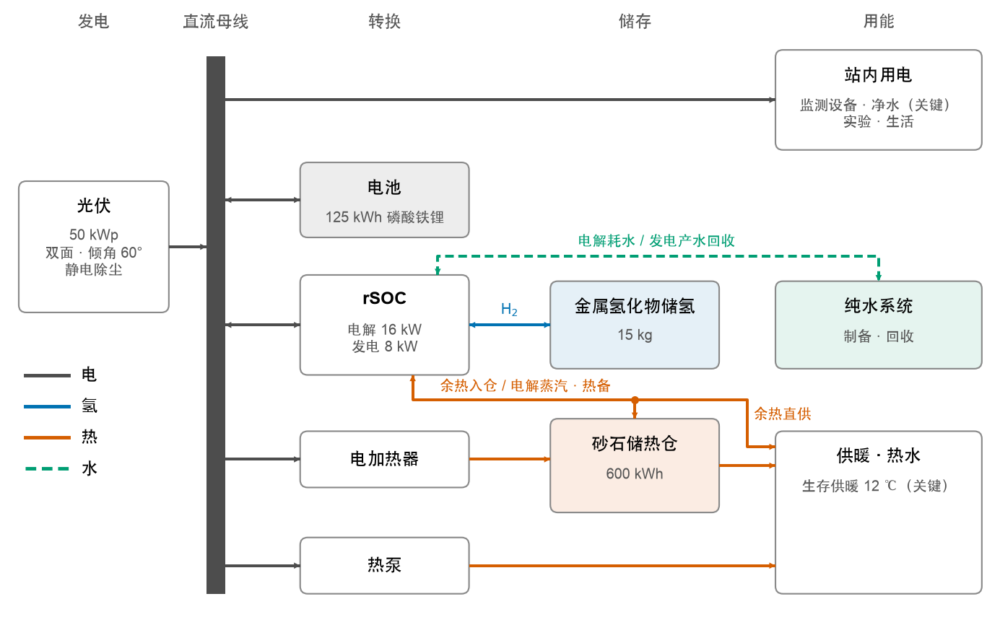
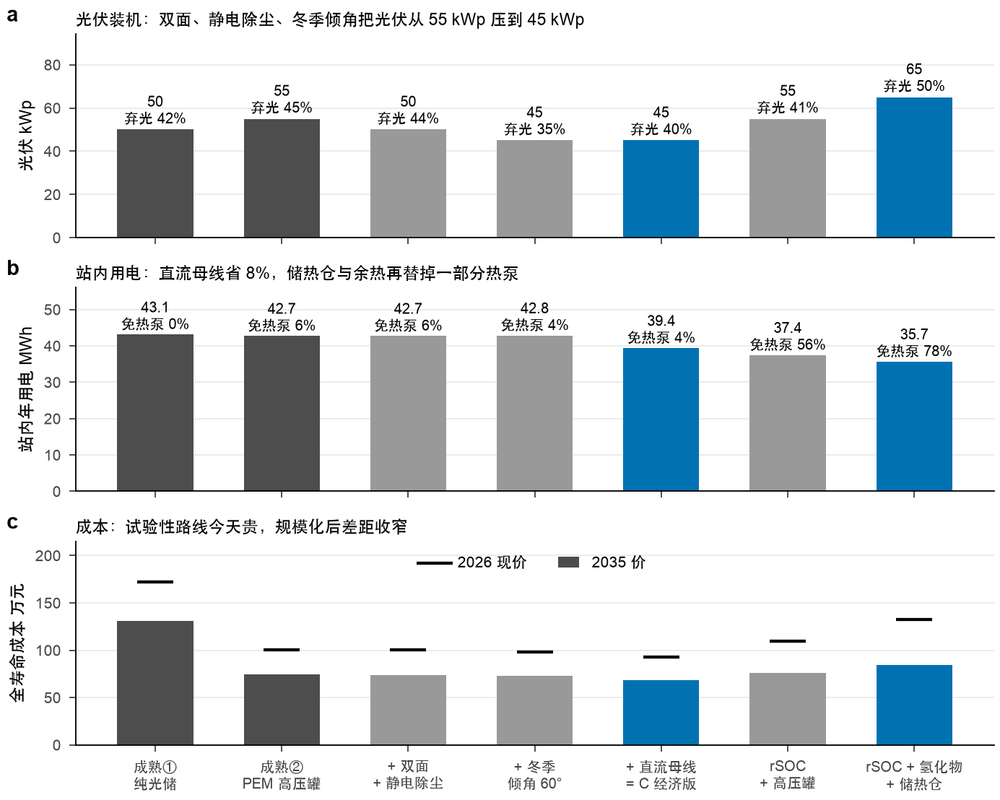
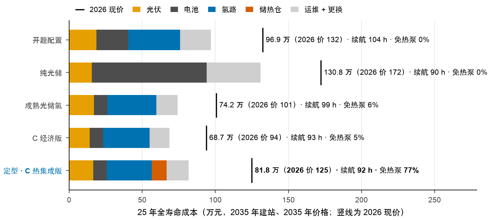
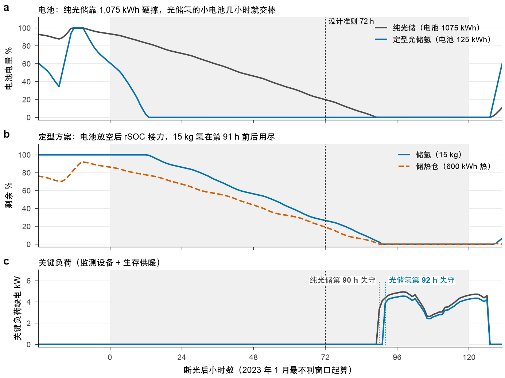
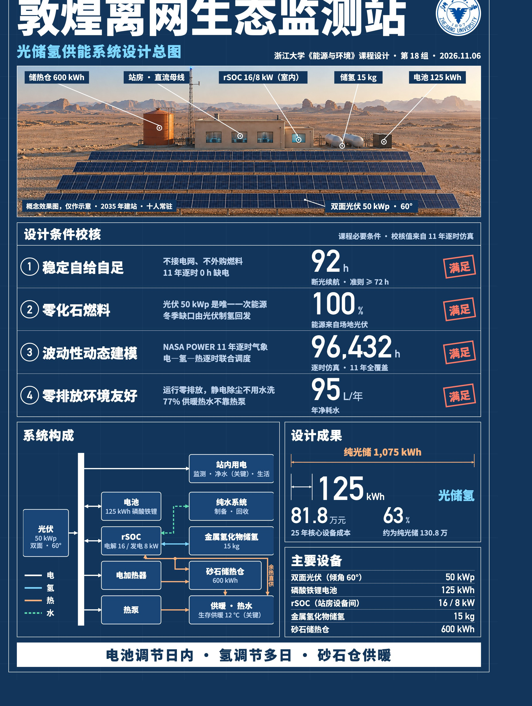
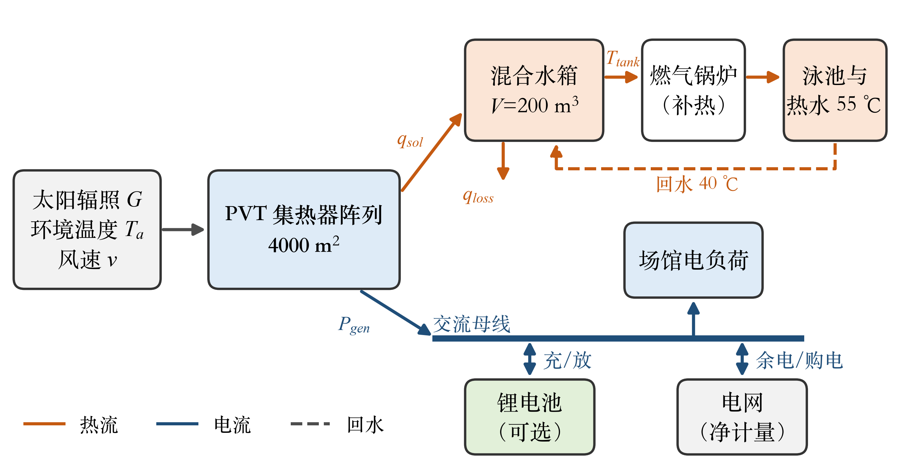
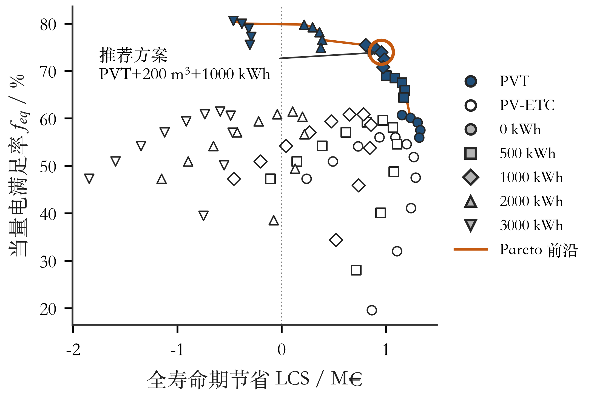

# 能源与环境系统工程概论

!!! note "课程信息"
    - **学期**：2026 年秋
    - **小组项目**：敦煌离网生态监测站光储氢供能系统设计
    - **课程论文**：游泳馆 PVT 热电联供与储能优化设计

这门课的两份大作业都是“给定一个场景，把能源系统算出来”：不是写概念，而是用逐时数据把发电、用能和储能一小时一小时地算清楚。这一页放这两份作业的报告和结论，方便以后做类似设计时回头查。

| 材料 | 内容 | 入口 |
|---|---|---|
| 设计说明书 | 小组项目完整报告，48 页 | [打开 PDF](sources/dunhuang-design-report.pdf){ target="_blank" } |
| 答辩 PPT | 网页版，按方向键翻页 | [打开](demo/dunhuang-defense.html){ target="_blank" } |
| 交互网页 | 看监测站逐时运行 | [打开](demo/dunhuang-station.html){ target="_blank" } |
| 海报 | A3 设计总图 | [打开图片](imgs/dunhuang-poster.jpg){ target="_blank" } |
| 课程论文 | 个人论文，9 页 | [打开 PDF](sources/pvt-swimming-pool-paper.pdf){ target="_blank" } |

为保护隐私，这里的文件去掉了成员姓名、学号和联系方式，正文没有改动。

---

## 小组项目 · 敦煌离网生态监测站

!!! info "章节概览"
    题目：2035 年在敦煌周边建一座十人常驻、200 m² 的生态监测站，不接电网、不买燃料，全部能源来自场地上的太阳。

### 难点在哪

敦煌太阳很好，难的是**连续几天没太阳**的时候。电池适合管一天之内的昼夜差，用它硬扛多日阴天，容量会大到不划算；氢可以存得久，但转换损失大。所以这个项目要回答的是：电池、氢和储热各管多长时间，才能又可靠又便宜。

设计时定了两条硬标准：

1. 用 2014–2024 年共 96,432 小时的真实逐时气象仿真，全程零缺电。
2. 把历史上最差的三段低日照窗口换成 72 小时完全无光，监测设备和生存供暖（室温不低于 12 ℃）都不能断。

### 系统怎么搭

<figure markdown="span">
  { width="90%" }
  <figcaption>定型系统的电、氢、热、水连接关系</figcaption>
</figure>

一句话记住分工：**电池调节日内，氢调节多日，砂石仓供暖。**

| 环节 | 定型配置 | 作用 |
|---|---|---|
| 双面光伏 | 50 kWp，倾角 60° | 唯一的一次能源，倾角偏大是为了多发冬季的电 |
| 磷酸铁锂电池 | 125 kWh | 日内调节 |
| rSOC | 电解 16 kW，发电 8 kW | 一台设备既能制氢又能发电 |
| 金属氢化物储氢 | 15 kg，压力低于 3 MPa | 多日储能，低压、不用压缩机 |
| 砂石储热仓 | 600 kWh（热） | 收集弃光和余热，用于供暖 |

### 用到的七项技术

| 技术 | 成熟度（TRL） | 在这里干什么 |
|---|---|---|
| 可逆固体氧化物电池（rSOC） | 5–6 | 同一电堆制氢和发电，是氢热耦合的核心 |
| 金属氢化物储氢 | 6–7 | 低压固态储氢，用余热放氢 |
| 砂石储热仓 | 7–8 | 全站的热枢纽 |
| 静电无水除尘 | 4–6 | 替代人工水洗，省水 |
| 双面组件 | 9 | 利用戈壁的高反照率，背面也发电 |
| 直流母线 | 7–8 | 少一道交直流转换，站内用电更省 |
| 冬季倾角优化 | 9 | 把少发的电放到本来就弃光的夏天 |

### 结果

<figure markdown="span">
  { width="90%" }
  <figcaption>每加一项改进，都在同样的标准下重新优化容量</figcaption>
</figure>

省得最多的不是最新潮的氢技术，而是发电侧和负荷侧的改进：组件、除尘、倾角和直流母线先把系统规模压下来，氢再解决多日储能。

<figure markdown="span">
  { width="90%" }
  <figcaption>相同可靠性约束下的方案成本</figcaption>
</figure>

!!! key-point "主要结论"
    - 纯光储需要约 1,075 kWh 电池，加入氢之后电池降到 125 kWh。
    - 按 2035 年价格，核心能源设备 25 年全寿命成本为 81.8 万元，约为常规光储的 63%。
    - 72 小时零光照测试下，三个不利窗口中最短的关键负荷续航为 92 小时。
    - 77% 的供暖和热水不靠热泵；年净耗水约 95 L。
    - 算上建筑、冷热机电和工程费用的中档概算，整站初始预算 177.1 万元，25 年净现值 209.8 万元。

<figure markdown="span">
  { width="90%" }
  <figcaption>断光压力测试</figcaption>
</figure>

!!! warning "结论的边界"
    rSOC 和金属氢化物的成熟度还不高，经济性依赖设备降价。以上数字只适用于报告设定的气象、负荷、模型和价格情景。

### 动手看看

下面是答辩时用的交互网页，可以直接操作。手机上建议[全屏打开](demo/dunhuang-station.html){ target="_blank" }。

<iframe class="project-demo" src="demo/dunhuang-station.html" title="敦煌离网生态监测站交互网页" loading="lazy"></iframe>

<figure markdown="span">
  { width="70%" }
  <figcaption>项目海报</figcaption>
</figure>

---

## 课程论文 · 游泳馆 PVT 热电联供

!!! info "章节概览"
    题目：意大利巴里一座游泳馆有 4000 m² 屋顶，既要电也要热水。这块屋顶该怎么铺，配多大的水箱和电池？

### 问题

光伏（PV）只发电，真空管集热器（ETC）只供热，两者并排就要分屋顶。PVT 组件把两件事放在同一块板上，单位面积的总产出更高。

这篇论文在已有研究的基础上继续往下算：扫描任意的 PV–ETC 面积比，而不是只算三档；同时把水箱容积和电池容量也放进来优化。

<figure markdown="span">
  { width="90%" }
  <figcaption>系统结构</figcaption>
</figure>

### 结论

!!! key-point "主要结论"
    - 屋顶受限时，PVT 是满足率最高的单一技术：当量电满足率 59.1%，高于任意比例的 PV–ETC 组合（最高 56.2%），减排量也最高（560 t/a）。
    - 没有储能时，电的即时满足率只有约 40%。配 1000 kWh 电池能升到 69.1%，但电池单价要低于约 200 €/kWh，才能同时提高全寿命期节省。
    - 水箱超过 30–50 L/m² 后收益明显递减；夏季弃热是季节性过剩，日级储热解决不了。
    - 推荐方案：PVT 4000 m² + 200 m³ 水箱 + 1000 kWh 锂电池，当量电满足率 73.9%，回收期 14.6 年。

<figure markdown="span">
  { width="90%" }
  <figcaption>设计空间与帕累托前沿</figcaption>
</figure>

模型对 PV 发电量的复现偏差为 +6.0%，对 PVT 发电量偏高 12.7%，所以 PVT 的电输出要当上限看。

[打开论文全文](sources/pvt-swimming-pool-paper.pdf){ .md-button .md-button--primary target="_blank" }
