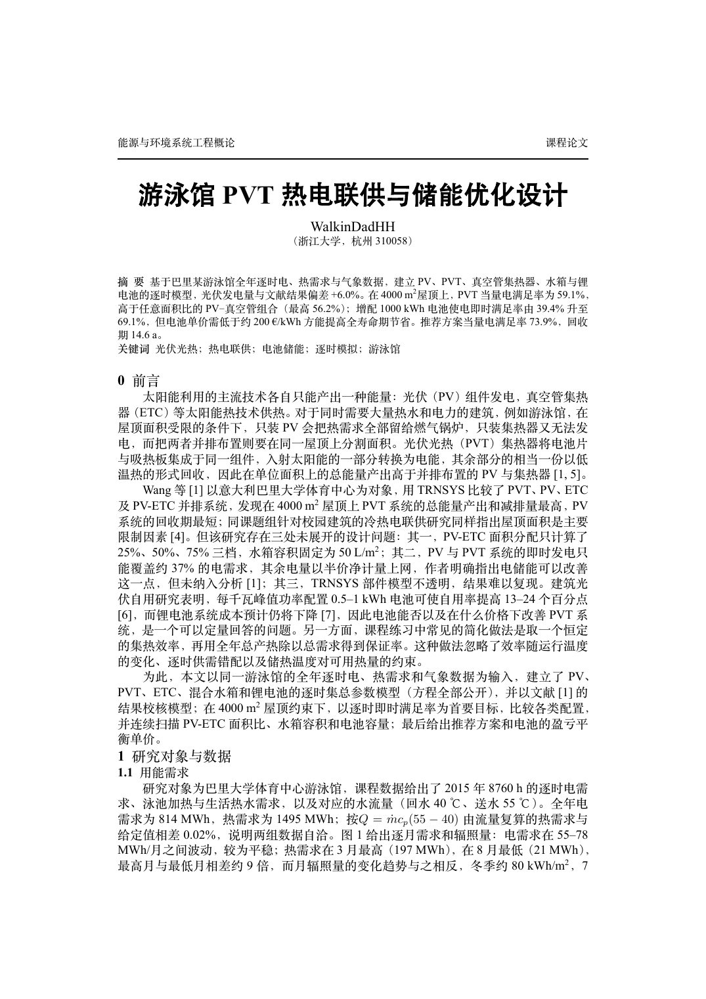
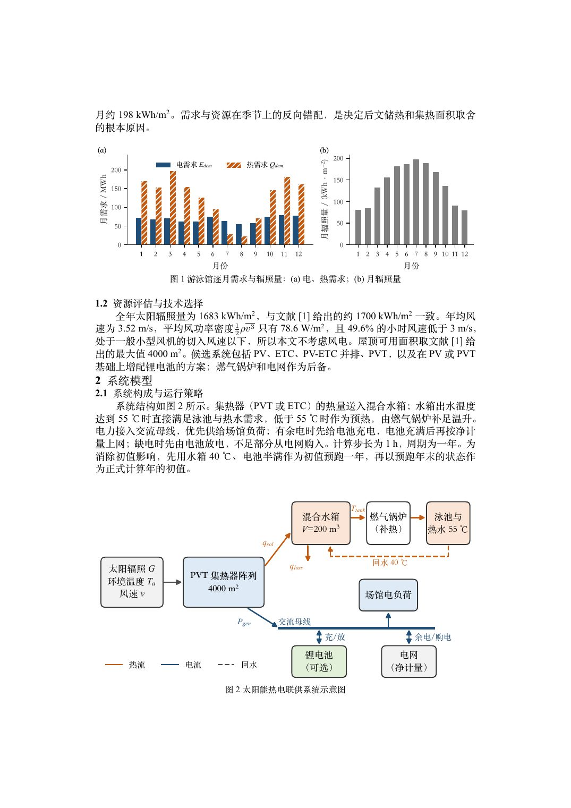
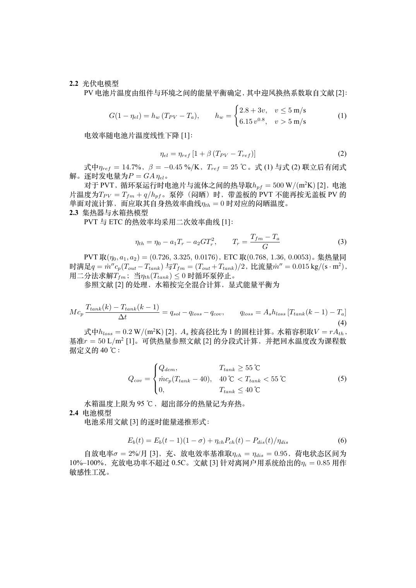
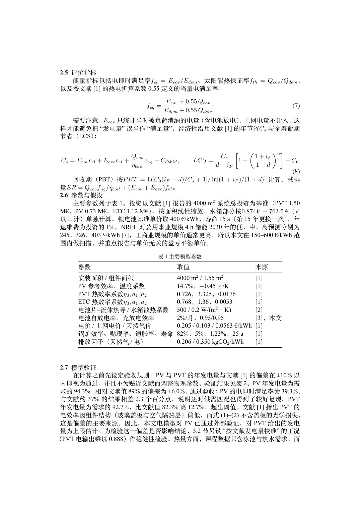
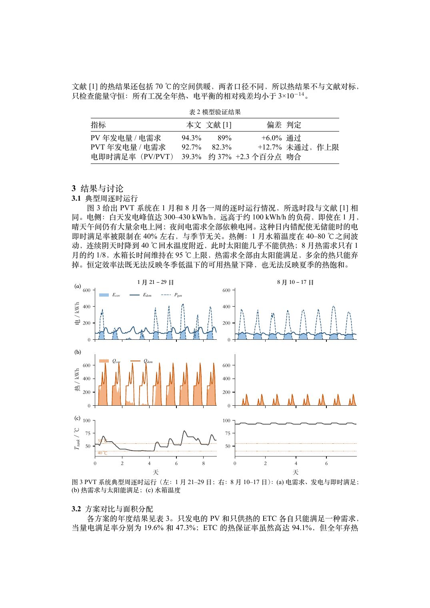
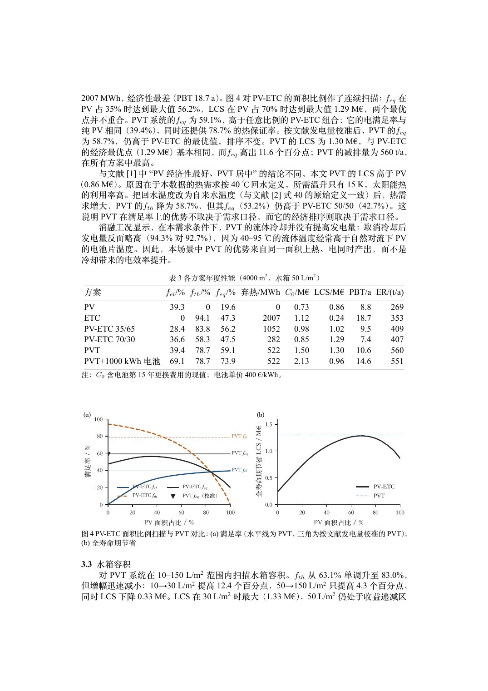
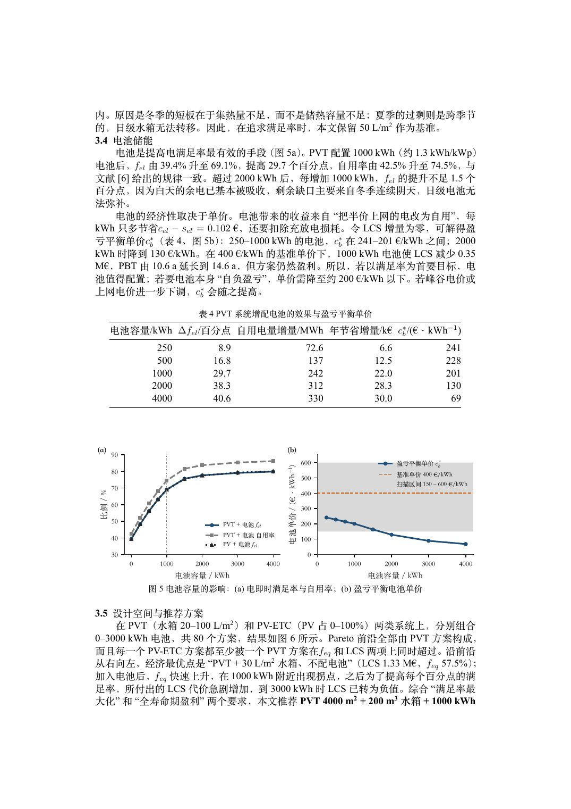
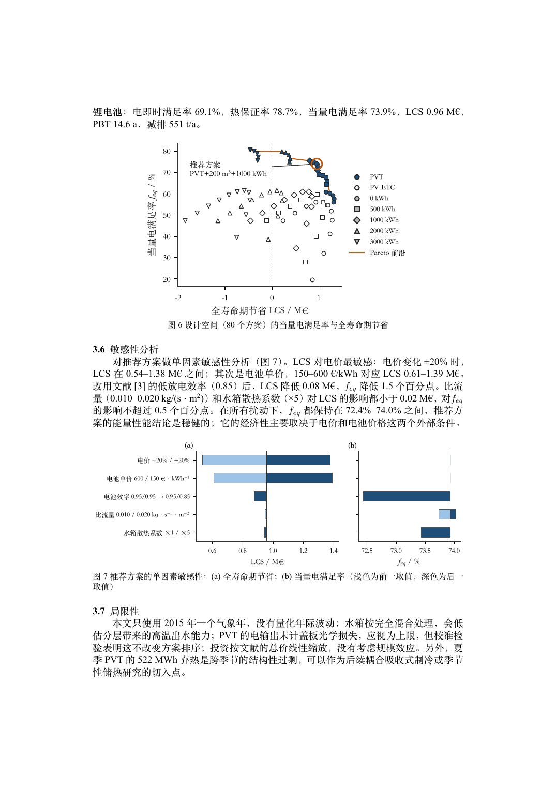
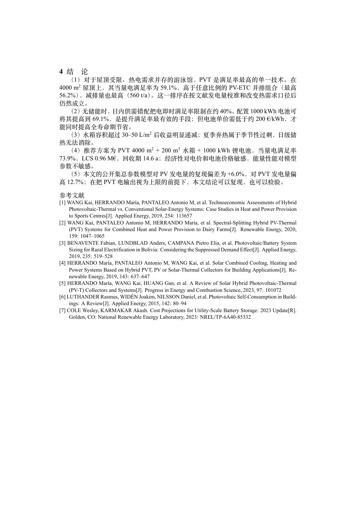

# 游泳馆 PVT 热电联供与储能优化设计

!!! info "文件说明"
    个人课程论文，共 9 页。PDF 打不开时切到图片模式。

=== ":material-file-pdf-box: PDF 预览"

    <iframe src="../sources/pvt-swimming-pool-paper.pdf" width="100%" height="820px" frameborder="0"></iframe>

    [⬇ 下载 PDF](sources/pvt-swimming-pool-paper.pdf){ .md-button .md-button--primary }

=== ":material-image-multiple: 图片模式（iOS 可用）"

    { loading=lazy }
    { loading=lazy }
    { loading=lazy }
    { loading=lazy }
    { loading=lazy }
    { loading=lazy }
    { loading=lazy }
    { loading=lazy }
    { loading=lazy }
