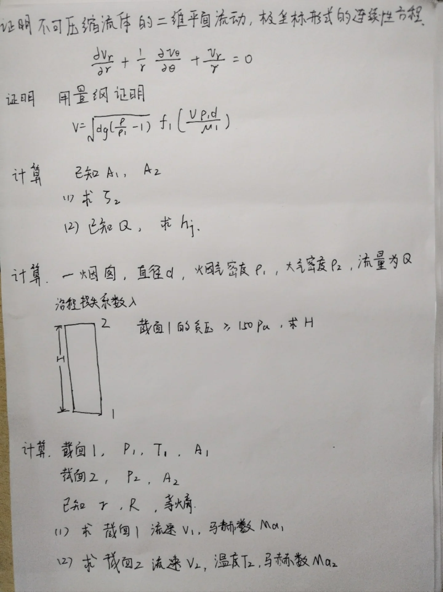
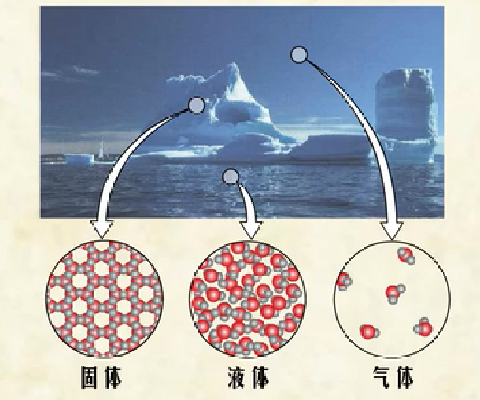
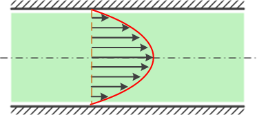
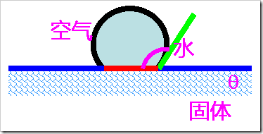
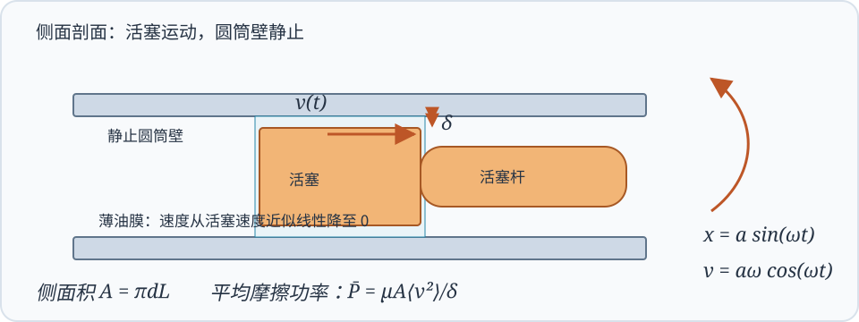
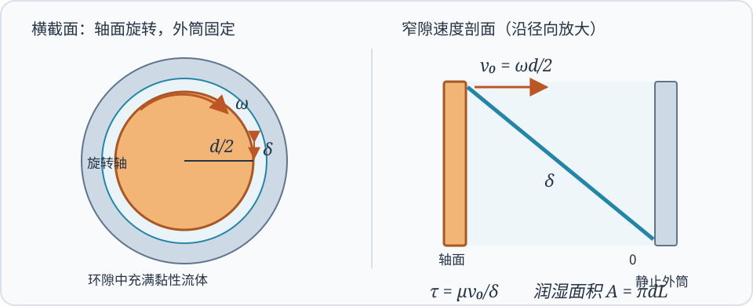
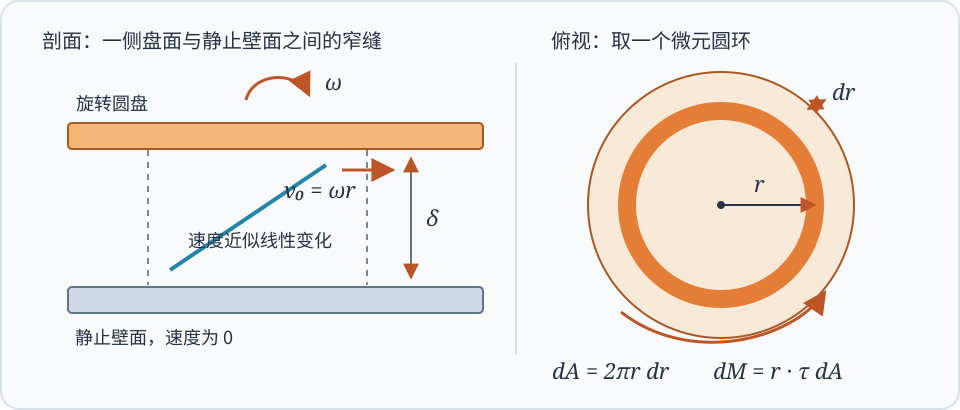
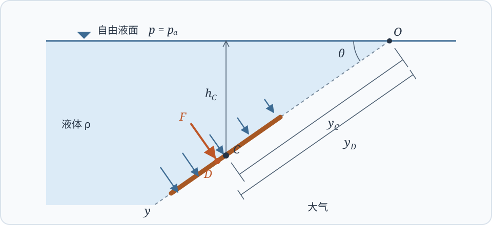
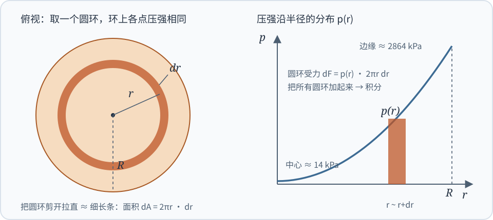
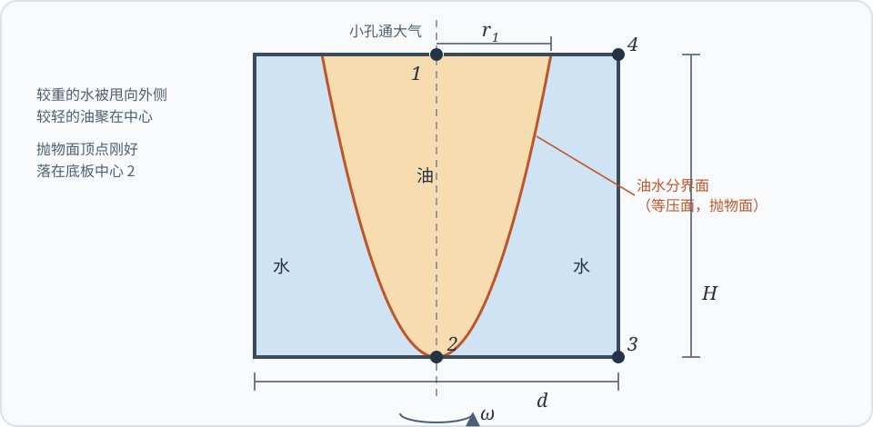

# 工程流体力学（甲）Ⅰ

!!! note "课程信息"
    - **主讲教师**：俞自涛、范利武
    - **教材**：孔珑主编《工程流体力学（第四版）》，中国电力出版社
    - **期末考试**：2026 年 11 月 7 日（周六）10:30–12:30，**闭卷**，占总评 60%
    - **题型**：填空 10 题共 40 分（每题 2 空，每空 2 分）· 证明 2 题共 20 分 · 问答 2 题共 20 分 · 计算 2 题共 20 分（俞老师 11 月 3 日最新说法）
    - **平时成绩** 40%：10 次作业 20%、2 篇阅读 10%、2 次测验 10%

这是一份**面向期末的复习讲义**，章节按老师发的《期末复习提纲》编排：第一章流体性质、第二章静力学、第三章理想流体、第四章黏性管流、第五章量纲分析。课上讲过的可压缩一维流动**不在提纲里**，放在文末附录，时间不够可以跳过。

每一节的写法尽量统一：先用一两句话说清**这节在讲什么、考什么**，再给**必背公式**，然后是**证明题的标准写法**，最后是**例题和易错点**。

---

## 章节概览

| 章节 | 标题 | 一句话 | 考试可能性 | 重要程度 | 状态 |
|------|------|--------|------|------|------|
| [第一章](#ch1) | 流体的性质 | 流体为什么会流，黏性和表面张力怎么算 | 高 | ★★☆ | ✅ |
| [第二章](#ch2) | 流体静力学 | 静止流体的压强怎么分布，对壁面的力多大、作用在哪 | 中 | ★★☆ | ✅ |
| [第三章](#ch3) | 理想流体动力学 | 质量、动量、能量三大守恒在无黏流体中的样子 | 高 | ★★★ | ✅ |
| [第四章](#ch4) | 黏性流体管内流动 | 实际管路的能量损失怎么算 | 高 | ★★★ | ✅ |
| [第五章](#ch5) | 量纲分析与相似原理 | 用无量纲数组织实验、设计模型 | 高 | ★★★ | ✅ |
| [附录](#appendix-compressible) | 可压缩一维流动 | 提纲未列，本次不考 | 不考 | ★☆☆ | ✅ |

## 考前怎么用这一页 { #exam-guide }

### 正文标签怎么看 { #exam-tags-guide }

正文每节标题下都有三个标签，用来决定先看什么。

| 标签 | 取值 | 含义 |
|---|---|---|
| 考试可能性 | 必考 | 老师原话说必考 |
|  | 高 | 老师点名要会，或明确说考试会出 |
|  | 中 | 提纲列了，或课上讲过，可能以填空、问答出现 |
|  | 低 | 老师说看看就行，或只作为背景 |
|  | 不考 | 老师说不考，或提纲对照表里没有 |
| 重要程度 | ★★★ / ★★☆ / ★☆☆ | 对做题和理解后续内容的帮助 |
| 掌握程度 | 会推导、会计算、会用公式、背熟、理解概念、看懂、了解、不用看 | 复习到这个程度就够了 |

除“必考”外，这些标签是根据提纲、手写稿和全部课程字幕做的判断，不是老师公布的范围。

### 复习课划的重点 { #review-class }

根据全部课程字幕整理：11 月 3 日俞老师讲考试范围，11 月 5 日范老师做复习课，其余课上提到考试的地方也收在这里。出卷的是俞老师。

老师的总体态度：**重心在第三章动力学，更想考概念和推导，不爱出难算题。** 俞老师的总规则是：**提纲上没有的不考，没讲过的不考**，难度比往年容易。

| 优先级 | 内容 | 老师的说法 |
|---|---|---|
| **必考** | [物质导数](#acceleration) $\dfrac{\mathrm d}{\mathrm dt}=\dfrac{\partial}{\partial t}+(\boldsymbol V\cdot\nabla)$ | 定常时 $\partial/\partial t=0$，但 $\mathrm d/\mathrm dt$ 不一定为 0；局部加速度和对流（迁移）加速度要分清 |
| **最核心** | [理想流体运动方程](#proof-euler) | 本学期最核心，用力的分析求解 |
| **必须会推** | [伯努利方程](#bernoulli-review-proof) | 必须走一遍，5 个条件很重要，范老师说“经常考到” |
| **必须会推** | [毕托管、文丘里管](#bernoulli-apps) | 记不住公式也要能推出来 |
| **必须会推** | [圆管层流](#proof-poiseuille) | 推一遍抛物线，积一遍平均流速；$\lambda=64/\mathrm{Re}$ 不知道就“太过分了”。俞老师 10 月 22 日说哈根–泊肃叶公式“必考”，要记住 |
| **概念翻译** | 定常、不可压、理想流体、牛顿内摩擦定律 | 要能把词翻译成数学式：$\partial/\partial t=0$、$\rho=$ 常数、不计切应力、切应力与速度梯度成正比 |
| **重要** | [连续性方程](#proof-continuity)、[拉格朗日法与欧拉法](#ch3) | 微分形式和 $VA=$ 常数都要会 |
| **重要** | [沿程阻力系数](#friction-factor)、雷诺数 | 达西公式要知道；雷诺数是惯性力与黏性力之比 |
| **重要** | [单管路流量题](#pipe-systems) | 课后答疑时老师让关注 |
| 了解 | [动力黏度与运动黏度](#fluid-viscosity)、黏度随温度变化 | 液体升温黏度减小，气体相反 |
| **很可能有一题** | [$\Pi$ 定理](#pi-theorem) | 范老师 10 月 29 日说“一般我们考试会出这么一题”，当天布置的[两道作业](#pi-homework)“考试里面会有类似的”，要亲手重做 |
| 了解 | [相似原理](#similarity) | 有所了解就好，考试基本考 $\Pi$ 定理 |
| 淡化 | [动量方程](#momentum-integral) | 能量、动量淡化，尽量考概念 |
| 看看就行 | 静力学第五到八节：[相对平衡](#relative-equilibrium)、[平面](#plane-force)、[曲面](#curved-force)、[浮力](#buoyancy) | 可以出得很难，但老师不喜欢，说这种题像高中题 |
| 看懂就行 | [压差驱动的两平板流动](#plate-flow) | 11 月 3 日课上讲了但说不考；提纲仍列两板流动，[纯剪切流](#plate-flow)要会 |

**明确不考**（知道概念就行，不用花时间）：

- [迭代法](#three-pipe-problems)，俞老师说“很明确的告诉大家不考”
- [莫迪图](#turbulent-pipe)和各区阻力公式，不用背；沿程阻力只考最简单的情形
- [极坐标连续性方程](#recall-polar-continuity)和柱、球坐标方程，老师本来想考，已经换题
- [水力直径和非圆管](#hydraulic-diameter)
- 两平板的[水力直径对比](#hydraulic-diameter)、倾斜平板和同心环流动
- [边界层](#boundary-layer)，已确定不考，别的班没学过，放到下个月再考
- [混合长度和湍流时均理论](#turbulent-pipe)，俞老师 10 月 20 日说不会考
- 黏性底层厚度公式和湍流对数律，不用背；只记雷诺数越大，黏性底层越薄
- 相似准则的比例换算
- [环路和管网](#three-reservoirs)
- 局部损失的各种系数表，不用背
- 剪切变形率的推导
- 提纲对照表里没有的内容，比如[水击](#water-hammer)和[可压缩流动](#appendix-compressible)

### 题型与复习策略

| 题型 | 分值 | 怎么准备 |
|------|------|----------|
| 填空 | 10 题，每题 2 空，每空 2 分 | 背定义、单位、条件和几个关键数字（$2300$、$64/\mathrm{Re}$、伯努利的条件等）。名词要写对，比如“文丘里管”，俞老师两次提到有人写错。每章末尾的「填空速记」就是为它准备的 |
| 证明 | 2 题 × 10 分 | 把下面「证明题清单」里的推导**自己默写一遍**。重点是取微元、列受力、化简这几步，不必背原句 |
| 问答 | 2 题 × 10 分 | 分值比原来多一倍。老师把第三道计算题改成了问答分析题，看你是否掌握方法。准备概念对比和方法分析：牛顿与非牛顿流体、层流与湍流、$\partial/\partial t$ 与 $\mathrm d/\mathrm dt$、拉格朗日法与欧拉法、伯努利五个条件、相似原理 |
| 计算 | 2 题 × 10 分 | 优先准备三类：单管路能量方程**求流量**（沿程 + 局部损失）、伯努利 + 连续性（文丘里、皮托管、小孔）、[$\Pi$ 定理](#pi-theorem)推关系式。简单串联看老师例题。静压力题复习课说不深挖 |

### 证明题清单 { #proof-list }

按复习课的说法重排。先把第一组默写熟，时间够再看第二组。

**第一组：老师点名要会推**

1. [理想流体运动方程（欧拉方程）](#proof-euler)
2. [伯努利方程，五个条件逐步加](#bernoulli-review-proof)
3. [圆管层流：速度抛物线、平均流速、$\lambda=64/\mathrm{Re}$](#proof-poiseuille)
4. [皮托管、文丘里管的流速和流量公式](#bernoulli-apps)
5. [用 $\Pi$ 定理推关系式](#pi-theorem)，也可能出成计算题

**第二组：手写稿完整推过，有可能考**

6. [连续性微分方程（达朗贝尔）](#proof-continuity)及[散度的物理意义](#proof-divergence)
7. [突然扩大的局部损失 $h_j=(V_1-V_2)^2/2g$](#proof-sudden-expansion)
8. [量纲分析证明某个关系式](#recall-dimension)
9. [静压强各向同性（楔形微元）](#proof-isotropy)和[欧拉平衡方程](#proof-euler-statics)

**第三组：看懂就行**

10. [两平板间流动的速度分布](#proof-plate-flow)（纯剪切流要会，压差驱动看懂）
11. [平面总压力与压力中心](#proof-plane-force)
12. [旋转容器自由液面为抛物面](#proof-rotation)

[极坐标连续性方程](#recall-polar-continuity)虽然在回忆卷出现过，但这次老师已经换题，不用准备。

!!! tip "证明题怎么写才拿满分"
    1. **画图并说明所取的微元或控制体**，标出坐标和尺寸。
    2. **写清假设**：定常/不可压/忽略黏性/充分发展等。阅卷时，假设本身就是得分点。
    3. **列受力或守恒式**，每一项写出来源（左面压力、右面压力、重力……）。
    4. **化简**时说明约去了什么、略去了哪些高阶小量。
    5. **框出结论**，必要时补一句物理意义。

### 提纲对照表 { #outline-map }

| 提纲条目 | 本页位置 | 可能的题型 |
|----------|----------|------------|
| 流体定义及性质、黏度、牛顿流体、牛顿内摩擦定律 | [第一章](#ch1) | 填空、问答 |
| 牛顿与非牛顿流体的区别 | [非牛顿流体](#non-newtonian) | 问答 |
| 表面张力 | [表面张力](#fluid-surface-tension) | 填空、小计算 |
| 雷诺数定义 | [雷诺数](#reynolds-number) | 填空 |
| 两板间流动 | [两板间流动](#plate-flow) | 纯剪切流要会；压差驱动看懂 |
| 帕斯卡定律、静压分布 | [第二章前半](#ch2) | 填空、证明 |
| 平面、曲面上的静压力 | [平面](#plane-force)、[曲面](#curved-force) | 看看就行 |
| 理想流体、质量守恒、达朗贝尔定律、散度 | [第三章前半](#ch3)、[散度动画与证明](#proof-divergence) | 填空、证明 |
| 欧拉方程、积分动量方程 | [欧拉方程](#proof-euler)、[动量方程](#momentum-integral) | 欧拉方程**证明**；动量淡化 |
| 伯努利方程及其假设条件 | [伯努利方程](#bernoulli) | 填空、证明 |
| 小孔出流、皮托管、文丘里流量计 | [伯努利应用](#bernoulli-apps) | **证明**、**计算** |
| 黏性流体伯努利方程、达西公式、局部损失 | [第四章前半](#ch4) | 填空、**计算** |
| 层流与湍流、圆管层流、哈根–泊肃叶 | [圆管层流](#proof-poiseuille) | **证明**、填空；公式要记 |
| 水力光滑与粗糙、莫迪图（不考） | [湍流与阻力系数](#turbulent-pipe) | 概念填空、问答；公式不用背 |
| 局部损失（用下游速度水头） | [局部损失](#minor-loss) | 证明、计算 |
| 串联、并联管路（「见笔记上的举例」） | [管路系统](#pipe-systems) | 单管路和简单串联优先；环路、管网不考 |
| 量纲分析、量纲一致性、$\Pi$ 定理、相似原理 | [第五章](#ch5) | $\Pi$ 定理**证明或计算**；相似原理了解 |

---

## 公式速查 { #formula-quickref }

!!! info "怎么用这张表"
    按章分页，点标签切换。每条公式都写了**适用条件**，最后一列链接到正文的推导或例题。做计算题卡住时，先在这里找对应的公式，再回正文看例题怎么用。闭卷考试，表里的公式和条件都要背。

=== "符号"

    **流体性质**

    | 符号 | 含义 | 单位或关系 |
    |------|------|------------|
    | $\rho$ | 密度 | $\mathrm{kg/m^3}$ |
    | $\gamma=\rho g$ | 重度（比重） | $\mathrm{N/m^3}$ |
    | $\mu$ | 动力黏度 | $\mathrm{Pa\cdot s}$ |
    | $\nu=\mu/\rho$ | 运动黏度 | $\mathrm{m^2/s}$ |
    | $\sigma$ | 表面张力系数 | $\mathrm{N/m}$ |
    | $K$ | 体积弹性模量 | $\mathrm{Pa}$ |

    **压强与静力学**

    | 符号 | 含义 | 说明 |
    |------|------|------|
    | $p$、$p_a$ | 压强、大气压 | $\mathrm{Pa}$ |
    | $h_C$、$y_C$ | 形心的淹深、沿平面的坐标 | 计算总压力**大小**用 |
    | $h_D$、$y_D$ | 压力中心的淹深、沿平面的坐标 | 总压力的**作用点** |
    | $I_C$ | 面积对过形心水平轴的惯性矩 | $\mathrm{m^4}$ |
    | $A_x$ | 曲面在竖直面上的投影面积 | 求水平分力 |
    | $V_p$ | 压力体体积 | 求竖直分力 |
    | $\omega$ | 角速度（旋转容器、转轴、圆盘） | $\omega=2\pi n/60$，$n$ 单位 $\mathrm{r/min}$ |

    **流动与管路**

    | 符号 | 含义 | 说明 |
    |------|------|------|
    | $\boldsymbol V=(u,v,w)$ | 速度矢量及分量 | $\mathrm{m/s}$ |
    | $V$ | 断面平均流速 | $V=Q/A$ |
    | $Q$、$\dot m$ | 体积流量、质量流量 | $\dot m=\rho Q$ |
    | $\alpha$ | 动能修正系数 | 层流 2，湍流约 1.05 |
    | $\lambda$ | 沿程阻力系数（达西系数） | 英文教材、课堂 OneNote 记作 $f$ |
    | $\zeta$ | 局部阻力系数 | 英文教材记作 $K$ |
    | $h_f$、$h_j$、$h_w$ | 沿程、局部、总水头损失 | $\mathrm m$ |
    | $\Delta$ | 管壁绝对粗糙度 | 英文教材记作 $\varepsilon$ |
    | $\tau_w$ | 壁面切应力 | $\mathrm{Pa}$ |
    | $\delta$ | 缝隙宽度、黏性底层厚度或边界层厚度 | 按上下文区分 |
    | $D_h$ | 水力直径 | $4A/\mathcal P$ |
    | $\mathrm{Re}$、$\mathrm{Fr}$、$\mathrm{Eu}$ | 雷诺数、弗劳德数、欧拉数 | 无量纲 |

    !!! tip "同一个字母的不同用法"
        老师手写稿里 $\gamma$ 表示重度 $\rho g$；附录里的气体比热比另记为 $\gamma_g$。$\mu$ 在第一、四章是动力黏度，在小孔、文丘里、管路公式里是**流量系数**。遇到原题以题目定义为准。

=== "第一章 流体性质"

    **黏性**

    | 公式 | 条件 / 说明 | 详见 |
    |------|-------------|------|
    | $\tau=\mu\dfrac{\mathrm du}{\mathrm dy}$ | 牛顿内摩擦定律，只适用于牛顿流体 | [黏性](#fluid-viscosity) |
    | $\nu=\dfrac{\mu}{\rho}$ | 运动黏度 | [黏性](#fluid-viscosity) |
    | $\dfrac{\mathrm du}{\mathrm dy}\approx\dfrac{U}{\delta}$ | 窄缝内速度近似线性分布（$\delta$ 很小） | [例题](#first-fluid-examples) |
    | $F=\mu\dfrac{UA}{\delta}$ | 平板拖动力（库埃特流） | [两板间流动](#plate-flow) |
    | $M=\dfrac{\pi\mu Ld^3\omega}{4\delta}$，$P=M\omega$ | 同心圆柱转轴的阻力矩与功率（轴面速度处处相同） | [例题](#first-fluid-examples) |
    | $M=\dfrac{\pi\mu\omega d^4}{32\delta}$ | 圆盘一侧的阻力矩（速度随 $r$ 变，要圆环积分） | [例题](#first-fluid-examples) |
    | $u=\dfrac{U}{h}y+\dfrac{1}{2\mu}\left(-\dfrac{\mathrm dp}{\mathrm dx}\right)y(h-y)$ | 两板间流动通解；上板固定时 $\bar u=\frac23u_{\max}$ | [证明](#proof-plate-flow) |

    **表面张力、压缩性、雷诺数**

    | 公式 | 条件 / 说明 | 详见 |
    |------|-------------|------|
    | $h=\dfrac{4\sigma\cos\theta}{\rho gd}$ | 毛细管液面高度；$\theta<90^\circ$ 上升，$\theta>90^\circ$ 下降 | [表面张力](#fluid-surface-tension) |
    | $\Delta p=\dfrac{2\sigma}{R}$；肥皂泡 $\dfrac{4\sigma}{R}$ | 液滴一个界面，肥皂泡两个界面 | [表面张力](#fluid-surface-tension) |
    | $K=-V\dfrac{\mathrm dp}{\mathrm dV}$ | 体积弹性模量，越大越难压缩 | 第一章 |
    | $Q_2=Q_1[1+\alpha_V(T_2-T_1)]$ | 质量流量不变，体积随温度膨胀 | [作业 2-7](#first-fluid-examples) |
    | $\mathrm{Re}=\dfrac{\rho Vd}{\mu}=\dfrac{Vd}{\nu}$ | 惯性力 / 黏性力；圆管 $\mathrm{Re}_c=2300$ | [雷诺数](#reynolds-number) |

=== "第二章 静力学"

    **静压分布**

    | 公式 | 条件 / 说明 | 详见 |
    |------|-------------|------|
    | $\nabla p=\rho\boldsymbol f$ | 欧拉平衡方程，任何静止流体 | [证明](#proof-euler-statics) |
    | $p=p_0+\rho gh$ 或 $z+\dfrac{p}{\rho g}=C$ | 只受重力、均质、连通、静止的液体 | [静压分布](#proof-euler-statics) |
    | $p_{\text{表}}=p-p_a$，$p_{\text{真空}}=p_a-p$ | 表压、真空度 | [静压分布](#proof-euler-statics) |
    | $p_2=p_1\exp\left[-\dfrac{g(z_2-z_1)}{RT}\right]$ | 等温大气 | [静压分布](#proof-euler-statics) |
    | $F_2=F_1\dfrac{A_2}{A_1}$ | 帕斯卡定律（液压机），两活塞同高 | [帕斯卡](#pascal-law) |
    | 向下 $+\rho g\Delta h$，向上 $-\rho g\Delta h$ | 压强计：沿连通液体逐段走 | [压强计](#manometer) |

    **平面与曲面上的总压力**

    | 公式 | 条件 / 说明 | 详见 |
    |------|-------------|------|
    | $F=\rho gh_CA$ | 平面总压力 = 形心压强 × 面积 | [证明](#proof-plane-force) |
    | $y_D=y_C+\dfrac{I_C}{y_CA}$ | 压力中心，$y$ 沿平面从液面交线量起；$D$ 在形心下方 | [证明](#proof-plane-force) |
    | $x_D-x_C=\dfrac{I_{Cxy}}{y_CA}$ | 横向位置；平面左右对称时 $x_D=x_C$ | [证明](#proof-plane-force) |
    | 矩形 $\dfrac{bh^3}{12}$；圆 $\dfrac{\pi d^4}{64}$；三角形 $\dfrac{bh^3}{36}$ | 常用截面对形心水平轴的 $I_C$ | [惯性矩表](#proof-plane-force) |
    | $F_x=\rho gh_{C,x}A_x$ | 曲面水平分力 = 竖直投影面上的平面总压力 | [曲面](#curved-force) |
    | $F_z=\rho gV_p$ | 曲面竖直分力 = 压力体内液重；实压力体向下，虚压力体向上 | [曲面](#curved-force) |
    | $F=\sqrt{F_x^2+F_z^2}$，$\tan\alpha=\dfrac{F_z}{F_x}$ | 曲面合力；圆弧面合力过圆心 | [曲面](#curved-force) |
    | $F_B=\rho gV_{\text{排}}$ | 浮力，作用在浮心 | [浮力](#buoyancy) |

    **相对平衡**

    | 公式 | 条件 / 说明 | 详见 |
    |------|-------------|------|
    | $\nabla p=\rho(\boldsymbol g-\boldsymbol a)$ | 液体随容器做刚体运动；等压面垂直于 $\boldsymbol g-\boldsymbol a$ | [相对平衡](#relative-equilibrium) |
    | $\tan\theta=\dfrac{a_x}{g+a_z}$ | 容器水平加速时液面倾角 | [相对平衡](#relative-equilibrium) |
    | $p=p_0+\dfrac12\rho\omega^2r^2-\rho gz$ | 绕竖直轴等角速旋转；原点取轴心液面。$p_0=p_a$ 得绝对压强，$p_0=0$ 得表压（计示压强）；求壁面受力、外侧是大气时用表压 | [证明](#proof-rotation) |
    | $z=\dfrac{\omega^2r^2}{2g}$ | 自由液面为旋转抛物面 | [证明](#proof-rotation) |
    | 中心降、边缘升各 $\dfrac{\omega^2R^2}{4g}$ | 开口圆筒，相对原静止液面；抛物面体积为同底同高圆柱的一半 | [证明](#proof-rotation) |
    | $F=\displaystyle\int_0^R p(r)\,2\pi r\,\mathrm dr$ | 旋转液体对顶盖或底面的总压力；压强随 $r$ 变，必须圆环积分 | [习题 3-17](#proof-rotation) |
    | 等压面 $z=\dfrac{\omega^2r^2}{2g}+C$ | 形状与密度无关；两种液体的分界面也是这种抛物面 | [习题 3-19](#proof-rotation) |

=== "第三章 理想流体"

    **质量守恒**

    | 公式 | 条件 / 说明 | 详见 |
    |------|-------------|------|
    | $Q=\displaystyle\int_A\boldsymbol V\cdot\boldsymbol n\,\mathrm dA$，$V=\dfrac QA$ | 流量与断面平均流速 | [研究方法](#ch3) |
    | $\dfrac{\partial\rho}{\partial t}+\nabla\cdot(\rho\boldsymbol V)=0$ | 连续性微分方程，任何流动 | [证明](#proof-continuity) |
    | $\nabla\cdot\boldsymbol V=0$ | 不可压缩流体（定常、非定常均可） | [证明](#proof-continuity) |
    | $\nabla\cdot\boldsymbol V=\dfrac{1}{\delta V}\dfrac{\mathrm d(\delta V)}{\mathrm dt}$ | 散度 = 微团的相对体积变化率；只管体积，不管形状 | [动画与证明](#proof-divergence) |
    | $\dfrac{\partial v_r}{\partial r}+\dfrac{v_r}{r}+\dfrac1r\dfrac{\partial v_\theta}{\partial\theta}=0$ | 不可压缩二维流动，极坐标；本次不考 | [证明](#recall-polar-continuity) |
    | $\rho_1V_1A_1=\rho_2V_2A_2$；$V_1A_1=V_2A_2$ | 一维定常管流；后者为不可压缩 | [证明](#proof-continuity) |

    **动量守恒**

    | 公式 | 条件 / 说明 | 详见 |
    |------|-------------|------|
    | $\boldsymbol a=\dfrac{\partial\boldsymbol V}{\partial t}+(\boldsymbol V\cdot\nabla)\boldsymbol V$ | 局部加速度 + 对流加速度；**物质导数必考** | [加速度](#acceleration) |
    | $\dfrac{\mathrm d\boldsymbol V}{\mathrm dt}=\boldsymbol f-\dfrac1\rho\nabla p$ | 欧拉运动方程，只适用于理想流体 | [证明](#proof-euler) |
    | $\sum\boldsymbol F=\rho Q(\boldsymbol V_2-\boldsymbol V_1)$ | 动量方程：定常、一进一出、断面速度均匀；求固壁受力 | [动量方程](#momentum-integral) |

    **能量守恒（伯努利方程）**

    | 公式 | 条件 / 说明 | 详见 |
    |------|-------------|------|
    | $z+\dfrac{p}{\rho g}+\dfrac{V^2}{2g}=C$ | 定常、不可压、无摩擦、沿流线、无轴功、无传热 | [证明](#proof-bernoulli) |
    | $V=\varphi\sqrt{2gh}$，$Q=\mu A\sqrt{2gh}$ | 小孔出流；理想时 $\varphi=1$ | [应用](#bernoulli-apps) |
    | $u=\sqrt{\dfrac{2(p_0-p)}{\rho}}=\sqrt{2g\Delta h\dfrac{\rho'-\rho}{\rho}}$ | 皮托管；$\rho'$ 为 U 形管指示液密度 | [应用](#bernoulli-apps) |
    | $Q=\mu A_2\sqrt{\dfrac{2g\Delta h(\rho'-\rho)}{\rho(1-A_2^2/A_1^2)}}$ | 文丘里流量计，$\mu=0.95\sim0.98$；与管道是否倾斜无关 | [应用](#bernoulli-apps) |
    | $\dfrac{p}{\rho g}+\dfrac{u^2}{2g}-\dfrac{\omega^2r^2}{2g}=C$ | 叶轮中的相对运动 | [应用](#bernoulli-apps) |

=== "第四章 黏性管流"

    **能量方程与损失**

    | 公式 | 条件 / 说明 | 详见 |
    |------|-------------|------|
    | $z_1+\dfrac{p_1}{\rho g}+\dfrac{\alpha_1V_1^2}{2g}+H_p=z_2+\dfrac{p_2}{\rho g}+\dfrac{\alpha_2V_2^2}{2g}+h_w$ | 黏性流体总流伯努利方程；定常、不可压、质量力只有重力、断面为缓变流；$H_p$ 为泵扬程 | [黏性伯努利](#viscous-bernoulli) |
    | $h_w=\sum h_f+\sum h_j$ | 总损失 = 沿程 + 局部 | [黏性伯努利](#viscous-bernoulli) |
    | $h_f=\lambda\dfrac ld\dfrac{V^2}{2g}$ | 达西公式，层流湍流都适用 | [黏性伯努利](#viscous-bernoulli) |
    | $\lambda=\dfrac{8\tau_w}{\rho V^2}$，$h_f=\dfrac{4\tau_w}{\rho g}\dfrac ld$ | 由管段动量平衡得到，不限流态 | [黏性伯努利](#viscous-bernoulli) |
    | $h_j=\zeta\dfrac{V^2}{2g}$ | 局部损失；一般用**下游**速度水头 | [局部损失](#minor-loss) |
    | $P=\dfrac{\rho gQH_p}{\eta}$ | 泵的输入功率，$\eta$ 为泵效率 | [例题](#single-pipe-pump) |

    **圆管层流（$\mathrm{Re}<2300$）**

    | 公式 | 条件 / 说明 | 详见 |
    |------|-------------|------|
    | $\tau=\dfrac{\Delta p}{l}\dfrac r2$ | 切应力线性分布，壁面最大；层流湍流都成立 | [证明](#proof-poiseuille) |
    | $u=\dfrac{\Delta p}{4\mu l}(R^2-r^2)$ | 速度为旋转抛物面 | [证明](#proof-poiseuille) |
    | $Q=\dfrac{\pi R^4\Delta p}{8\mu l}=\dfrac{\pi d^4\Delta p}{128\mu l}$ | 哈根–泊肃叶定律；俞老师说必考，公式和推导都要会 | [证明](#proof-poiseuille) |
    | $V=\dfrac{u_{\max}}{2}$ | 平均流速是最大流速的一半 | [证明](#proof-poiseuille) |
    | $\lambda=\dfrac{64}{\mathrm{Re}}$，$h_f=\dfrac{32\mu lV}{\rho gd^2}$ | 只与 $\mathrm{Re}$ 有关；$h_f\propto V$ | [证明](#proof-poiseuille) |

    **湍流沿程阻力系数**

    | 公式 | 条件 / 说明 | 详见 |
    |------|-------------|------|
    | $\lambda=\dfrac{0.3164}{\mathrm{Re}^{0.25}}$ | 布拉休斯，水力光滑，$4000<\mathrm{Re}<10^5$ | [阻力系数](#friction-factor) |
    | $\dfrac1{\sqrt\lambda}=2\lg(\mathrm{Re}\sqrt\lambda)-0.8$ | 普朗特–施利希廷，水力光滑 | [阻力系数](#friction-factor) |
    | $\dfrac1{\sqrt\lambda}=-2\lg\left(\dfrac{\Delta}{3.7d}+\dfrac{2.51}{\mathrm{Re}\sqrt\lambda}\right)$ | 科尔布鲁克，过渡区（莫迪图的基础，莫迪图不考） | [阻力系数](#friction-factor) |
    | $\lambda=\dfrac1{[2\lg(d/2\Delta)+1.74]^2}$ | 尼古拉兹，水力粗糙（阻力平方区） | [阻力系数](#friction-factor) |
    | $\delta=\dfrac{34.2d}{\mathrm{Re}^{0.875}}$ | 黏性底层厚度，公式不用背；$\delta>\Delta$ 水力光滑，$\delta<\Delta$ 水力粗糙 | [光滑与粗糙](#hydraulic-smooth-rough) |
    | $D_h=\dfrac{4A}{\mathcal P}$ | 非圆管水力直径，代替 $d$；本次不考 | [水力直径](#hydraulic-diameter) |

    **局部损失系数**

    | 公式 | 条件 / 说明 | 详见 |
    |------|-------------|------|
    | $h_j=\dfrac{(V_1-V_2)^2}{2g}$ | 突然扩大（包达–卡诺公式） | [证明](#proof-sudden-expansion) |
    | $\zeta_1=\left(1-\dfrac{A_1}{A_2}\right)^2$，$\zeta_2=\left(\dfrac{A_2}{A_1}-1\right)^2$ | 突扩，分别以上游、下游速度为基准 | [证明](#proof-sudden-expansion) |
    | $\zeta\approx0.42\left(1-\dfrac{d^2}{D^2}\right)$ | 突然缩小，以小管速度为基准 | [管件](#minor-loss-fittings) |
    | 入口 $0.5$，出口 $1.0$ | 锐缘入口；流入大水池的出口 | [管件](#minor-loss-fittings) |
    | $L_{eq}=\dfrac{\zeta d}{\lambda}$ | 等效管长 | [管件](#minor-loss-fittings) |

    **管路系统**

    | 公式 | 条件 / 说明 | 详见 |
    |------|-------------|------|
    | $h_w=\dfrac{V^2}{2g}\left(\lambda\dfrac Ld+\sum\zeta\right)$ | 单根等径管路的总损失 | [管件](#minor-loss-fittings) |
    | $Q=\mu A\sqrt{2gh}$，$\mu=\dfrac{1}{\sqrt{1+\sum\lambda_i\frac{l_i}{d_i}\left(\frac{A}{A_i}\right)^2+\sum\zeta_i\left(\frac{A}{A_i}\right)^2}}$ | 水箱经串联管出流，$A$ 为出口面积 | [串联](#series-pipes) |
    | 串联：$Q$ 相同，$h_w=\sum h_{w,i}$ | | [串并联](#series-pipes) |
    | 并联：$h_{w,i}$ 相同，$Q=\sum Q_i$；$\dfrac{Q_1}{Q_2}=\sqrt{\dfrac{\lambda_2l_2}{\lambda_1l_1}\left(\dfrac{d_1}{d_2}\right)^5}$ | 忽略局部损失 | [串并联](#series-pipes) |
    | $\lambda_i\dfrac{L_i}{d_i}\dfrac{V_i^2}{2g}=z_i-h_J$，$\sum Q_i=0$ | 三水库问题，猜 $h_J$ 迭代；本次不考 | [三水库](#three-reservoirs) |

    **其他**

    | 公式 | 条件 / 说明 | 详见 |
    |------|-------------|------|
    | 层流 $\dfrac{L_e}{d}\approx0.06\,\mathrm{Re}$；湍流 $\dfrac{L_e}{d}\approx4.4\,\mathrm{Re}^{1/6}$ | 入口段长度 | [流动状态](#reynolds-regimes) |
    | $\Delta p=\rho cV_0$ | 水击压强升高（阀门突然关闭） | [水击](#water-hammer) |
    | $u=0.99U$ 处 | 本次不考。边界层厚度的定义；层流 $\delta\propto x^{1/2}$，湍流 $\delta\propto x^{4/5}$ | [边界层](#boundary-layer) |

=== "第五章 量纲分析"

    | 公式 | 条件 / 说明 | 详见 |
    |------|-------------|------|
    | $n-m$ 个独立 $\Pi$ 数 | $\Pi$ 定理：$n$ 个物理量、$m$ 个基本量纲（一般 $M,L,T$） | [$\Pi$ 定理](#pi-theorem) |
    | $\Pi=x\,\rho^aV^bd^c$，令量纲为 1 | 重复变量通常选 $\rho,V,d$，不选待求量 | [$\Pi$ 定理](#pi-theorem) |
    | $\mathrm{Re}=\dfrac{\rho VL}{\mu}$ | 惯性力 / 黏性力；有压管流的相似准则 | [相似](#similarity) |
    | $\mathrm{Fr}=\dfrac{V}{\sqrt{gL}}$ | 惯性力 / 重力；明渠、波浪的相似准则 | [相似](#similarity) |
    | $\mathrm{Eu}=\dfrac{\Delta p}{\rho V^2}$ | 压力 / 惯性力；一般是结果 | [相似](#similarity) |
    | $\mathrm{We}=\dfrac{\rho V^2L}{\sigma}$，$\mathrm{Ma}=\dfrac Va$ | 表面张力、压缩性 | [相似](#similarity) |
    | $V_m=V_p\dfrac{d_p}{d_m}$ | 雷诺准则，模型与原型用同种流体 | [相似](#similarity) |
    | $V_m=V_p\sqrt{\dfrac{l_m}{l_p}}$ | 弗劳德准则 | [相似](#similarity) |
    | $\Delta p_p=\Delta p_m\dfrac{\rho_pV_p^2}{\rho_mV_m^2}$ | 由欧拉数相等换算原型压降 | [相似](#similarity) |

    **常用量纲**：速度 $LT^{-1}$；密度 $ML^{-3}$；力 $MLT^{-2}$；压强 $ML^{-1}T^{-2}$；动力黏度 $ML^{-1}T^{-1}$；运动黏度 $L^2T^{-1}$；表面张力 $MT^{-2}$；功率 $ML^2T^{-3}$。

=== "附录 可压缩流动"

    | 公式 | 条件 / 说明 | 详见 |
    |------|-------------|------|
    | $a=\sqrt{\gamma_gRT}$，$\mathrm{Ma}=\dfrac Va$ | 声速、马赫数 | [附录](#appendix-compressible) |
    | $\dfrac{T_0}{T}=1+\dfrac{\gamma_g-1}{2}\mathrm{Ma}^2$ | 滞止温度，绝热无轴功 | [附录](#appendix-compressible) |
    | $\dfrac{p_0}{p}=\left(1+\dfrac{\gamma_g-1}{2}\mathrm{Ma}^2\right)^{\gamma_g/(\gamma_g-1)}$ | 滞止压强，等熵 | [附录](#appendix-compressible) |
    | $\dfrac{\mathrm dA}{A}=(\mathrm{Ma}^2-1)\dfrac{\mathrm dV}{V}$ | 亚声速加速要收缩，超声速加速要扩张 | [附录](#appendix-compressible) |
    | $\dfrac{p^*}{p_0}=\left(\dfrac{2}{\gamma_g+1}\right)^{\gamma_g/(\gamma_g-1)}$ | 临界压比，空气约 0.528 | [附录](#appendix-compressible) |

---

## 手写讲义原稿 { #fluid-handwritten-sources }

本页前三章依据老师的手写讲义整理。想核对老师的列式顺序或图示，可以打开对应 PDF 原页（页码指阅读器显示的页码）。第四章另有一份英文手写稿 *Chapter 6 Viscous Flow in Ducts*，体积过大，没有放到站点上，正文按它的内容整理。

| 手写讲义 | 页数 | 内容 |
|----------|------|------|
| [第一章：流体的定义与模型](sources/ch1-fluid-definition-handwritten.pdf) | 5 | 连续介质、流体与固体的区别 |
| [第一章 1.1：流体的性质和特点](sources/ch1-fluid-properties-handwritten.pdf) | 7 | 牛顿内摩擦定律、非牛顿流体、表面张力 |
| [第二章：流体静力学](sources/ch2-fluid-statics-handwritten.pdf) | 16 | 静压特性、压强计、平面与曲面总压力、浮力、相对平衡 |
| [第三章：理想流体力学基础](sources/ch3-ideal-flow-handwritten.pdf) | 24 | 连续性方程、欧拉方程、动量方程、伯努利方程及应用 |

## 甲Ⅰ手写回忆卷 · 年份未注明 { #fluid-i-recall }

这份手写记录由同学提供，**没有试卷抬头、年份和完整数值**。它的题型结构（两道证明 + 三道计算）与今年公布的题型吻合，很值得做。题目卡片分散放在各章对应知识点下；原图缺失的条件用符号推导，并说明补了哪些假设。可[展开查看手写原图](#fluid-i-recall-photo)。

查看手写回忆卷原图

| 原题线索 | 放在讲义何处 |
|----------|----------------|
| 证明二维极坐标连续性方程 | [第三章：连续性方程](#recall-polar-continuity) |
| 由截面积求局部阻力系数 $\zeta_2$；已知 $Q$ 求 $h_j$ | [第四章：局部损失](#recall-local-loss) |
| 烟囱密度差、沿程阻力与高度 $H$ | [第四章：管路计算](#recall-chimney) |
| 已知两截面状态求速度、温度与马赫数 | [附录：等熵气流](#recall-isentropic) |
| 证明沉降速度的量纲表达 | [第五章：量纲分析](#recall-dimension) |

---

## 第一章 · 流体的性质 { #ch1 }

考试可能性：高重要程度：★★☆掌握程度：理解概念

!!! info "章节概览"
    这一章要回答两个问题：**流体和固体到底差在哪**，以及**流体内部的摩擦（黏性）怎么定量**。考试主要考定义和单位（填空）、牛顿与非牛顿流体（问答），以及平板、圆盘、圆柱缝隙里的黏性力计算。

### 流体的定义与连续介质假设

考试可能性：高重要程度：★★☆掌握程度：会默写定义

!!! definition "流体的定义（填空高频）"
    流体是**在任何微小剪切力作用下都会发生连续变形**的物质。换句话说，**静止的流体不能承受剪切应力**。

固体受剪切力时，变形到一定程度就停下来，应力和**变形量**对应。流体只要受剪切力就一直变形（流动），切应力对应的是**变形的快慢**，也就是速度梯度。这是第一章最核心的一句话，后面的牛顿内摩擦定律就是它的定量版本。

<figure markdown="span">
  { width="76%" }
  <figcaption>固体、液体和气体的微观排列示意。流体分子可相对移动，因此宏观上能持续变形（图源：流体基本概念课件）</figcaption>
</figure>

**连续介质假设**：不管分子之间的空隙，把流体看成连续充满空间的介质，于是密度、压强、速度都是空间和时间的连续函数，可以求导和积分。只要研究尺度远大于分子平均自由程（稀薄气体除外），这个假设就成立。

**压缩性**用体积弹性模量 $K=-V\,\mathrm dp/\mathrm dV$ 描述，$K$ 越大越难压缩。液体通常按不可压缩处理（$\rho=$ 常数）；气体在低速（马赫数小于约 0.3）、压差不大时也可近似为不可压缩。

### 黏性与牛顿内摩擦定律 { #fluid-viscosity }

考试可能性：高重要程度：★★★掌握程度：会用公式

**黏性**是流体抵抗相邻流层相对滑动的性质，只有在流体**运动**、且各层速度不同时才表现出来。

把流体夹在两块平行板之间，下板不动、上板以速度 $U$ 拖动。贴着板的流体随板一起运动（**无滑移条件**），中间各层速度线性变化。实验发现，拖动上板所需的单位面积力为

$$
\tau=\mu\frac{\mathrm du}{\mathrm dy}
$$

这就是**牛顿内摩擦定律**：切应力与速度梯度（剪切变形速率）成正比，比例系数 $\mu$ 叫动力黏度。

<figure markdown="span">
  { width="82%" }
  <figcaption>上板拖动流体形成线性速度分布；切应力与速度梯度成正比（图源：流体基本概念课件）</figcaption>
</figure>

!!! key-point "必背：两种黏度"
    | | 定义 | 单位 | 用在哪 |
    |---|---|---|---|
    | 动力黏度 $\mu$ | $\tau=\mu\,\mathrm du/\mathrm dy$ 中的比例系数 | $\mathrm{Pa\cdot s}=\mathrm{N\cdot s/m^2}$ | 算切应力 |
    | 运动黏度 $\nu$ | $\nu=\mu/\rho$ | $\mathrm{m^2/s}$ | 算雷诺数 |

!!! note "温度对黏度的影响（问答、填空常考）"
    **液体**：温度升高，黏度**下降**。液体黏性主要来自分子间的内聚力，升温后分子间距增大，内聚力减弱。

    **气体**：温度升高，黏度**上升**。气体黏性主要来自分子热运动造成的层间动量交换，升温后热运动加剧，动量交换增强。

### 牛顿流体与非牛顿流体 { #non-newtonian }

考试可能性：中重要程度：★★☆掌握程度：会答问答

**牛顿流体**：切应力与速度梯度成**线性**关系，且 $\tau$–$\mathrm du/\mathrm dy$ 曲线过原点，也就是 $\mu$ 只与温度、压强有关，与剪切快慢无关。水、空气、汽油、大多数低分子液体都是牛顿流体。

**非牛顿流体**：不满足上述线性关系，常见三类：

| 类型 | 特征 | 例子 |
|------|------|------|
| 塑性流体（宾汉流体） | 切应力超过**屈服应力** $\tau_0$ 后才开始流动，之后近似线性：$\tau=\tau_0+\mu_p\,\mathrm du/\mathrm dy$ | 牙膏、泥浆、油漆 |
| 假塑性流体（剪切稀化） | 剪切越快，表观黏度越**小** | 血液、高分子溶液、番茄酱 |
| 胀塑性流体（剪切增稠） | 剪切越快，表观黏度越**大** | 浓淀粉浆、流沙 |

!!! tip "问答题答题要点：牛顿流体与非牛顿流体的区别"
    1. 定义：是否满足 $\tau=\mu\,\mathrm du/\mathrm dy$ 且 $\mu$ 与剪切速率无关；
    2. 曲线：牛顿流体是过原点的直线，其余三类分别是有截距的直线、上凸曲线、下凹曲线（最好画一张 $\tau$–$\mathrm du/\mathrm dy$ 草图）；
    3. 举例各一；
    4. 本课程的计算（含所有管流公式）**默认牛顿流体**。

### 表面张力与毛细现象 { #fluid-surface-tension }

考试可能性：低重要程度：★☆☆掌握程度：了解

液面分子受力不对称，液面像一张绷紧的膜一样有收缩趋势。**表面张力系数** $\sigma$ 是液面上单位长度分界线受到的拉力，单位 $\mathrm{N/m}$，满足 $F=\sigma l$。

**几个必背结果**：

- 液滴（一个界面）内外压差 $\Delta p=2\sigma/R$；肥皂泡（内外两个界面）$\Delta p=4\sigma/R$。
- 毛细管内液面升高（管内径 $d$、接触角 $\theta$）：

$$
h=\frac{4\sigma\cos\theta}{\rho g d}
$$

推导只有一步：表面张力的竖直分量 $\sigma\cos\theta\cdot\pi d$ 托起液柱重量 $\rho g h\cdot\pi d^2/4$，两者相等即得。$\theta<90^\circ$（水–玻璃，润湿）时液面**上升**；$\theta>90^\circ$（水银–玻璃，不润湿）时 $h<0$，液面**下降**。

<figure markdown="span">
  { width="78%" }
  <figcaption>接触角由固、液、气三相界面的平衡决定（图源：流体基本概念课件）</figcaption>
</figure>

### 雷诺数 { #reynolds-number }

考试可能性：高重要程度：★★★掌握程度：会用公式

$$
\mathrm{Re}=\frac{\rho Vd}{\mu}=\frac{Vd}{\nu}
=\frac{\text{惯性力}}{\text{黏性力}}
$$

$\mathrm{Re}$ 小，黏性占主导，流动稳定、分层，是**层流**；$\mathrm{Re}$ 大，惯性占主导，小扰动会被放大，变成**湍流**。圆管的临界雷诺数取 $\mathrm{Re}_c=2300$（用管径 $d$ 和断面平均流速 $V$ 计算）。详见[第四章](#reynolds-regimes)。

### 两平板间的流动（典型问题） { #plate-flow }

考试可能性：中重要程度：★★☆掌握程度：纯剪切流会算

这是提纲点名的「典型问题」，常见两种情形：

**① 纯剪切流（库埃特流）**：下板静止，上板以 $U$ 运动，间距 $h$ 很小，沿流向没有压差。速度线性分布，壁面切应力处处相同：

$$
u(y)=\frac{U}{h}y,\qquad
\tau=\mu\frac{U}{h},\qquad
F=\tau A=\mu\frac{UA}{h}
$$

**② 两板固定，靠压差推动（平面泊肃叶流）**（11 月 3 日课上说不考，看懂就行）：

$$
u(y)=\frac{1}{2\mu}\left(-\frac{\mathrm dp}{\mathrm dx}\right)y(h-y),
\qquad
u_{\max}=\frac{h^2}{8\mu}\left(-\frac{\mathrm dp}{\mathrm dx}\right),
\qquad
\bar u=\frac23u_{\max}
$$

#### 证明：两板间流动的速度分布 { #proof-plate-flow }

考试可能性：低重要程度：★☆☆掌握程度：看懂

!!! definition "证明思路"
    **假设**：定常、不可压、二维、充分发展（$u=u(y)$，$v=0$），忽略重力。

    **取微元**：长 $\mathrm dx$、高 $\mathrm dy$、单位宽度的流体微元。左右两面受压力，上下两面受切应力。

    **$x$ 方向受力平衡**（充分发展，没有加速度）：

    $$
    \left[p-\left(p+\frac{\mathrm dp}{\mathrm dx}\mathrm dx\right)\right]\mathrm dy
    +\left[\left(\tau+\frac{\mathrm d\tau}{\mathrm dy}\mathrm dy\right)-\tau\right]\mathrm dx=0
    \;\Longrightarrow\;
    \frac{\mathrm d\tau}{\mathrm dy}=\frac{\mathrm dp}{\mathrm dx}
    $$

    代入 $\tau=\mu\,\mathrm du/\mathrm dy$，得 $\mu\,\mathrm d^2u/\mathrm dy^2=\mathrm dp/\mathrm dx=$ 常数。积分两次：

    $$
    u=\frac{1}{2\mu}\frac{\mathrm dp}{\mathrm dx}y^2+C_1y+C_2
    $$

    **边界条件（无滑移）**：$y=0$ 时 $u=0$；$y=h$ 时 $u=U$（上板运动）或 $u=0$（上板固定）。解得通解

    $$
    \boxed{u(y)=\frac{U}{h}y+\frac{1}{2\mu}\left(-\frac{\mathrm dp}{\mathrm dx}\right)y(h-y)}
    $$

    令 $\mathrm dp/\mathrm dx=0$ 得情形①，令 $U=0$ 得情形②。

### 第一章例题 { #first-fluid-examples }

考试可能性：中重要程度：★★☆掌握程度：做一遍

缝隙类黏性题的统一套路：**写出接触面上的局部速度 → 速度梯度 ≈ 速度/缝隙 → 切应力 → 乘面积得力（转动要再乘力臂得力矩）→ 功率 = 力 × 速度或力矩 × 角速度**。

??? example "作业 2-9｜动力黏度换算为运动黏度"
    **题目**：某油的动力黏度 $\mu=2.9\times10^{-4}\ \mathrm{Pa\cdot s}$、密度 $\rho=678\ \mathrm{kg/m^3}$，求运动黏度。

    **解**：

    $$
    \nu=\frac{\mu}{\rho}=\frac{2.9\times10^{-4}}{678}\approx4.28\times10^{-7}\ \mathrm{m^2/s}
    $$

??? example "作业 2-12｜平行板剪切反求动力黏度"
    **题目**：两板间距 $\delta=0.5\ \mathrm{mm}$，上板以 $U=0.25\ \mathrm{m/s}$ 匀速运动，每平方米需切向力 $2\ \mathrm N$。求 $\mu$。

    **解**：单位面积的力就是切应力，$\tau=2\ \mathrm{Pa}$。线性速度分布 $\tau=\mu U/\delta$，所以

    $$
    \mu=\frac{\tau\delta}{U}=\frac{2\times0.0005}{0.25}=0.004\ \mathrm{Pa\cdot s}
    $$

    **易错**：先把 $\mathrm{mm}$ 换成 $\mathrm m$。

??? example "作业 2-14｜由飞轮减速反求轴承油液黏度"
    **题目**：飞轮重 $W=500\ \mathrm N$、回转半径 $k=0.30\ \mathrm m$，轴承长 $L=0.05\ \mathrm m$、轴径 $d=0.02\ \mathrm m$、径向间隙 $\delta=0.05\ \mathrm{mm}$。转速 $n=600\ \mathrm{r/min}$ 时角减速度 $\alpha=0.02\ \mathrm{rad/s^2}$。减速全部来自油的黏性阻力，求 $\mu$。

    **解**：转动惯量与阻力矩为

    $$
    I=\frac Wg k^2,\qquad M=I\alpha,\qquad \omega=\frac{2\pi n}{60}=20\pi\ \mathrm{rad/s}
    $$

    轴面切应力 $\mu\omega d/(2\delta)$，面积 $\pi dL$，力臂 $d/2$：

    $$
    M=\frac{\pi\mu Ld^3\omega}{4\delta}
    \;\Longrightarrow\;
    \mu=\frac{4\delta I\alpha}{\pi Ld^3\omega}\approx0.2325\ \mathrm{Pa\cdot s}
    $$

    **易错**：回转半径用于 $I=mk^2$，不是几何半径。

??? example "作业 2-16、2-17｜毛细管升高与降低"
    **2-16**：内径 $10\ \mathrm{mm}$ 玻璃管插入 $20^\circ\mathrm C$ 水中，$\theta=10^\circ$。用 $h=4\sigma\cos\theta/(\rho gd)$，约得 $h=0.294\ \mathrm{cm}$，液面上升。

    **2-17**：内径 $8\ \mathrm{mm}$ 玻璃管插入水银，$\theta\approx140^\circ$。$\cos140^\circ<0$，算得 $h<0$，表示液面**下降**约 $1.36\ \mathrm{mm}$。

    **易错**：保留 $\cos\theta$ 的符号，最后写明「上升」还是「下降」。

??? example "作业 2-7｜升温造成的体积流量变化"
    **题目**：$70^\circ\mathrm C$ 的水以 $Q_1=50\ \mathrm{m^3/h}$ 流入锅炉，升至 $90^\circ\mathrm C$，体积膨胀系数 $\alpha_V=0.00064\ \mathrm{K^{-1}}$，求出口体积流量。

    **解**：质量流量不变，体积按 $\alpha_V\Delta T$ 膨胀：

    $$
    Q_2=Q_1[1+\alpha_V(T_2-T_1)]=50\times(1+0.00064\times20)=50.64\ \mathrm{m^3/h}
    $$

??? example "课件例题 1-2｜往复活塞的平均摩擦功率"
    **题目**：活塞长 $L=10\ \mathrm{cm}$、直径 $d=8\ \mathrm{cm}$，间隙 $\delta=0.5\ \mathrm{mm}$，油 $\mu=0.09\ \mathrm{Pa\cdot s}$。活塞位移 $x=a\sin\omega t$，$a=20\ \mathrm{cm}$，每分钟往复 $n=360$ 次。求克服摩擦的平均功率。

    

    **解**：$\omega=2\pi n/60=12\pi\ \mathrm{rad/s}$，速度 $v=a\omega\cos\omega t$。摩擦力 $F=\mu\dfrac{|v|}{\delta}\pi dL$，瞬时功率 $P=F|v|=\dfrac{\pi\mu Ld}{\delta}v^2$。一个周期内 $\overline{\cos^2}=1/2$：

    $$
    \bar P=\frac{\pi\mu Ld\,a^2\omega^2}{2\delta}\approx129\ \mathrm W
    $$

    **易错**：求的是周期平均功率，不能直接代最大速度。

??? example "课件图 1-15｜同心圆柱旋转的阻力矩与功率"
    **题目**：直径 $d$、长 $L$ 的轴在静止圆筒中以 $\omega$ 转动，环隙 $\delta\ll d$，黏度 $\mu$。求阻力矩和功率。

    

    **解**：轴面速度 $\omega d/2$ 处处相同，所以切应力也处处相同：

    $$
    \tau=\frac{\mu\omega d}{2\delta},\qquad
    M=\tau\cdot\pi dL\cdot\frac d2=\frac{\pi\mu Ld^3\omega}{4\delta},\qquad
    P=M\omega=\frac{\pi\mu Ld^3\omega^2}{4\delta}
    $$

??? example "课件图 1-16｜圆盘缝隙中的黏性阻力矩"
    **题目**：直径 $d$ 的圆盘以 $\omega$ 转动，盘面与静止壁面间有缝隙 $\delta$，黏度 $\mu$。求一侧盘面的阻力矩。

    

    **解**：和圆柱不同，圆盘上**不同半径处速度不同**，必须取圆环积分。半径 $r$ 处速度 $\omega r$，切应力 $\tau=\mu\omega r/\delta$。取宽 $\mathrm dr$ 的圆环，面积 $2\pi r\,\mathrm dr$，力臂 $r$：

    $$
    \mathrm dM=\frac{\mu\omega r}{\delta}\cdot2\pi r\,\mathrm dr\cdot r
    =\frac{2\pi\mu\omega}{\delta}r^3\,\mathrm dr,
    \qquad
    M=\int_0^{d/2}\frac{2\pi\mu\omega}{\delta}r^3\,\mathrm dr=\frac{\pi\mu\omega d^4}{32\delta}
    $$

    **记忆**：积分里的 $r^3$ 来自三个 $r$——切应力 $\propto r$、环带面积 $\propto r$、力臂 $=r$。两面都有缝隙时力矩加倍。

### 第一章填空速记

考试可能性：高重要程度：★★★掌握程度：背熟

- 流体在**任意微小**剪切力作用下都会**连续变形**；静止流体**不能**承受剪切应力。
- 牛顿内摩擦定律 $\tau=\mu\,\mathrm du/\mathrm dy$；$\mu$ 单位 $\mathrm{Pa\cdot s}$；$\nu=\mu/\rho$ 单位 $\mathrm{m^2/s}$。
- 温度升高：液体黏度**降低**，气体黏度**升高**。
- 表面张力系数单位 $\mathrm{N/m}$；毛细高度 $h=4\sigma\cos\theta/(\rho gd)$。
- $\mathrm{Re}=\rho Vd/\mu$，表示**惯性力与黏性力之比**。
- 常温水的运动黏度量级约 $10^{-6}\ \mathrm{m^2/s}$（$20^\circ\mathrm C$ 时约 $1.0\times10^{-6}$）。

---

## 第二章 · 流体静力学 { #ch2 }

考试可能性：中重要程度：★★☆掌握程度：理解概念

!!! info "章节概览"
    静止流体里没有切应力，只有压强。这一章先证明**静压强的两个特性**，再由微元受力平衡推出**压强随深度线性增加**，最后算**流体对平面、曲面的总压力**。复习课说：重点是 $p=p_0+\rho gh$ 的概念，其中 $h$ 本质是 $\Delta z$；相对平衡和平面、曲面、浮力这几节**看看就行，不用深挖**。

### 静压强的两个特性 { #proof-isotropy }

考试可能性：中重要程度：★★☆掌握程度：看懂推导

!!! key-point "必背"
    1. **方向性**：静压强的方向总是**垂直并指向**作用面（内法线方向）。
    2. **大小与方向无关**：静止流体中任一点的压强在各个方向上都相等，$p_x=p_y=p_z=p_n$。

**特性 1** 的理由：如果压强有切向分量，流体就会在切向力作用下变形（流动），与「静止」矛盾；压强也不可能是拉力，因为流体几乎不能受拉。

**特性 2 的证明**（老师手写稿第 1–2 页）：

!!! definition "证明：静压强各向同性"
    在静止流体中取一个三棱柱（楔形）微元：$x$ 向边长 $\Delta x$、$z$ 向边长 $\Delta z$、斜边长 $\Delta s$、垂直纸面宽 $b$，斜面与水平面夹角 $\theta$。三个面上的平均压强为 $p_x,p_z,p_n$。

    微元静止、没有切应力，只受压力和重力 $\frac12\rho g\,b\,\Delta x\,\Delta z$：

    $$
    \sum F_x=p_x b\Delta z-p_n b\Delta s\sin\theta=0
    $$

    $$
    \sum F_z=p_z b\Delta x-p_n b\Delta s\cos\theta-\frac12\rho g\,b\,\Delta x\,\Delta z=0
    $$

    由几何关系 $\Delta s\sin\theta=\Delta z$、$\Delta s\cos\theta=\Delta x$，化简得

    $$
    p_x=p_n,\qquad p_z=p_n+\frac12\rho g\,\Delta z
    $$

    令微元缩成一点（$\Delta z\to0$），得 $p_x=p_z=p_n$。由于 $\theta$ 任意，**静止流体中一点的压强与方向无关**。

    **注**：运动流体中有黏性应力，三个法向应力不再相等，这时把压强定义为三个法向应力的平均值的负值 $p=-\frac13(\sigma_{xx}+\sigma_{yy}+\sigma_{zz})$。

### 欧拉平衡方程与静压分布 { #proof-euler-statics }

考试可能性：高重要程度：★★★掌握程度：会用公式

**压强本身不产生合力，压强的梯度才产生合力。**取边长 $\mathrm dx,\mathrm dy,\mathrm dz$ 的六面体微元，$x$ 方向左面压力 $p\,\mathrm dy\,\mathrm dz$，右面压力 $(p+\frac{\partial p}{\partial x}\mathrm dx)\,\mathrm dy\,\mathrm dz$，净压力为 $-\frac{\partial p}{\partial x}\mathrm dx\,\mathrm dy\,\mathrm dz$。三个方向合起来，单位体积受的净压力为 $-\nabla p$。

静止时它与单位体积的质量力 $\rho\boldsymbol f$ 平衡：

$$
\boxed{\nabla p=\rho\boldsymbol f}
\qquad\text{分量式：}\quad
\frac{\partial p}{\partial x}=\rho f_x,\quad
\frac{\partial p}{\partial y}=\rho f_y,\quad
\frac{\partial p}{\partial z}=\rho f_z
$$

这叫**欧拉平衡微分方程**。只受重力、$z$ 轴竖直向上时 $\boldsymbol f=(0,0,-g)$：

$$
\frac{\partial p}{\partial x}=\frac{\partial p}{\partial y}=0,\qquad
\frac{\mathrm dp}{\mathrm dz}=-\rho g
$$

液体密度不变，积分得**静力学基本方程**：

$$
p=p_0+\rho g h
\qquad\text{或}\qquad
z+\frac{p}{\rho g}=\text{常数}
$$

$h$ 是测点在自由液面以下的深度，$p_0$ 是液面压强。第二种写法的含义是：静止液体中各点的**测压管水头**（位置水头 + 压强水头）都相等。

!!! key-point "静压分布的三条结论（老师红笔标注）"
    1. 连续、均质的静止流体中，压强**只随竖直深度变化**，与容器形状无关；
    2. **同一水平面上压强相等**（前提：同一种、连续的静止流体）；
    3. 压强随深度增加。

**绝对压强、表压、真空度**：

$$
p_{\text{表}}=p_{\text{绝}}-p_a\ (p>p_a),\qquad
p_{\text{真空}}=p_a-p_{\text{绝}}\ (p<p_a)
$$

**气体**：密度随压强变，不能直接用 $p_0+\rho gh$。等温大气由 $\rho=p/(RT)$ 积分得 $p_2=p_1\exp[-g(z_2-z_1)/(RT)]$。

### 帕斯卡定律 { #pascal-law }

考试可能性：中重要程度：★★☆掌握程度：理解概念

**在密闭、连通的静止液体中，施加在液体边界上的压强增量 $\Delta p$ 会等值地传到液体内各点。**这是 $p=p_0+\rho gh$ 的直接推论：$p_0$ 增加 $\Delta p$，各点 $p$ 都增加 $\Delta p$。

液压机原理：两活塞同高，$\Delta p=F_1/A_1=F_2/A_2$，所以 $F_2=F_1A_2/A_1=F_1(d_2/d_1)^2$。

<figure markdown="span">
  { width="54%" }
  <figcaption>密闭液体传递外加压强；液体内原有的静压强仍随深度变化（图源：流体基本概念课件）</figcaption>
</figure>

!!! warning "帕斯卡定律传递的是「增量」"
    帕斯卡定律说的是**外加压强的增量**处处相同，不是说不同深度处的**总压强**相同。

### 压强计 { #manometer }

考试可能性：中重要程度：★★☆掌握程度：会计算

用液柱高度差测压差。做题只记一条规则：**从已知压强点出发，沿连通液体一段段走到待求点，向下走加 $\rho g\Delta h$，向上走减 $\rho g\Delta h$，经过不同液体时换成该段液体的密度。**

例如 U 形管一端接容器 A（流体密度 $\rho_1$），另一端开口，指示液密度 $\rho_2$：

$$
p_A+\rho_1 g|z_A-z_1|-\rho_2 g|z_2-z_1|=p_a
$$

??? example "演示题｜液压机举力"
    两活塞同高，$d_1=2\ \mathrm{cm}$、$d_2=10\ \mathrm{cm}$，小活塞施力 $F_1=100\ \mathrm N$。$F_2=F_1(d_2/d_1)^2=2500\ \mathrm N$。力放大 25 倍，大活塞的位移只有小活塞的 1/25，能量守恒。

### 平面上的静水总压力 { #plane-force }

考试可能性：低重要程度：★☆☆掌握程度：看懂

复习课把这部分归为「看看就行」，会基本题即可，不用深挖。要求两样东西：**总压力多大**，**作用在哪里**（压力中心）。

!!! key-point "必背结论"
    $$
    F=\rho g h_C A
    $$

    总压力等于**形心处的压强乘面积**，方向垂直指向平面。

    $$
    y_D=y_C+\frac{I_C}{y_C A}
    $$

    $y$ 沿平面从液面交线 $O$ 量起。压力中心 $D$ **总在形心 $C$ 的下方**（对称平面左右位置与形心相同）。

#### 证明：平面总压力与压力中心 { #proof-plane-force }

考试可能性：低重要程度：★☆☆掌握程度：看懂

<figure markdown="span">
  { width="62%" }
  <figcaption>倾斜平面受压示意：O 为平面延长线与自由液面的交点，y 轴沿平面向下，C 为形心，D 为压力中心（据老师手写稿第 10 页重绘）</figcaption>
</figure>

!!! definition "证明（老师手写稿第 10–11 页）"
    **坐标**：平面与水平面夹角 $\theta$，其延长线与自由液面交于 $Ox$ 轴（垂直纸面）。$y$ 轴沿平面向下。平面上坐标为 $y$ 的点淹没深度 $h=y\sin\theta$。平面另一侧也是大气，所以只算表压。

    **总压力**：取微元面积 $\mathrm dA$，受力 $\mathrm dF=\rho gh\,\mathrm dA=\rho g\sin\theta\,y\,\mathrm dA$。各微元力都垂直于平面，是平行力系，直接相加：

    $$
    F=\rho g\sin\theta\int_A y\,\mathrm dA=\rho g\sin\theta\,y_C A=\rho g h_C A
    $$

    其中 $\int_A y\,\mathrm dA=y_CA$ 是面积对 $Ox$ 轴的**静矩**（面积矩）。

    **压力中心**：由**合力矩定理**（合力对某轴之矩等于各分力对同轴之矩的和），对 $Ox$ 轴取矩：

    $$
    F\,y_D=\int_A y\,\mathrm dF=\rho g\sin\theta\int_A y^2\,\mathrm dA=\rho g\sin\theta\,I_x
    $$

    $I_x=\int_A y^2\,\mathrm dA$ 是面积对 $Ox$ 轴的**惯性矩**。两式相除，$\rho g\sin\theta$ 约掉：

    $$
    y_D=\frac{I_x}{y_C A}
    $$

    用**平行移轴定理** $I_x=I_C+y_C^2A$（$I_C$ 为对过形心且平行于 $Ox$ 的轴的惯性矩）：

    $$
    \boxed{y_D=y_C+\frac{I_C}{y_CA}}
    $$

    因为 $I_C>0$，所以 $y_D>y_C$，即 $h_D>h_C$：**压力中心在形心下方**。原因是越深压强越大，下半部分受力更多，合力作用点被「拉」了下去。

    **横向位置**：同理对 $y$ 轴取矩，$x_D=I_{xy}/(y_CA)$，$I_{xy}$ 是惯性积。移轴后 $x_D-x_C=I_{Cxy}/(y_CA)$。平面关于过形心的竖直轴**对称**时 $I_{Cxy}=0$，所以 $x_D=x_C$。考试中的平面几乎都是对称的。

!!! tip "常用截面对形心轴的惯性矩（闭卷要背）"
    | 截面 | 面积 $A$ | 形心位置 | $I_C$（对过形心的水平轴） |
    |------|---------|----------|---------------------------|
    | 矩形（宽 $b$、高 $h$） | $bh$ | 高度中点 | $\dfrac{bh^3}{12}$ |
    | 圆（直径 $d$） | $\dfrac{\pi d^2}{4}$ | 圆心 | $\dfrac{\pi d^4}{64}$ |
    | 三角形（底 $b$、高 $h$） | $\dfrac{bh}{2}$ | 距底边 $h/3$ | $\dfrac{bh^3}{36}$ |
    | 半圆（半径 $r$） | $\dfrac{\pi r^2}{2}$ | 距直径 $\dfrac{4r}{3\pi}$ | $\approx0.1098\,r^4$ |

??? example "检验｜竖直矩形闸门，上边缘与水面齐平"
    高 $b$、宽 $w$。$y_C=b/2$，$I_C=wb^3/12$，$A=wb$：

    $$
    F=\rho g\frac b2\cdot wb=\frac12\rho g w b^2,\qquad
    y_D=\frac b2+\frac{wb^3/12}{(b/2)\,wb}=\frac{2b}{3}
    $$

    压力中心在水下 $2b/3$ 处，正好是三角形压强分布图的形心。用**压强分布图法**也能得到同样结果：三角形面积 $\frac12\rho gb\cdot b$ 乘宽 $w$ 就是 $F$，作用点在三角形形心。

??? example "典型计算｜圆形闸门的启门力矩"
    **题目**：倾角 $\theta=60^\circ$ 的斜壁上有直径 $d=1\ \mathrm m$ 的圆形闸门，闸门形心在水下 $h_C=3\ \mathrm m$。求总压力和压力中心沿斜面距形心多远。

    **解**：$A=\pi d^2/4=0.785\ \mathrm{m^2}$，

    $$
    F=\rho gh_CA=1000\times9.81\times3\times0.785\approx23.1\ \mathrm{kN}
    $$

    $y_C=h_C/\sin\theta=3.464\ \mathrm m$，$I_C=\pi d^4/64=0.0491\ \mathrm{m^4}$：

    $$
    y_D-y_C=\frac{I_C}{y_CA}=\frac{0.0491}{3.464\times0.785}\approx0.018\ \mathrm m
    $$

    压力中心比形心沿斜面低约 $1.8\ \mathrm{cm}$。**规律**：淹得越深，$y_D-y_C$ 越小，压力中心越接近形心。

### 曲面上的静水总压力 { #curved-force }

考试可能性：低重要程度：★☆☆掌握程度：看懂

曲面上各点压强方向不同，不能直接相加，所以先**分解成水平和竖直两个分量**分别积分（老师手写稿第 11–12 页）：

$$
\mathrm dF_x=\rho gh\,\mathrm dA\cos\theta=\rho gh\,\mathrm dA_x,\qquad
\mathrm dF_z=\rho gh\,\mathrm dA\sin\theta=\rho gh\,\mathrm dA_z
$$

$\mathrm dA_x$、$\mathrm dA_z$ 分别是微元在竖直面和水平面上的投影。积分得：

!!! key-point "必背：曲面总压力"
    **水平分力**：等于曲面在**竖直平面上的投影面积** $A_x$ 所受的总压力（就是平面问题）：

    $$
    F_x=\rho g h_{C,x}A_x
    $$

    作用线通过投影面 $A_x$ 的压力中心。

    **竖直分力**：等于**压力体**内液体的重量：

    $$
    F_z=\rho gV_p
    $$

    作用线通过压力体的形心。

    **合力**：$F=\sqrt{F_x^2+F_z^2}$，与水平方向夹角 $\alpha=\arctan(F_z/F_x)$，作用线通过 $F_x$、$F_z$ 两条作用线的交点。

!!! tip "压力体怎么画"
    压力体由三部分围成：**曲面本身**、**自由液面（或其延长面）**、**过曲面边缘的铅垂面**。

    - 液体和压力体在曲面**同侧**（「实压力体」）：$F_z$ **向下**；
    - 液体和压力体在曲面**异侧**（「虚压力体」，里面没有液体）：$F_z$ **向上**；
    - 曲面形状复杂时，分段画压力体再叠加，方向相反的部分互相抵消。

    压力体只是一个计算用的体积，**里面不一定有液体**。

??? example "典型计算｜四分之一圆柱面闸门"
    **题目**：半径 $R=2\ \mathrm m$、宽 $b=3\ \mathrm m$ 的四分之一圆柱面闸门，挡水一侧水深恰好到闸门顶，圆心在水面上，闸门凸向水体之外，水在曲面上方。求总压力的大小和方向。

    **解**：竖直投影面是 $R\times b$ 的矩形，形心深度 $R/2$：

    $$
    F_x=\rho g\frac R2\cdot Rb=\frac12\rho gR^2b=\frac12\times9810\times4\times3\approx58.9\ \mathrm{kN}
    $$

    压力体就是曲面上方的四分之一圆柱水体，与水同侧，$F_z$ 向下：

    $$
    F_z=\rho g\cdot\frac{\pi R^2}{4}b=9810\times\frac{\pi\times4}{4}\times3\approx92.5\ \mathrm{kN}
    $$

    $$
    F=\sqrt{58.9^2+92.5^2}\approx109.7\ \mathrm{kN},\qquad
    \alpha=\arctan\frac{92.5}{58.9}\approx57.5^\circ
    $$

    圆柱面上每点压力都垂直于曲面，也就是都通过圆心，所以**合力作用线一定通过圆心**。这是圆弧闸门题的一个常用检查。

### 浮力 { #buoyancy }

考试可能性：低重要程度：★☆☆掌握程度：了解

**阿基米德原理**：浸在流体中的物体受到竖直向上的浮力，大小等于它**排开流体的重量**，作用线通过排开体积的形心（浮心）：

$$
F_B=\rho gV_{\text{排}}
$$

**推导**（手写稿第 13 页）：取一根竖直细柱穿过物体，上下表面压差 $(p_2-p_1)\mathrm dA_H=\rho g(z_1-z_2)\mathrm dA_H$，对整个物体积分得 $\rho gV$。它其实就是曲面竖直分力的特例：下表面压力体减去上表面压力体，等于物体体积。

**浮体稳定性**：重心 $G$、浮心 $B$、定倾中心 $M$。$M$ 在 $G$ 之上（定倾高度 $\overline{MG}>0$）时产生恢复力矩，浮体稳定；$M$ 在 $G$ 之下则翻覆。

### 相对平衡：容器加速和旋转 { #relative-equilibrium }

考试可能性：低重要程度：★☆☆掌握程度：看懂

复习课说这部分考得少，看看就行。下面的长例题时间不够可以跳过。

液体和容器一起做刚体运动时，液体内部没有相对运动、没有切应力，可以在随容器运动的坐标系里加上惯性力，当作「静止」处理：

$$
\nabla p=\rho(\boldsymbol g-\boldsymbol a)
$$

**等压面（包括自由液面）总是垂直于 $\boldsymbol g-\boldsymbol a$ 的方向。**

**① 水平加速 $a_x$（竖直加速度 $a_z$）**：自由液面倾斜，倾角 $\tan\theta=\dfrac{a_x}{g+a_z}$。

#### ② 绕竖直轴等角速度旋转 { #proof-rotation }

考试可能性：低重要程度：★☆☆掌握程度：看懂

!!! definition "证明：旋转液面是抛物面（手写稿第 16 页）"
    向心加速度 $\boldsymbol a=-r\omega^2\boldsymbol e_r$，代入 $\nabla p=\rho(\boldsymbol g-\boldsymbol a)$：

    $$
    \frac{\partial p}{\partial r}=\rho r\omega^2,\qquad
    \frac{\partial p}{\partial z}=-\rho g
    $$

    第一式对 $r$ 积分得 $p=\frac12\rho r^2\omega^2+f(z)$。代入第二式得 $f'(z)=-\rho g$，故 $f=-\rho gz+C$。取轴心液面处 $(r,z)=(0,0)$ 时 $p=p_0$，则 $C=p_0$：

    $$
    p=p_0+\frac12\rho\omega^2r^2-\rho gz
    $$

    令 $p=p_0$（自由液面），得

    $$
    \boxed{z=\frac{\omega^2r^2}{2g}}
    $$

    自由液面是**旋转抛物面**。

!!! warning "这个公式算出的是表压还是绝对压强？由 $p_0$ 决定"
    公式 $p=p_0+\frac12\rho\omega^2r^2-\rho gz$ 本身不分表压、绝压，**$p_0$ 用什么，算出来的 $p$ 就是什么**。$p_0$ 是原点（轴心、$z=0$ 处）的压强。

    | 情形 | $p_0$ 取 | 算出的 $p$ | 常用写法 |
    |---|---|---|---|
    | 开口容器，原点取在轴心自由液面 | $p_a$ | **绝对压强** | $p=p_a+\rho g\left(\dfrac{\omega^2r^2}{2g}-z\right)$ |
    | 同上，但只关心比大气高多少 | $0$ | **表压**（计示压强） | $p=\rho g\left(\dfrac{\omega^2r^2}{2g}-z\right)$ |
    | 密闭容器，液面上方气体压强为 $p_0$ | 气体压强（看题目给的是表压还是绝压） | 与 $p_0$ 同类 | $p=p_0+\rho g\left(\dfrac{\omega^2r^2}{2g}-z\right)$ |
    | 容器充满、没有自由液面，已知某点压强 | 由该点代入求积分常数 | 与已知值同类 | 先写 $p=\frac12\rho\omega^2r^2-\rho gz+C$，再代入已知点 |

    **什么时候用表压**：

    - 题目问「**计示压强**」「表压」「压力表读数」：计示压强就是表压；
    - 求**作用在容器壁、顶盖上的总压力**，而壁外是大气：大气压在壁的内外两侧同时作用、互相抵消，只有表压产生净力。习题 3-17 求螺栓拉力就是这种情况。

    **什么时候必须用绝对压强**：

    - 判断液体会不会**汽化、断流**（中心区域压强最低，要和饱和蒸汽压比较，蒸汽压是绝对压强）；
    - 用到**气体状态方程**（如密闭容器上方气体被压缩，$pV=$ 常数）；
    - 壁的另一侧**不是大气**（例如两侧是不同压强的流体）。

    **易错**：开口容器旋转时，中心液面下降、边缘上升，但**自由液面上处处是大气压**，所以自由液面上的表压处处为零。表压为负（真空）只会出现在密闭充满的容器内部，绝压则永远不能为负。

!!! tip "旋转容器题的体积守恒"
    旋转抛物面的体积等于同底同高圆柱的**一半**。所以对于半径 $R$ 的圆筒，液面**中心下降**和**边缘上升**相对于原静止液面各为 $\dfrac{\omega^2R^2}{4g}$。题目问「转速多大时液体刚好溢出或刚好露底」就用这一条。

??? example "教材习题 3-17｜离心铸造车轮：边缘压强与螺栓群拉力"
    **题目**：离心铸造机铸造车轮。铁水密度 $\rho=7138\ \mathrm{kg/m^3}$，车轮尺寸 $h=200\ \mathrm{mm}$、$d=900\ \mathrm{mm}$。下箱由基座支承，上箱及其砂重 $G=10\ \mathrm{kN}$。转速 $n=600\ \mathrm{r/min}$，求车轮边缘处的计示压强和螺栓群 A–A 所受的总拉力。（答案：$2864\ \mathrm{kPa}$，$905\ \mathrm{kN}$）

    **① 压强分布**：题目问「计示压强」，也就是**表压**。浇口通大气，原点取在轴心浇口的液面处，该处 $r=0$、表压 $p=0$，所以积分常数为零（若取绝对压强，常数就是 $p_a$）：

    $$
    p=\rho g\left(\frac{\omega^2r^2}{2g}-z\right),\qquad
    \omega=\frac{2\pi n}{60}=20\pi\ \mathrm{rad/s}
    $$

    **② 边缘压强**：车轮上表面比原点低 $h$，即 $z=-0.2\ \mathrm m$，边缘 $r=d/2=0.45\ \mathrm m$：

    $$
    p_e=7138\times9.8\times\left(\frac{(20\pi)^2\times0.45^2}{2\times9.8}+0.2\right)\approx2864\ \mathrm{kPa}
    $$

    **③ 螺栓群拉力：只看上箱**。下箱由基座托住，螺栓只负责拉住上箱。上箱受三个力：

    | 力 | 方向 | 来源 |
    |---|---|---|
    | 铁水压力 $F_p$ | 向上 | 型腔里的铁水顶着上箱内壁（车轮上表面） |
    | 重力 $G$ | 向下 | 上箱和砂子的自重 |
    | 螺栓拉力 $T$ | 向下 | 螺栓把上箱往下拉 |

    上箱静止，所以 $T=F_p-G$。

    !!! note "为什么在「车轮上表面」积分，而不是「上箱内表面」？"
        **它们是同一个面。**离心铸造是往砂型里浇铁水，砂型中间挖出的空腔（型腔）就是车轮的形状。型腔的顶面从铁水一侧看是**车轮上表面**，从砂型一侧看就是**上箱（连同型砂）的内表面**。题解用铸件尺寸来定位它：比原点低 $h=0.2\ \mathrm m$，即 $z=-0.2$。

        铁水接触的上箱内表面还有别的部分，但都不往上顶：

        - **浇口和型腔的侧壁**是竖直面，压力沿水平方向，绕一圈左右抵消；
        - **分型面以下**的型腔表面属于下箱，铁水把它往下压，由底座承担，与螺栓无关。

        所以把上箱往上顶的，只有型腔**朝下的面**，也就是车轮上表面。真实车轮的轮毂常比轮辐厚，顶面是台阶状的，那就要每段面按**各自的深度** $z$ 分别积分再相加；教材把车轮简化成等厚圆盘，整个顶面都在 $z=-0.2$，一个积分就够了。

    **④ 求 $F_p$：为什么必须积分**

    「力 = 压强 × 面积」只在**整块面积上压强都一样**时才成立。这道题里上表面的压强

    $$
    p(r)=\rho g\left(\frac{\omega^2r^2}{2g}+0.2\right)
    $$

    随半径 $r$ 变化，而且变得非常剧烈：中心约 $14\ \mathrm{kPa}$，边缘约 $2864\ \mathrm{kPa}$，相差 200 倍。这时拿哪一个压强去乘面积都不对：

    | 错误做法 | 结果 | 错在哪 |
    |---|---|---|
    | 中心压强 × 面积 | $14\ \mathrm{kPa}\times0.636\ \mathrm{m^2}\approx8.9\ \mathrm{kN}$ | 把外圈的高压全忽略了，小了约 100 倍 |
    | 边缘压强 × 面积 | $2864\ \mathrm{kPa}\times0.636\ \mathrm{m^2}\approx1822\ \mathrm{kN}$ | 把内圈也当成最高压，大了约一倍 |
    | 形心（圆心）压强 × 面积 | 同第一行 | 第二章 $F=\rho gh_CA$ 能用形心，是因为那里压强随位置**线性**变化；这里压强随 $r^2$ 变化，形心法失效 |

    **正确思路：把面积切成小块，让每一小块上的压强「几乎一样」，各自算力再相加。**怎么切才能让每块上压强一样？压强只和 $r$ 有关，所以**同一个圆环上压强处处相同**——按圆环切。

    <figure markdown="span">
      { width="96%" }
      <figcaption>左：按圆环切分，环上各点压强相同；右：压强沿半径呈抛物线增长，外圈远大于内圈</figcaption>
    </figure>

    半径 $r$、宽 $\mathrm dr$ 的圆环，剪开拉直近似是一根长 $2\pi r$、宽 $\mathrm dr$ 的细条，面积 $\mathrm dA=2\pi r\,\mathrm dr$。这个圆环受的力就是「这一圈的压强 × 这一圈的面积」：

    $$
    \mathrm dF=p(r)\cdot2\pi r\,\mathrm dr
    $$

    **先用粗切法感受一下**：把半径 $0.45\ \mathrm m$ 切成 3 个圆环，每环用中间半径处的压强近似：

    | 圆环 | 中间半径 | 该处压强 | 圆环面积 | 圆环受力 |
    |---|---|---|---|---|
    | $0\sim0.15\ \mathrm m$ | $0.075\ \mathrm m$ | $93\ \mathrm{kPa}$ | $0.071\ \mathrm{m^2}$ | $6.6\ \mathrm{kN}$ |
    | $0.15\sim0.30\ \mathrm m$ | $0.225\ \mathrm m$ | $727\ \mathrm{kPa}$ | $0.212\ \mathrm{m^2}$ | $154\ \mathrm{kN}$ |
    | $0.30\sim0.45\ \mathrm m$ | $0.375\ \mathrm m$ | $1995\ \mathrm{kPa}$ | $0.353\ \mathrm{m^2}$ | $705\ \mathrm{kN}$ |
    | 合计 | | | | $\approx865\ \mathrm{kN}$ |

    已经接近答案了。切得越细，每环上的压强越接近真正的常数，结果越准；切成无穷多个无穷细的圆环，「求和」就变成了「积分」：

    $$
    F_p=\int_0^{R}p(r)\cdot2\pi r\,\mathrm dr
    =\int_0^{R}\rho g\left(\frac{\omega^2r^2}{2g}+0.2\right)2\pi r\,\mathrm dr
    =\rho g\left[\frac{2\pi\omega^2}{2g}\cdot\frac{R^4}{4}+0.2\,\pi R^2\right]
    $$

    代入 $\rho g=69952$、$\omega^2=3948$、$R=0.45\ \mathrm m$：旋转项约 $907.6\ \mathrm{kN}$，静压项约 $8.9\ \mathrm{kN}$，合计 $F_p\approx916.5\ \mathrm{kN}$。

    !!! note "换个角度：这其实是压力体"
        被积函数括号里的 $\dfrac{\omega^2r^2}{2g}+0.2$，正好是从上箱内表面（$z=-0.2$）量到旋转抛物面 $z=\dfrac{\omega^2r^2}{2g}$ 的竖直高度。抛物面就是液体在这个转速下**假想的自由液面**（压强为零的面）。所以

        $$
        F_p=\rho g\times\left(\text{上箱内表面与假想自由液面之间的体积}\right)
        $$

        这就是[曲面总压力](#curved-force)里的**压力体**：静止时假想自由液面是水平面，旋转时变成了抛物面，思路完全一样。

    !!! tip "从表里看出的规律"
        最外一环贡献了超过 80% 的力。原因是外圈**压强大**（$p\propto r^2$）且**面积大**（$\mathrm dA\propto r$），两者相乘，圆环受力 $\propto r^3$。这和[圆盘缝隙题](#first-fluid-examples)里阻力矩 $\propto r^3$ 是同一个道理：凡是「某个量随半径变化、又要对整个圆面求总和」，都按圆环 $2\pi r\,\mathrm dr$ 积分。

    $$
    T=F_p-G\approx916.5-10\approx906\ \mathrm{kN}
    $$

    与答案 $905\ \mathrm{kN}$ 相符，差别来自 $g$、$\pi$ 的取值。

    **体会**：旋转产生的压强远大于液柱静压（$907\ \mathrm{kN}$ 对 $9\ \mathrm{kN}$），所以高速旋转时铁水几乎是在把上箱「甩开顶起」。某讲解视频板书最后写成 $705000\ \mathrm N$，是算术错误，方法本身没问题。

??? example "教材习题 3-19｜油水分层的旋转容器：临界转速与顶盖、底板压强"
    **题目**：圆柱形容器直径 $d=600\ \mathrm{mm}$、高 $H=500\ \mathrm{mm}$，盛水至 $h=400\ \mathrm{mm}$，余下的容积盛满密度 $\rho_o=800\ \mathrm{kg/m^3}$ 的油，顶盖中心有一小孔与大气相通。容器绕主轴旋转，问转速 $n$ 多大时油面开始接触底板？求此时顶盖和底板上的最大、最小计示压强。（提示：油水分界面为等压面。答案：$157\ \mathrm{r/min}$；顶盖 $11270\ \mathrm{Pa}$、$0$；底板 $16173\ \mathrm{Pa}$、$3922\ \mathrm{Pa}$）

    <figure markdown="span">
      { width="92%" }
      <figcaption>水被甩到外侧，油聚在中心；油水分界面是顶点落在底板中心的抛物面，与顶盖交于半径 r₁ 处</figcaption>
    </figure>

    **先想清楚发生了什么**

    - 容器**装满、加盖**，没有自由液面，液体只能在容器里重新分布。
    - 旋转时离心作用把**重的水甩到外侧**，**轻的油挤向中心**。
    - 「油面开始接触底板」指的是**油水分界面**往下凹，它的最低点（抛物面顶点）刚好碰到底板中心。

    **为什么分界面也是抛物面**：旋转液体中任一种液体的压强都是 $p=C+\frac12\rho\omega^2r^2-\rho gz$，令 $p=$ 常数，得等压面 $z=\dfrac{\omega^2r^2}{2g}+\text{常数}$，**形状与密度无关**。分界面上两种液体压强相等（题目提示的「等压面」），所以分界面就是这样一个抛物面。以底板中心为原点，顶点在原点：

    $$
    z=\frac{\omega^2r^2}{2g}
    $$

    **① 由油的体积不变求 $r_1$**

    油原来是顶部厚 $H-h$ 的一层圆柱；旋转后变成一个倒立的抛物体，顶点在底板中心，高 $H$，与顶盖交于半径 $r_1$。抛物体体积是同底同高圆柱的一半：

    $$
    \frac\pi4d^2(H-h)=\frac12\pi r_1^2H
    \;\Longrightarrow\;
    r_1=\sqrt{\frac{d^2(H-h)}{2H}}=\sqrt{\frac{0.6^2\times0.1}{2\times0.5}}\approx0.1897\ \mathrm m
    $$

    **② 由分界面经过 $(r_1,H)$ 求转速**

    $$
    H=\frac{\omega^2r_1^2}{2g}
    \;\Longrightarrow\;
    \omega=\frac{\sqrt{2gH}}{r_1}=\frac{\sqrt{2\times9.8\times0.5}}{0.1897}\approx16.5\ \mathrm{rad/s},
    \qquad
    n=\frac{60\omega}{2\pi}\approx157\ \mathrm{r/min}
    $$

    **③ 四个关键点的计示压强**

    小孔通大气，所以**顶盖中心 1 的表压为 0**，这就是整个压强场的基准（参见上面「表压还是绝对压强」）。之后沿着**同一种液体**一段一段走，每走一段用该段液体的密度。

    **1 → 2**：沿轴线竖直向下穿过油柱 $H$。轴线上 $r=0$，没有旋转项，就是普通的液柱静压：

    $$
    p_2=\rho_ogH=800\times9.8\times0.5=3920\ \mathrm{Pa}
    $$

    **2 → 3**：沿底板水平向外走到边缘，$z$ 不变，只有旋转项。底板上除中心一点外**全是水**：

    $$
    \begin{aligned}
    p_3&=p_2+\frac12\rho_w\omega^2R^2\\
    &=3920+\frac12\times1000\times16.5^2\times0.3^2\approx16170\ \mathrm{Pa}
    \end{aligned}
    $$

    **3 → 4**：沿侧壁竖直向上走 $H$，$r$ 不变，只有静压项，仍在**水**中：

    $$
    p_4=p_3-\rho_wgH=16170-1000\times9.8\times0.5=11270\ \mathrm{Pa}
    $$

    | 点 | 位置 | 所在液体 | 计示压强 |
    |---|---|---|---|
    | 1 | 顶盖中心 | 油 | $0$ |
    | 2 | 底板中心 | 油水交界 | $3920\ \mathrm{Pa}$ |
    | 3 | 底板边缘 | 水 | $16170\ \mathrm{Pa}$ |
    | 4 | 顶盖边缘 | 水 | $11270\ \mathrm{Pa}$ |

    结论（与答案的微小差别来自 $g$ 取 9.8 还是 9.807）：

    - **顶盖**：最小 $p_1=0$（中心），最大 $p_4\approx11270\ \mathrm{Pa}$（边缘）；
    - **底板**：最小 $p_2\approx3920\ \mathrm{Pa}$（中心），最大 $p_3\approx16170\ \mathrm{Pa}$（边缘）。

    **为什么最小、最大都在中心和边缘**：同一水平面上压强随 $r$ 增大而增大（$\frac12\rho\omega^2r^2$ 项），所以每块板上最小值在中心、最大值在边缘。

    !!! tip "验算：分界面上油和水的压强必须相等"
        取分界面与顶盖的交点 $(r_1,H)$：

        - 从 1 沿顶盖走过去，全在油中：$p=\frac12\rho_o\omega^2r_1^2=\frac12\times800\times16.5^2\times0.1897^2\approx3920\ \mathrm{Pa}$；
        - 从 2 走过去，全在水中：$p=p_2+\frac12\rho_w\omega^2r_1^2-\rho_wgH=3920+4900-4900=3920\ \mathrm{Pa}$。

        两边相等，说明压强场接得上。考场上用这一步可以检查有没有用错密度。

    !!! warning "易错点"
        - 从 2 走到 3 时**必须用水的密度**：底板上除了中心那一个点，其余全是水。用油的密度会得到错误的 $p_3$。
        - 「油面接触底板」不是油跑到了底部外圈，而是**中心**的分界面顶点下降到底板。
        - 不能直接用「中心下降、边缘上升各 $\omega^2R^2/4g$」那条结论：它针对的是**开口容器的自由液面**；这里容器加盖装满，要用油的体积守恒重新列式。

### 第二章填空速记

考试可能性：高重要程度：★★☆掌握程度：背熟

- 静压强方向**垂直指向**作用面；一点的静压强**与方向无关**。
- 欧拉平衡方程 $\nabla p=\rho\boldsymbol f$；重力场中 $p=p_0+\rho gh$，即 $z+p/(\rho g)=$ 常数。
- 平面总压力 $F=\rho gh_CA$；压力中心 $y_D=y_C+I_C/(y_CA)$，在形心**下方**。
- 曲面：$F_x=\rho gh_{C,x}A_x$（投影面），$F_z=\rho gV_p$（压力体）。
- 浮力等于排开流体的重量，作用在浮心。
- 等速旋转液面 $z=\omega^2r^2/(2g)$，抛物面体积是同底同高圆柱的一半。
- 压强公式里的 $p_0$ 取 $p_a$ 得绝对压强，取 $0$ 得表压；计示压强 = 表压；外侧为大气的壁面受力用表压，判断汽化用绝压。

---

## 第三章 · 理想流体动力学 { #ch3 }

考试可能性：高重要程度：★★★掌握程度：会推导

!!! info "章节概览"
    流体动起来以后，用三个守恒定律描述：**质量守恒 → 连续性方程**，**动量守恒 → 欧拉方程/动量方程**，**能量守恒 → 伯努利方程**。这章是全课的核心：**物质导数必考**，**欧拉方程和伯努利方程必须会推**，皮托管和文丘里管也要会推；计算题主要是伯努利 + 连续性的组合。动量方程和能量部分淡化，考概念为主。

### 理想流体与研究方法

考试可能性：高重要程度：★★★掌握程度：理解概念

!!! definition "理想流体（填空）"
    **理想流体**是**忽略黏性**（$\mu=0$）的假想流体。它运动时内部没有切应力，表面力只有压强。

**系统与控制体**：系统是一团**固定的流体质点**，跟着流体走，形状位置都会变；控制体是空间中**固定的一块区域**，流体从中流进流出。守恒定律本来是对系统写的，流体力学里更方便对控制体写，二者用雷诺输运定理联系：

> 控制体内的量的变化率 = 流进的 − 流出的 + 内部产生的

**流量**：通过面积 $A$ 的体积流量 $Q=\int_A\boldsymbol V\cdot\boldsymbol n\,\mathrm dA$，质量流量 $\dot m=\int_A\rho\boldsymbol V\cdot\boldsymbol n\,\mathrm dA$。$\boldsymbol n$ 取**外法线**，$\boldsymbol V\cdot\boldsymbol n>0$ 表示流出。**断面平均流速** $V=Q/A$。

??? example "手写稿例 3.4｜由速度剖面求平均流速"
    圆管内速度 $u=U_0(1-r/R)^m$，求平均流速。取圆环 $\mathrm dA=2\pi r\,\mathrm dr$：

    $$
    V=\frac{1}{\pi R^2}\int_0^RU_0\left(1-\frac rR\right)^m2\pi r\,\mathrm dr
    =\frac{2U_0}{(1+m)(2+m)}
    $$

    $m=1/2$（近似层流）时 $V\approx0.53U_0$；$m=1/7$（湍流）时 $V\approx0.82U_0$。湍流剖面更「饱满」，平均速度更接近最大速度。

**流线与迹线**：流线是某一**时刻**处处与速度相切的曲线；迹线是**一个质点**走过的轨迹。定常流动中二者重合。

### 连续性方程（达朗贝尔定律） { #proof-continuity }

考试可能性：高重要程度：★★★掌握程度：会推导

老师把质量守恒的微分形式称为**达朗贝尔（d'Alembert）连续性方程**，18 世纪中期由他首先建立。

!!! definition "证明：连续性微分方程（手写稿第 5–6 页）"
    **取控制体**：在流场中取边长 $\Delta x,\Delta y,\Delta z$ 的微小六面体，中心点 $M$ 的速度 $(u,v,w)$、密度 $\rho$。控制体固定不动。

    **$x$ 方向净流入质量**：左面中心的速度和密度为 $u-\frac{\partial u}{\partial x}\frac{\Delta x}2$、$\rho-\frac{\partial\rho}{\partial x}\frac{\Delta x}2$，右面为 $u+\frac{\partial u}{\partial x}\frac{\Delta x}2$、$\rho+\frac{\partial\rho}{\partial x}\frac{\Delta x}2$。面积很小，取面中心值作为全面的平均值。单位时间净流入：

    $$
    \left(\rho-\frac{\partial\rho}{\partial x}\frac{\Delta x}{2}\right)\left(u-\frac{\partial u}{\partial x}\frac{\Delta x}{2}\right)\Delta y\Delta z
    -\left(\rho+\frac{\partial\rho}{\partial x}\frac{\Delta x}{2}\right)\left(u+\frac{\partial u}{\partial x}\frac{\Delta x}{2}\right)\Delta y\Delta z
    =-\frac{\partial(\rho u)}{\partial x}\Delta x\Delta y\Delta z
    $$

    （略去三阶小量。）同理，$y$、$z$ 方向净流入为 $-\frac{\partial(\rho v)}{\partial y}\Delta x\Delta y\Delta z$、$-\frac{\partial(\rho w)}{\partial z}\Delta x\Delta y\Delta z$。

    **质量守恒**：控制体体积不变，净流入的质量只能使其中密度增加，单位时间增量为 $\frac{\partial\rho}{\partial t}\Delta x\Delta y\Delta z$。令二者相等并约去体积：

    $$
    \boxed{\frac{\partial\rho}{\partial t}+\frac{\partial(\rho u)}{\partial x}+\frac{\partial(\rho v)}{\partial y}+\frac{\partial(\rho w)}{\partial z}=0}
    \qquad\text{即}\qquad
    \frac{\partial\rho}{\partial t}+\nabla\cdot(\rho\boldsymbol V)=0
    $$

**特殊情形**：

- 定常流动：$\nabla\cdot(\rho\boldsymbol V)=0$。
- 不可压缩流体（$\rho=$ 常数，定常、非定常都成立）：

$$
\nabla\cdot\boldsymbol V=\frac{\partial u}{\partial x}+\frac{\partial v}{\partial y}+\frac{\partial w}{\partial z}=0
$$

!!! key-point "散度的物理意义（填空、问答）"
    速度的**散度** $\nabla\cdot\boldsymbol V$ 表示流体微团**单位体积的体积变化率**（相对膨胀率）。它的每一项都是一个方向的拉伸率，加起来就是体积变化的快慢。不可压缩流体的体积不能变，所以速度场的散度必须为零。看不懂可以先看下面的[动画讲解](#proof-divergence)。

**一维总流（管流）形式**：对一段流管，侧壁上 $\boldsymbol V\cdot\boldsymbol n=0$，只有两端断面有流量进出：

$$
\rho_1V_1A_1=\rho_2V_2A_2\qquad\xrightarrow{\ \rho=\text{常数}\ }\qquad V_1A_1=V_2A_2=Q
$$

多进多出时：$\sum\dot m_{\text{进}}=\sum\dot m_{\text{出}}$。

#### 散度：动画讲解与证明 { #proof-divergence }

考试可能性：中重要程度：★★☆掌握程度：理解概念

<video controls preload="metadata" playsinline poster="imgs/divergence-video-poster.jpg?v=20261105" style="width:100%;border-radius:8px">
  <source src="videos/divergence-explained.mp4?v=20261105" type="video/mp4">
  你的浏览器不支持视频播放，可以<a href="videos/divergence-explained.mp4">下载后观看</a>。
</video>

英文配音，配中英字幕，约 3 分 40 秒。配音由开源模型 Fish Audio S2 Pro 生成。

动画里盯住一小块橙色流体，看它的面积怎么变（二维流动中，垂直纸面的厚度不变，面积就代表体积）。最该记住的一句话：**散度只管体积，不管形状。**

**第一步：拆开符号。** $\nabla=(\partial/\partial x,\ \partial/\partial y,\ \partial/\partial z)$ 是一组还没填对象的求导操作，$\boldsymbol V=(u,v,w)$ 是三个方向的速度。点乘就是一一配对、相乘、相加：

$$
\nabla\cdot\boldsymbol V=\frac{\partial u}{\partial x}+\frac{\partial v}{\partial y}+\frac{\partial w}{\partial z}
$$

每个速度只沿**自己的方向**求导，$\partial u/\partial y$ 这种交叉项不进来。结果不是箭头，而是每个点上的一个数。

**第二步：看每一项量的是什么。** 取一小段长 $\delta x$ 的流体。左端速度是 $u$，右端速度是 $u+\dfrac{\partial u}{\partial x}\delta x$，右端更快就会拉开距离。经过 $\mathrm dt$，多出来的长度是

$$
\frac{\partial u}{\partial x}\,\delta x\,\mathrm dt
$$

除以原长 $\delta x$，再除以 $\mathrm dt$，剩下 $\partial u/\partial x$。所以它就是 $x$ 方向的**拉伸率**：每米每秒长长多少。比如 $u=2x$ 时，$\partial u/\partial x=2\ \mathrm{s^{-1}}$，每米长度每秒长 2 m。

**第三步：把三个方向加起来。** 三条边的拉伸率相加，就是体积的相对变化率。为什么是相加而不是相乘？单位正方形的两边变成 $1+a\,\mathrm dt$ 和 $1+b\,\mathrm dt$，面积多出 $a\,\mathrm dt$、$b\,\mathrm dt$ 两条和一个小角 $ab\,\mathrm dt^2$，小角是高阶小量，略去后只剩 $a+b$。

**第四步：代入速度场算一遍。** 下表每一行都是这样算的，比如 $u=ax,\ v=-ay$ 时，$\nabla\cdot\boldsymbol V=a+(-a)=0$。

| 流动 | 速度场 | 散度 | 橙色方块 |
|------|--------|------|----------|
| 向四周散开 | $u=ax,\ v=ay$ | $2a>0$ | 变大 |
| 向中心汇聚 | $u=-ax,\ v=-ay$ | $-2a<0$ | 变小（只有可压缩流体才可能） |
| 一边拉长一边压扁 | $u=ax,\ v=-ay$ | $0$ | 形状变，面积不变 |
| 剪切 | $u=ky,\ v=0$ | $0$ | 歪成平行四边形，面积不变 |
| 整体旋转 | $u=-\omega y,\ v=\omega x$ | $0$ | 转动，面积不变 |

所以**散度为零不等于流体不动、不变形**，只是体积不变。剪切流 $u=ky$ 里 $u$ 确实在变，但它随 $y$ 变，散度只问 $u$ 随 $x$ 怎么变，所以是零。

**和管流连起来**：水流进收缩管时，沿流动方向变快，微团被拉长；管壁收拢，微团变细。不可压缩时两者正好抵消，$\partial u/\partial x>0$ 被 $\partial v/\partial y<0$ 抵消，这就是 $V_1A_1=V_2A_2$ 在一个点上的版本。

!!! warning "$\nabla\cdot\boldsymbol V$ 和 $(\boldsymbol V\cdot\nabla)$ 别搞混"
    | 写法 | 名称 | 结果 |
    |------|------|------|
    | $\nabla\cdot\boldsymbol V$ | 散度 | 导数已经作用在 $\boldsymbol V$ 上，算完是一个数 |
    | $\boldsymbol V\cdot\nabla=u\dfrac{\partial}{\partial x}+v\dfrac{\partial}{\partial y}+w\dfrac{\partial}{\partial z}$ | 对流运算模板 | 还没算完，后面要接东西；接 $u$ 得到一个数，接 $\boldsymbol V$ 得到矢量 |
    | $\nabla p$ | 梯度 | 一个矢量 $(\partial p/\partial x,\ \partial p/\partial y,\ \partial p/\partial z)$ |

    $\nabla$ 在右边，就还要继续作用到后面的量上；$\nabla$ 在左边，就已经作用完了。

??? question "证明题｜速度散度等于流体微团的相对体积变化率"
    **题目**：取边长为 $\delta x,\delta y,\delta z$ 的微小六面体流体微团，体积 $\delta V=\delta x\,\delta y\,\delta z$，速度场为 $(u,v,w)$。

    （1）证明

    $$
    \frac{1}{\delta V}\frac{\mathrm d(\delta V)}{\mathrm dt}=\frac{\partial u}{\partial x}+\frac{\partial v}{\partial y}+\frac{\partial w}{\partial z}=\nabla\cdot\boldsymbol V
    $$

    （2）由此证明不可压缩流体满足 $\nabla\cdot\boldsymbol V=0$。

    **证明（1）**：看 $x$ 方向的边。左面速度为 $u$，右面速度为 $u+\dfrac{\partial u}{\partial x}\delta x$。经过 $\mathrm dt$，右面比左面多走 $\dfrac{\partial u}{\partial x}\delta x\,\mathrm dt$，所以边长变成

    $$
    \delta x'=\delta x\left(1+\frac{\partial u}{\partial x}\mathrm dt\right)
    $$

    同理

    $$
    \delta y'=\delta y\left(1+\frac{\partial v}{\partial y}\mathrm dt\right),\qquad
    \delta z'=\delta z\left(1+\frac{\partial w}{\partial z}\mathrm dt\right)
    $$

    三条边相乘，略去 $\mathrm dt$ 的高阶小量：

    $$
    \delta V'\approx\delta V\left[1+\left(\frac{\partial u}{\partial x}+\frac{\partial v}{\partial y}+\frac{\partial w}{\partial z}\right)\mathrm dt\right]
    $$

    由 $\mathrm d(\delta V)=\delta V'-\delta V$，两边除以 $\delta V\,\mathrm dt$：

    $$
    \boxed{\frac{1}{\delta V}\frac{\mathrm d(\delta V)}{\mathrm dt}=\frac{\partial u}{\partial x}+\frac{\partial v}{\partial y}+\frac{\partial w}{\partial z}=\nabla\cdot\boldsymbol V}
    $$

    **证明（2）**：微团由固定的流体质点组成，质量不变，$\delta m=\rho\,\delta V=$ 常数。对时间求导：

    $$
    \delta V\frac{\mathrm d\rho}{\mathrm dt}+\rho\frac{\mathrm d(\delta V)}{\mathrm dt}=0
    $$

    两边除以 $\rho\,\delta V$，代入（1）的结果：

    $$
    \frac1\rho\frac{\mathrm d\rho}{\mathrm dt}+\nabla\cdot\boldsymbol V=0
    $$

    不可压缩流体的 $\rho$ 不变，$\mathrm d\rho/\mathrm dt=0$，所以

    $$
    \boxed{\nabla\cdot\boldsymbol V=0}
    $$

    **得分点**：边长变化的来历、略去高阶小量、质量守恒 $\rho\,\delta V=$ 常数，这三步都要写出来。

??? example "练习｜判断速度场能否是不可压缩流动"
    **做法**：算 $\dfrac{\partial u}{\partial x}+\dfrac{\partial v}{\partial y}$，看是否恒等于零。

    - (a) $u=2x,\ v=-2y$：$2-2=0$，**可以**；
    - (b) $u=x^2,\ v=y$：$2x+1\neq0$，**不可以**；
    - (c) $u=-y,\ v=x$：$0+0=0$，**可以**，这是整体旋转。

#### 回忆题：极坐标连续性方程 { #recall-polar-continuity .exam-skip }

考试可能性：不考重要程度：★☆☆掌握程度：不用看

!!! note "本次不考"
    俞老师 11 月 3 日说本来想考这题，已经换题了。回忆卷里出现过，所以留着，以后学柱坐标时可以回头看。

??? question "年份未注明 · 证明｜二维极坐标连续性方程"
    **原题**（[查看手写原图](#fluid-i-recall-photo)）：证明不可压缩流体二维平面流动的极坐标连续性方程

    $$
    \frac{\partial v_r}{\partial r}+\frac{v_r}{r}+\frac{1}{r}\frac{\partial v_\theta}{\partial\theta}=0
    $$

    **证明**：取单位厚度的扇环微元，内半径 $r$、径向长 $\mathrm dr$、张角 $\mathrm d\theta$。

    **径向**：内弧长 $r\,\mathrm d\theta$，流入 $v_rr\,\mathrm d\theta$；外弧长 $(r+\mathrm dr)\mathrm d\theta$，流出 $(rv_r)+\frac{\partial(rv_r)}{\partial r}\mathrm dr$ 乘 $\mathrm d\theta$。净流出 $\dfrac{\partial(rv_r)}{\partial r}\mathrm dr\,\mathrm d\theta$。

    **周向**：两条径向边长都是 $\mathrm dr$，净流出 $\dfrac{\partial v_\theta}{\partial\theta}\mathrm d\theta\,\mathrm dr$。

    **不可压缩**，净流出为零。除以微元面积 $r\,\mathrm dr\,\mathrm d\theta$：

    $$
    \frac1r\frac{\partial(rv_r)}{\partial r}+\frac1r\frac{\partial v_\theta}{\partial\theta}=0
    $$

    展开 $\frac{\partial(rv_r)}{\partial r}=r\frac{\partial v_r}{\partial r}+v_r$，即得原式。

    **易漏**：$v_r/r$ 这一项。它来自外弧比内弧长，即使 $v_r$ 不变，流出的量也比流进的多。

### 质点加速度：局部 + 对流 { #acceleration }

考试可能性：必考重要程度：★★★掌握程度：会默写

一个流体质点 $\Delta t$ 时间后从 $(x,y,z)$ 移到 $(x+\Delta x,y+\Delta y,z+\Delta z)$，速度变化 $\Delta\boldsymbol V=\frac{\partial\boldsymbol V}{\partial t}\Delta t+\frac{\partial\boldsymbol V}{\partial x}\Delta x+\cdots$，而 $\Delta x=u\Delta t$ 等。所以

$$
\boldsymbol a=\frac{\mathrm d\boldsymbol V}{\mathrm dt}
=\underbrace{\frac{\partial\boldsymbol V}{\partial t}}_{\text{局部加速度}}
+\underbrace{u\frac{\partial\boldsymbol V}{\partial x}+v\frac{\partial\boldsymbol V}{\partial y}+w\frac{\partial\boldsymbol V}{\partial z}}_{\text{对流（迁移）加速度}}
=\frac{\partial\boldsymbol V}{\partial t}+(\boldsymbol V\cdot\nabla)\boldsymbol V
$$

!!! key-point "物质导数（复习课：必考）"
    $$
    \frac{\mathrm d}{\mathrm dt}=\frac{\partial}{\partial t}+(\boldsymbol V\cdot\nabla)
    $$

    $\mathrm d/\mathrm dt$ **跟着质点走**，$\partial/\partial t$ **站在固定点看**，两者不相等。定常流动 $\partial/\partial t=0$，但 $\mathrm d/\mathrm dt$ 不一定为 0：水流过收缩管，每个固定点的速度都不随时间变，质点却在加速。

**局部加速度**：固定空间点上速度随时间的变化，定常流动中为零。**对流加速度**：质点换了位置而引起的速度变化，例如定常流过收缩管时质点仍在加速。

### 欧拉运动微分方程 { #proof-euler }

考试可能性：高重要程度：★★★掌握程度：会推导

动画从“定常流动里质点为什么还在加速”讲起，重点看**压差力的来历**和**加速度的两个来源**。英文配音，配中英字幕，约 4 分钟。配音由开源模型 Fish Audio S2 Pro 生成。

<video controls preload="metadata" playsinline poster="imgs/euler-equation-video-poster.jpg?v=20261106" style="width:100%;border-radius:8px">
  <source src="videos/euler-equation.mp4?v=20261106e" type="video/mp4">
  你的浏览器不支持视频播放，可以<a href="videos/euler-equation.mp4">下载后观看</a>。
</video>

!!! definition "证明：欧拉方程（手写稿第 9–12 页）"
    **取微元**：边长 $\Delta x,\Delta y,\Delta z$ 的六面体，中心 $M$。理想流体，**忽略黏性**，只受质量力和压力。

    **$x$ 方向受力**：质量力 $\rho f_x\Delta x\Delta y\Delta z$；压力：左面 $(p-\frac{\partial p}{\partial x}\frac{\Delta x}2)\Delta y\Delta z$，右面 $(p+\frac{\partial p}{\partial x}\frac{\Delta x}2)\Delta y\Delta z$，净压力 $-\frac{\partial p}{\partial x}\Delta x\Delta y\Delta z$。这一项的来历见[伯努利动画和说明](#bernoulli-review-proof)。

    **牛顿第二定律**：

    $$
    \rho\Delta x\Delta y\Delta z\frac{\mathrm du}{\mathrm dt}
    =\rho f_x\Delta x\Delta y\Delta z-\frac{\partial p}{\partial x}\Delta x\Delta y\Delta z
    \;\Longrightarrow\;
    \frac{\mathrm du}{\mathrm dt}=f_x-\frac1\rho\frac{\partial p}{\partial x}
    $$

    把加速度展开为局部 + 对流，三个方向合写：

    $$
    \begin{aligned}
    \frac{\partial u}{\partial t}+u\frac{\partial u}{\partial x}+v\frac{\partial u}{\partial y}+w\frac{\partial u}{\partial z}&=f_x-\frac1\rho\frac{\partial p}{\partial x}\\
    \frac{\partial v}{\partial t}+u\frac{\partial v}{\partial x}+v\frac{\partial v}{\partial y}+w\frac{\partial v}{\partial z}&=f_y-\frac1\rho\frac{\partial p}{\partial y}\\
    \frac{\partial w}{\partial t}+u\frac{\partial w}{\partial x}+v\frac{\partial w}{\partial y}+w\frac{\partial w}{\partial z}&=f_z-\frac1\rho\frac{\partial p}{\partial z}
    \end{aligned}
    $$

    矢量式：

    $$
    \boxed{\frac{\partial\boldsymbol V}{\partial t}+(\boldsymbol V\cdot\nabla)\boldsymbol V=\boldsymbol f-\frac1\rho\nabla p}
    $$

    左边是单位质量流体的惯性力（局部 + 对流），右边是单位质量的质量力和压差力。**只适用于理想流体。**令 $\boldsymbol V=0$，就退化成第二章的欧拉平衡方程。

!!! note "从欧拉方程到黏性流体"
    再加上单位体积的黏性力 $\mu\nabla^2\boldsymbol V$，就得到不可压缩黏性流体的运动方程（纳维–斯托克斯方程）：$\rho\boldsymbol a=-\nabla p+\rho\boldsymbol g+\mu\nabla^2\boldsymbol V$。老师在第二章第 4 页写过这个式子。

### 积分形式的动量方程 { #momentum-integral }

考试可能性：中重要程度：★☆☆掌握程度：理解概念

复习课说能量、动量这部分淡化，尽量考概念。记住方程的含义和使用步骤，不用多刷题。

对任意固定控制体（体积 $V$，表面 $A$），**控制体内动量的增加率 + 通过控制面净流出的动量 = 作用在控制体内流体上的合外力**：

$$
\int_V\frac{\partial(\rho\boldsymbol V)}{\partial t}\mathrm dV
+\oint_A\rho\boldsymbol V V_n\,\mathrm dA
=\int_V\rho\boldsymbol f\,\mathrm dV-\oint_Ap\,\boldsymbol n\,\mathrm dA
$$

四项依次是：动量变化率、净流出动量、质量力、压力合力（$\boldsymbol n$ 为外法线）。

**定常、一进一出、断面上速度均匀**时，简化成最常用的形式：

$$
\boxed{\sum\boldsymbol F=\rho Q(\boldsymbol V_2-\boldsymbol V_1)}
$$

$\sum\boldsymbol F$ 包括两端断面的压力、重力和**固体壁面对流体的作用力**。

!!! tip "动量方程解题四步"
    1. 选控制体，把要求的固壁作用力包在控制面上；
    2. 设坐标，给未知力**先假设一个方向**；
    3. 分别写 $x$、$y$ 方向的投影式，速度投影带正负号；
    4. 算出的是**固壁对流体**的力，题目问**流体对固壁**的力，要反号。

??? example "典型计算｜水平 90° 弯管的受力"
    **题目**：水平放置的 90° 等径弯管，管径 $d$，流量 $Q$，进口压强 $p_1$、出口压强 $p_2$（表压）。流体沿 $+x$ 进入、沿 $+y$ 流出，求水流对弯管的作用力。

    **解**：$V=4Q/(\pi d^2)$，$A=\pi d^2/4$。设弯管对水的力为 $(R_x,R_y)$。进口断面压力沿 $+x$，出口断面压力沿 $-y$（外法线为 $+y$）：

    $$
    x:\ p_1A+R_x=\rho Q(0-V)\;\Rightarrow\;R_x=-(p_1A+\rho QV)
    $$

    $$
    y:\ -p_2A+R_y=\rho Q(V-0)\;\Rightarrow\;R_y=p_2A+\rho QV
    $$

    水对弯管的力与之反向：$F_x=p_1A+\rho QV$（沿 $+x$），$F_y=-(p_2A+\rho QV)$（沿 $-y$）。若题目只给 $p_1$，先用伯努利方程求 $p_2$（等径水平无损失时 $p_2=p_1$）。

### 伯努利方程 { #bernoulli }

考试可能性：高重要程度：★★★掌握程度：会推导

#### 复习课版推导：沿流线取微元 { #bernoulli-review-proof }

考试可能性：高重要程度：★★★掌握程度：会推导

老师在复习课上强调这版「必须走一遍，5 个条件很重要」。动画把每一项的来历都走了一遍，重点看**压强项的泰勒展开**和**重力投影**。英文配音，配中英字幕，约 5 分钟。配音由开源模型 Fish Audio S2 Pro 生成。

<video controls preload="metadata" playsinline poster="imgs/bernoulli-video-poster.jpg?v=20261105" style="width:100%;border-radius:8px">
  <source src="videos/bernoulli-derivation.mp4?v=20261105" type="video/mp4">
  你的浏览器不支持视频播放，可以<a href="videos/bernoulli-derivation.mp4">下载后观看</a>。
</video>

!!! key-point "为什么混用 $s$ 和 $z$"
    $s$ 描述**运动**：质点沿流线走，一个方向就够，三个方程变成一个。$z$ 描述**重力**：不管流线怎么弯，重力都竖直向下。$\cos\theta=\partial z/\partial s$ 把两者接起来，问的只是「竖直的重力在 $s$ 方向有多少」。

!!! definition "证明：伯努利方程（复习课版，五个条件）"
    **取微元**：沿流线取长 $\mathrm ds$、截面积 $\mathrm dA$ 的微元，$\mathrm dV=\mathrm ds\,\mathrm dA$，中心压强为 $p$，$s$ 方向与竖直向上的 $z$ 轴夹角为 $\theta$。

    **① 理想流体**（$\mu=0$）：侧面没有切应力，侧面压力又垂直于 $s$，所以沿 $s$ 方向只有两端面的压力。端面距中心 $\mathrm ds/2$，一阶泰勒展开得两端压强，相减：

    $$
    \left(p-\frac{\partial p}{\partial s}\frac{\mathrm ds}{2}\right)\mathrm dA-\left(p+\frac{\partial p}{\partial s}\frac{\mathrm ds}{2}\right)\mathrm dA=-\frac{\partial p}{\partial s}\,\mathrm ds\,\mathrm dA
    $$

    **② 重力场**：重量 $\rho g\,\mathrm dV$ 竖直向下，沿 $s$ 的分量为 $-\rho g\cos\theta\,\mathrm dV$。

    **牛顿第二定律**，其中 $u=u(s,t)$，$\dfrac{\mathrm du}{\mathrm dt}=\dfrac{\partial u}{\partial t}+u\dfrac{\partial u}{\partial s}$：

    $$
    \rho\,\mathrm dV\frac{\mathrm du}{\mathrm dt}=-\frac{\partial p}{\partial s}\,\mathrm dV-\rho g\cos\theta\,\mathrm dV
    \;\Longrightarrow\;
    \rho\left(\frac{\partial u}{\partial t}+u\frac{\partial u}{\partial s}\right)+\frac{\partial p}{\partial s}+\rho g\cos\theta=0
    $$

    **③ 定常**（$\partial u/\partial t=0$）：再用 $u\dfrac{\partial u}{\partial s}=\dfrac{\partial(u^2/2)}{\partial s}$ 和几何关系 $\mathrm dz=\mathrm ds\cos\theta$，即 $\cos\theta=\dfrac{\partial z}{\partial s}$：

    $$
    \rho\frac{\partial(u^2/2)}{\partial s}+\frac{\partial p}{\partial s}+\rho g\frac{\partial z}{\partial s}=0
    $$

    **④ 均质不可压**（$\rho=$ 常数）：$\rho$ 放进导数，三项合并：

    $$
    \frac{\partial}{\partial s}\left(\frac12\rho u^2+p+\rho gz\right)=0
    $$

    **⑤ 沿同一条流线积分**：

    $$
    \boxed{\frac12\rho u^2+p+\rho gz=C}
    $$

!!! warning "$\theta$ 的两种取法"
    这里的 $\theta$ 是流线与**竖直 $z$ 轴**的夹角，所以 $\mathrm dz=\mathrm ds\cos\theta$。下面手写稿版的 $\theta$ 是流线与**水平面**的夹角，所以写成 $\mathrm dz=\mathrm ds\sin\theta$。两版结果相同，答题时画图标明即可。

!!! tip "压强项的 $\frac{\partial p}{\partial x}\frac{\Delta x}{2}$ 怎么理解"
    $p$ 是微元**中心**的压强，端面离中心半个边长。压强变化的快慢是 $\partial p/\partial x$，**斜率 × 距离 = 变化量**，所以两端面分别是 $p\mp\frac{\partial p}{\partial x}\frac{\Delta x}{2}$。例如中心 $100$、斜率 $2$、$\Delta x=1$，左面 $99$、右面 $101$。[欧拉方程](#proof-euler)和这里是同一件事，只是把 $s$ 换成 $x$，把 $\mathrm dA$ 换成 $\Delta y\Delta z$。

#### 手写稿版推导：流管动量方程

考试可能性：低重要程度：★☆☆掌握程度：看懂

!!! definition "证明：伯努利方程（手写稿第 15–17 页）"
    **取控制体**：沿流线取一段微小流管，长 $\mathrm ds$，截面积 $A$，流线与水平面夹角 $\theta$，高程变化 $\mathrm dz=\mathrm ds\sin\theta$。假设截面上 $\rho,V,p$ 均匀，**忽略管壁摩擦**（$\tau=0$）。

    **沿流线方向的力**：

    - 重力分量：$-\rho gA\,\mathrm ds\sin\theta=-\rho gA\,\mathrm dz$；
    - 压力：两端压力加侧壁压力的轴向分量，合计 $\approx-A\,\mathrm dp$。

    **动量方程**：合力 = 控制体内动量变化率 + 净流出动量：

    $$
    -\rho gA\,\mathrm dz-A\,\mathrm dp
    =\frac{\partial(\rho V)}{\partial t}A\,\mathrm ds+\mathrm d(\dot mV)
    $$

    展开右边，并利用连续性方程 $\frac{\partial\rho}{\partial t}A\,\mathrm ds+\mathrm d\dot m=0$ 消去两项，剩 $\rho A\frac{\partial V}{\partial t}\mathrm ds+\dot m\,\mathrm dV$（$\dot m=\rho AV$）。两边除以 $\rho A$：

    $$
    \frac{\partial V}{\partial t}\mathrm ds+\frac{\mathrm dp}{\rho}+V\,\mathrm dV+g\,\mathrm dz=0
    $$

    这是**非定常、无摩擦流动沿流线的伯努利方程**。

    **再加两个条件**：定常（$\partial V/\partial t=0$）、不可压缩（$\rho=$ 常数），沿流线从 1 积分到 2：

    $$
    \boxed{\frac{p_1}{\rho}+\frac{V_1^2}{2}+gz_1=\frac{p_2}{\rho}+\frac{V_2^2}{2}+gz_2=\text{常数}}
    $$

    除以 $g$ 得到水头形式：

    $$
    z+\frac{p}{\rho g}+\frac{V^2}{2g}=H
    $$

!!! key-point "伯努利方程的六个适用条件（填空必考，老师原话）"
    1. **定常**流动；
    2. **不可压缩**流体；
    3. **无摩擦**（无黏性）；
    4. 沿**同一条流线**（无旋流动时可推广到全流场）；
    5. 1、2 两点之间**没有轴功**（没有泵或涡轮）；
    6. 1、2 两点之间**没有热量传递**。

    复习课按推导讲五个条件：理想、重力场、定常、均质不可压、沿流线，见[下面的推导](#bernoulli-review-proof)。答题时两种说法都写得出来最稳。

**三个水头的意义**：

| 项 | 名称 | 几何意义 | 物理意义（单位重量流体的……） |
|----|------|----------|------------------------|
| $z$ | 位置水头 | 该点到基准面的高度 | 位能 |
| $p/(\rho g)$ | 压强水头 | 测压管液面到该点的高度 | 压能 |
| $V^2/(2g)$ | 速度水头 | 皮托管液面比测压管液面高出的高度 | 动能 |
| 三者之和 $H$ | 总水头 | 皮托管液面到基准面的高度 | 总机械能 |

水头的单位是米，因为它是**能量除以重量**：$\mathrm{J/N}=\mathrm m$。例如动能 $\frac12mV^2$ 除以 $mg$ 就是 $V^2/(2g)$，它也等于以速度 $V$ 竖直上抛能到达的高度。

伯努利方程的意思是：理想流体沿流线流动时，**总机械能守恒，三种能量可以互相转换**。能量形式 $gz+\dfrac p\rho+\dfrac{V^2}{2}=C$ 每项是单位**质量**的能量，除以 $g$ 得到的水头形式每项是单位**重量**的能量。

!!! warning "「测压管水头」有两种叫法"
    同一门课的资料里，这个词指的不是同一个量：

    | 表达式 | 课件教材的叫法 | 老师手写稿和很多其他教材的叫法 |
    |---|---|---|
    | $z$ | 几何高度、位置水头 | 位置水头 |
    | $\dfrac{p}{\rho g}$ | **测压管高度、测压管水头** | 压强水头 |
    | $\dfrac{V^2}{2g}$ | 测速管高度、速度水头 | 速度水头 |
    | $z+\dfrac{p}{\rho g}$ | 未单独命名 | **测压管水头**（HGL） |

    本页按手写稿的叫法。**答题时名词后面跟上公式**，比如「压强水头（测压管高度）$p/\rho g$」。填空问 $p/\rho g$ 的名称时，填「压强水头」或「测压管高度」最稳。

**有旋与无旋**：有旋流动（$\omega\neq0$）只在**同一条流线**上总水头不变，不同流线的常数可以不同；无旋流动（$\omega=0$）**整个流场**各点总水头都相同。

**测压管水头线与总水头线**（手写稿第 19 页）：总水头线（EGL）高度为 $z+p/\rho g+V^2/2g$，用皮托管测；测压管水头线（HGL）高度为 $z+p/\rho g$，比 EGL 低一个速度水头，用测压管测。理想流体 EGL 水平；实际流体 EGL 因摩擦沿程下降，遇阀门等局部突降，遇泵突升。

**与能量方程的关系**：一进一出的定常能量方程比伯努利方程更一般，多了内能变化、传热、轴功和黏性功：

$$
\frac{p_1}{\rho}+\frac{\alpha_1V_1^2}{2}+gz_1=\frac{p_2}{\rho}+\frac{\alpha_2V_2^2}{2}+gz_2+(\hat u_2-\hat u_1-q)+w_s+w_v
$$

$\alpha$ 是**动能修正系数**：截面速度不均匀时，用平均流速算的动能偏小，需乘 $\alpha$ 修正。层流 $\alpha=2.0$，湍流 $\alpha=1.04\sim1.11$（常取 1）。

### 伯努利方程的应用 { #bernoulli-apps }

考试可能性：高重要程度：★★★掌握程度：会推导

复习课点名：**毕托管（皮托管）和文丘里管要会推导**，两者都不考虑位置水头，用 $\frac12\rho u^2+p=C$ 就能看出动压和静压的关系。

动画把两个推导连着走一遍，重点看**滞止点**、**U 形管的等压面**和**伯努利加连续性的联立**。英文配音，配中英字幕，约 4 分钟。配音由开源模型 Fish Audio S2 Pro 生成。

<video controls preload="metadata" playsinline poster="imgs/pitot-venturi-video-poster.jpg?v=20261106b" style="width:100%;border-radius:8px">
  <source src="videos/pitot-venturi.mp4?v=20261106e" type="video/mp4">
  你的浏览器不支持视频播放，可以<a href="videos/pitot-venturi.mp4">下载后观看</a>。
</video>

!!! tip "伯努利计算题四步"
    1. **选两个断面**：一个已知量多（如大水箱液面，$V\approx0$、$p=p_a$），一个包含待求量；
    2. **选基准面**：一般取较低断面的中心所在水平面，让 $z=0$；
    3. **压强统一用表压或统一用绝对压强**，大气中的出口取表压 $0$；
    4. **伯努利 + 连续性**联立，两个方程解两个未知数。

!!! warning "伯努利方程里的 $p$：表压还是绝对压强？"
    **两种都行，但方程两端必须用同一种。**压强在方程里以差值 $p_1-p_2$ 起作用，两端都换成绝对压强，等于同时加 $p_a$，一减就抵消了。

    **做题常用表压**，更省事：通大气的地方（水池液面、管道出口）表压直接为 $0$。

    | 情形 | 用什么 |
    |---|---|
    | 一般管路、水箱、小孔出流 | 表压，大气处取 $0$ |
    | 题目给表压、真空度、压力表读数 | 表压，真空度记为负值：真空 $3\ \mathrm{kPa}$ 代 $-3\ \mathrm{kPa}$ |
    | 题目给绝对压强 | 两端都用绝对压强，或都换算成表压 |
    | 判断会不会汽化（虹吸管顶、泵入口） | 绝对压强，要和饱和蒸汽压比较 |
    | 可压缩气体、用到 $p=\rho RT$ | 必须用绝对压强 |

    **最容易错的是混用**：一端写 $0$，另一端写 $101325\ \mathrm{Pa}$，会差出一整个大气压（约 $10.3\ \mathrm m$ 水柱）。答题时先写一句「压强均取表压」。

**① 小孔出流（托里拆利公式）**：大容器侧壁开小孔，孔中心在液面下 $h$。取液面 0–0 和孔口断面 1–1，基准面过孔口中心，两处都是大气压，容器截面远大于孔口，液面速度 $\approx0$：

$$
h+0+0=0+0+\frac{V^2}{2g}\;\Longrightarrow\;V=\sqrt{2gh}
$$

实际出流有收缩和损失，$V=\varphi\sqrt{2gh}$，$Q=\mu A\sqrt{2gh}$（$\varphi$ 为流速系数，$\mu$ 为流量系数）。

**② 皮托管测流速**：头部正对来流开孔（总压孔 0），侧面开静压孔 1。流到 0 点的流体被完全滞止，$u_0=0$，该点压强 $p_0$ 叫**滞止压强（总压）**。沿流线 0–1 列伯努利（两点高差可忽略）：

$$
\frac{p_0}{\rho g}=\frac{p_1}{\rho g}+\frac{u^2}{2g}
\;\Longrightarrow\;
u=\sqrt{\frac{2(p_0-p_1)}{\rho}}
$$

两孔接到 U 形压差计：同种流体测压管液面高差 $\Delta h$ 时 $u=\sqrt{2g\Delta h}$；用密度 $\rho'$ 的指示液时 $p_0-p_1=(\rho'-\rho)g\Delta h$，于是

$$
u=\sqrt{2g\Delta h\frac{\rho'-\rho}{\rho}}
$$

**③ 文丘里流量计**：收缩段 → 喉部 → 扩散段，测进口 1 与喉部 2 的压差。水平放置，伯努利 + 连续性：

$$
\frac{p_1}{\rho}+\frac{V_1^2}{2}=\frac{p_2}{\rho}+\frac{V_2^2}{2},\qquad V_1A_1=V_2A_2
$$

$$
V_2=\sqrt{\frac{2(p_1-p_2)}{\rho(1-A_2^2/A_1^2)}},\qquad
\boxed{Q=\mu A_2\sqrt{\frac{2g\,\Delta h\,(\rho'-\rho)}{\rho\,(1-A_2^2/A_1^2)}}}
$$

$\mu$ 是流量系数，一般取 $0.95\sim0.98$，修正黏性损失和速度分布不均。

!!! warning "文丘里管不水平时"
    U 形管读数 $\Delta h$ 给出的是**测压管水头差** $(z_1+p_1/\rho g)-(z_2+p_2/\rho g)$，不是纯压差。所以只要两个引压点接在同一根 U 形管上，上面的流量公式**与管道是否倾斜无关**。

??? example "手写讲义第 23 页｜文丘里管由压差求流量（符号解）"
    水平文丘里管，入口与喉部面积 $A_1>A_2$，压差 $\Delta p=p_1-p_2$，忽略损失：

    $$
    Q=A_2\sqrt{\frac{2\Delta p}{\rho[1-(A_2/A_1)^2]}}
    $$

    若压差由密度 $\rho_m$ 的指示液测得、液柱高差 $h$，则 $\Delta p=(\rho_m-\rho)gh$。实测流量乘 $\mu$。[对照手写原图第 22–23 页](sources/ch3-ideal-flow-handwritten.pdf#page=22)。

??? example "典型计算｜虹吸管"
    **题目**：用虹吸管从大水池吸水，出口比水池液面低 $H=3\ \mathrm m$，管顶比液面高 $h=2\ \mathrm m$，忽略损失。求出口流速和管顶真空度。

    **解**：液面 0 与出口 2（都是大气压）：$V_2=\sqrt{2gH}=\sqrt{2\times9.81\times3}\approx7.67\ \mathrm{m/s}$。

    等径管内各处速度相同。液面 0 与管顶 1：

    $$
    0=h+\frac{p_1}{\rho g}+\frac{V^2}{2g}
    \;\Longrightarrow\;
    \frac{p_1}{\rho g}=-(h+H)=-5\ \mathrm m
    $$

    管顶真空度 $p_v=\rho g\times5\approx49\ \mathrm{kPa}$。真空度不能超过约 $7\sim8\ \mathrm m$ 水柱，否则会汽化断流，这限制了虹吸高度。

**④ 叶轮中的相对运动伯努利方程**（手写稿第 23–24 页）：流体随叶轮以 $\omega$ 旋转时，在旋转坐标系中多一项离心力的势：

$$
\frac{p}{\rho g}+\frac{u^2}{2g}-\frac{\omega^2r^2}{2g}=C
$$

外缘 $R_2$ 比内缘 $R_1$ 的机械能高 $\frac{\omega^2}{2g}(R_2^2-R_1^2)>0$：泵和风机的叶轮对流体做功，机械能增加；水轮机、汽轮机正好相反。

### 第三章作业例题 { #ch3-homework }

考试可能性：高重要程度：★★★掌握程度：会计算

下面按红笔作业整理。4-13、4-15、4-18 是提纲重点题型（伯努利 + 连续性），优先做；4-34 的叶轮题不在提纲内。

??? example "作业 4-13｜喷嘴出流求截面压强"
    **题目**：直立圆管管径 $d_1=10\ \mathrm{mm}$，一端装有直径 $d_2=5\ \mathrm{mm}$ 的喷嘴，喷嘴中心比圆管截面 ① 高 $3.6\ \mathrm m$，水流从喷嘴排入大气，出口速度 $v_2=18\ \mathrm{m/s}$。不计摩擦损失，求截面 ① 处所需的计示压强。（答案：$1.87\times10^5\ \mathrm{Pa}$）

    **解**：连续性方程：

    $$
    v_1=\left(\frac{d_2}{d_1}\right)^2v_2=\left(\frac{5}{10}\right)^2\times18=4.5\ \mathrm{m/s}
    $$

    压强取表压，出口通大气，$p_2=0$。对截面 ① 和喷嘴出口列伯努利方程：

    $$
    \frac{p_1}{\rho g}+\frac{v_1^2}{2g}+z_1=\frac{v_2^2}{2g}+z_2
    $$

    $$
    p_1=\rho g(z_2-z_1)+\frac\rho2(v_2^2-v_1^2)
    =1000\times9.81\times3.6+500\times(18^2-4.5^2)\approx1.87\times10^5\ \mathrm{Pa}
    $$

??? example "作业 4-15｜文丘里管流量与压强计读数的关系"
    **题目**：文丘里管进口、喉部直径为 $d_1,d_2$，U 形压强计指示液密度 $\rho_m$，读数 $H$，流体密度 $\rho$。推导体积流量与读数的关系。

    **解**：两断面列伯努利方程：

    $$
    \left(\frac{p_1}{\rho g}+z_1\right)-\left(\frac{p_2}{\rho g}+z_2\right)=\frac{v_2^2-v_1^2}{2g}
    $$

    由压强计沿液柱逐段列式，$p_1-p_2=\rho g(z_2-z_1)+(\rho_m-\rho)gH$，所以

    $$
    \left(\frac{p_1}{\rho g}+z_1\right)-\left(\frac{p_2}{\rho g}+z_2\right)=\left(\frac{\rho_m}{\rho}-1\right)H
    $$

    左边的高差 $z_2-z_1$ 被吸收了，这就是文丘里管**倾斜也不影响结果**的原因。代入 $v_i=\dfrac{4q_V}{\pi d_i^2}$：

    $$
    \frac{16q_V^2}{\pi^2}\left(\frac1{d_2^4}-\frac1{d_1^4}\right)=2gH\left(\frac{\rho_m}{\rho}-1\right)
    $$

    $$
    \boxed{q_V=\frac\pi4\sqrt{\frac{2gH(\rho_m/\rho-1)}{1/d_2^4-1/d_1^4}}}
    $$

??? example "作业 4-18｜变径管出流与测压管水头线"
    **题目**：敞口水池中的水沿截面变化的水平管道排出，质量流量 $q_m=14\ \mathrm{kg/s}$，三段管径 $d_1=100\ \mathrm{mm}$、$d_2=75\ \mathrm{mm}$、$d_3=50\ \mathrm{mm}$，不计损失。求所需水头 $H$、第二管段中央 $M$ 点的压强，并绘制测压管水头线。（答案：$2.59\ \mathrm m$，$2.04\times10^4\ \mathrm{Pa}$）

    **解**：$q_V=q_m/\rho=0.014\ \mathrm{m^3/s}$，$v=\dfrac{4q_V}{\pi d^2}$：

    | 管段 | $d/\mathrm m$ | $v/(\mathrm{m/s})$ | $v^2/2g$ $/\mathrm m$ | 测压管水头 $/\mathrm m$ |
    |---|---|---|---|---|
    | 第一段 | $0.100$ | $1.783$ | $0.162$ | $2.429$ |
    | 第二段 | $0.075$ | $3.169$ | $0.512$ | $2.079$ |
    | 第三段 | $0.050$ | $7.130$ | $2.591$ | $0$ |

    **所需水头**：基准面取管轴。水池液面到出口，出口表压为 $0$：

    $$
    H=\frac{v_3^2}{2g}=2.59\ \mathrm m
    $$

    **$M$ 点压强**：

    $$
    H=\frac{p_M}{\rho g}+\frac{v_2^2}{2g}
    \;\Longrightarrow\;
    p_M=\frac\rho2(v_3^2-v_2^2)=500\times(7.130^2-3.169^2)\approx2.04\times10^4\ \mathrm{Pa}
    $$

    **水头线**：不计损失，总水头线是高度 $H$ 的水平线。测压管水头 $=z+\dfrac{p}{\rho g}=H-\dfrac{v^2}{2g}$，每段是一条水平线，在变径处向下跳，到出口段降为 $0$。

    **规律**：管子越细，速度水头越大，测压管水头线离总水头线越远。

??? example "作业 4-30｜射流冲击斜平板的分流"
    **题目**：射流冲击光滑斜平板后分成两股，沿下侧流动的流量为总流量的 $45\%$，求平板倾斜角 $\theta$。（答案：$84^\circ15'$）

    **解**：不计损失，两股流速都等于来流速度 $v_0$（伯努利方程，压强都是大气压）。平板光滑，沿板面方向没有外力，所以该方向动量守恒：

    $$
    q_Vv_0\cos\theta=q_{V1}v_0-q_{V2}v_0
    $$

    $q_{V1}=0.55q_V$，$q_{V2}=0.45q_V$：

    $$
    \cos\theta=0.55-0.45=0.10,\qquad\theta\approx84.26^\circ=84^\circ15'
    $$

??? example "作业 4-34｜风机叶轮的速度三角形与扭矩（提纲外）"
    **题目**：风机叶轮内径 $d_1=12.5\ \mathrm{cm}$，外径 $d_2=30\ \mathrm{cm}$，叶片宽 $b=2.5\ \mathrm{cm}$，转速 $n=1725\ \mathrm{r/min}$，流量 $q_V=372\ \mathrm{m^3/h}$。空气径向流入，绝对压强 $p_1=9.7\times10^4\ \mathrm{Pa}$，气温 $20^\circ\mathrm C$，出口叶片角 $\beta_2=30^\circ$。按理想不可压缩流体，求入口叶片角 $\beta_1$、出口速度 $v_2$ 和所需扭矩 $M_z$。（答案：$43^\circ$；$20\ \mathrm{m/s}$；$0.348\ \mathrm{N\cdot m}$）

    **入口**：径向流入，$v_{1u}=0$：

    $$
    u_1=\frac{\pi d_1n}{60}=11.29\ \mathrm{m/s},\quad
    v_{1r}=\frac{q_V}{\pi d_1b}=10.53\ \mathrm{m/s},\quad
    \tan\beta_1=\frac{v_{1r}}{u_1}=0.932,\quad\beta_1\approx43^\circ
    $$

    **出口**：

    $$
    u_2=\frac{\pi d_2n}{60}=27.09\ \mathrm{m/s},\quad
    v_{2r}=\frac{q_V}{\pi d_2b}=4.385\ \mathrm{m/s}
    $$

    $$
    v_{2u}=u_2-\frac{v_{2r}}{\tan\beta_2}=27.09-7.596=19.50\ \mathrm{m/s},\quad
    v_2=\sqrt{v_{2u}^2+v_{2r}^2}\approx20\ \mathrm{m/s}
    $$

    **扭矩**：$\rho=\dfrac{p_1}{RT}\approx1.154\ \mathrm{kg/m^3}$，动量矩方程：

    $$
    M_z=\rho q_V(r_2v_{2u}-r_1v_{1u})=1.154\times0.1033\times0.15\times19.50\approx0.35\ \mathrm{N\cdot m}
    $$

### 第三章填空速记

考试可能性：高重要程度：★★★掌握程度：背熟

- 理想流体：忽略黏性，$\mu=0$。
- 连续性方程 $\partial\rho/\partial t+\nabla\cdot(\rho\boldsymbol V)=0$；不可压缩时 $\nabla\cdot\boldsymbol V=0$；一维 $V_1A_1=V_2A_2$。
- 散度 = 单位体积的体积变化率。
- 物质导数（必考）$\mathrm d/\mathrm dt=\partial/\partial t+(\boldsymbol V\cdot\nabla)$；定常时 $\partial/\partial t=0$，$\mathrm d/\mathrm dt$ 不一定为 0。
- 加速度 = 局部加速度 $\partial\boldsymbol V/\partial t$ + 对流加速度 $(\boldsymbol V\cdot\nabla)\boldsymbol V$。
- 欧拉方程 $\mathrm d\boldsymbol V/\mathrm dt=\boldsymbol f-\nabla p/\rho$，适用于理想流体。
- 伯努利推导的五个条件：理想、重力场、定常、均质不可压、沿流线。
- 手写稿的六条件：定常、不可压、无摩擦、沿流线、无轴功、无传热。
- 伯努利方程的 $p$ 用表压或绝对压强都行，但两端必须一致；真空度按负表压代入。
- 水头 = 单位重量流体的能量，单位 $\mathrm m$；有旋流动同一流线上总水头不变，无旋流动全场总水头相同。
- 名词别写错：**文丘里管**。
- 小孔 $V=\sqrt{2gh}$；皮托管 $u=\sqrt{2(p_0-p)/\rho}$；文丘里流量系数 $0.95\sim0.98$。
- 动能修正系数：层流 2，湍流约 1.05。

---

## 第四章 · 黏性流体的管内流动 { #ch4 }

考试可能性：高重要程度：★★★掌握程度：会计算

!!! info "章节概览"
    实际流体有黏性，流过管道会损失机械能。这一章的主线就是一个方程：**黏性流体的伯努利方程 = 理想伯努利 + 水头损失 $h_w$**。剩下的工作都是在算 $h_w$：先用雷诺数判断层流还是湍流，再算沿程损失 $h_f=\lambda\frac ld\frac{V^2}{2g}$ 和局部损失 $h_j=\zeta\frac{V^2}{2g}$。圆管层流的推导是证明题的头号候选；计算题重点是**用管路能量方程求流量**。莫迪图不考，所以湍流题的 $\lambda$ 大概率由题目给出。

### 管路问题要解决什么

考试可能性：中重要程度：★★☆掌握程度：理解概念

老师在第四章开头说，管路计算无非两类：

1. **已知管路（管长、管径、阀门、弯头……）和流量，求需要多大的压差（泵扬程）**；
2. **已知可用的压差，求能输送多大流量**。

要算这些，关键是知道流动阻力，而阻力规律取决于流动状态（层流还是湍流），所以第一步永远是**算雷诺数**。

### 雷诺实验与流动状态 { #reynolds-regimes }

考试可能性：高重要程度：★★★掌握程度：理解概念

**雷诺实验（1883）**：水箱水位恒定，水经玻璃管流出，管口注入细股颜色水。

- 流速小：颜色水是一条**清晰的直线**，流体分层流动、互不掺混——**层流**；
- 流速增大到某值：颜色线开始**摆动、弯曲**——**过渡状态**；
- 流速再增大：颜色线**断裂、迅速扩散**到整个管截面，质点做不规则的横向脉动——**湍流**（紊流）。

同时测管段两端的水头损失 $h_f$：**层流 $h_f\propto V^{1.0}$，湍流 $h_f\propto V^{1.75\sim2}$**。同一根管子，损失随流速变化的规律不同，原因就是流动状态不同。

**临界流速与临界雷诺数**：层流转为湍流时的流速叫临界流速 $V_c$。实验发现 $V_c\propto\mu/(\rho d)$，所以把它组合成一个无量纲数，就是**雷诺数**：

$$
\mathrm{Re}=\frac{\rho Vd}{\mu}=\frac{Vd}{\nu}
$$

对各种管径、各种流体，临界雷诺数都差不多，工程上取 **$\mathrm{Re}_c=2300$**：

$$
\mathrm{Re}<2300\ \text{层流},\qquad \mathrm{Re}>2300\ \text{湍流}
$$

!!! key-point "为什么雷诺数能判断流态（问答要点）"
    $\mathrm{Re}$ 是**惯性力与黏性力之比**。流动中总有小扰动：黏性力的作用是**衰减**扰动，惯性力的作用是**放大**扰动。$\mathrm{Re}$ 小时黏性占上风，扰动被抑制，保持层流；$\mathrm{Re}$ 大时惯性占上风，扰动被放大，转为湍流。

    转捩还受**扰动大小**影响：极力消除扰动（入口光滑、管壁光滑、来流稳定），层流可以维持到 $\mathrm{Re}\approx10^5$。但 $\mathrm{Re}<2300$ 时，任何扰动都会衰减，一定是层流。所以工程上取 2300 作为判据。平板边界层的临界雷诺数（以距前缘 $x$ 计）约为 $5\times10^5$，与管流不同，不要混用。

??? example "手写稿例 6.1｜判断流态"
    **题目**：管径 $d=200\ \mathrm{mm}$，流量 $Q=0.025\ \mathrm{m^3/s}$。（1）流体为水，$\nu=1.141\times10^{-6}\ \mathrm{m^2/s}$；（2）流体为油，$\nu=10^{-4}\ \mathrm{m^2/s}$。判断流态。

    **解**：

    $$
    V=\frac{Q}{\pi d^2/4}=\frac{0.025}{\pi\times0.2^2/4}=0.796\ \mathrm{m/s}
    $$

    （1）$\mathrm{Re}=\dfrac{0.796\times0.2}{1.141\times10^{-6}}\approx1.39\times10^5>2300$，**湍流**。

    （2）$\mathrm{Re}=\dfrac{0.796\times0.2}{10^{-4}}\approx1592<2300$，**层流**。

    同样的管子和流量，黏度大的油是层流，水是湍流。**结论**：工程中的水、空气管流几乎都是湍流；高黏度油（润滑油、原油）的管流常为层流。

**入口段**：流体刚进管时速度均匀，边界层沿管长逐渐增厚，直到在管中心汇合，之后速度剖面不再变化，叫**充分发展流动**。入口段长度：

$$
\text{层流}\ \frac{L_e}{d}\approx0.06\,\mathrm{Re}\ (\text{最大}\approx138),\qquad
\text{湍流}\ \frac{L_e}{d}\approx4.4\,\mathrm{Re}^{1/6}
$$

入口段内摩擦损失比充分发展段大，忽略它会**低估**压降。长管（$l/d\sim1000$）可以忽略，短管换热器等不能忽略。

### 黏性流体的伯努利方程 { #viscous-bernoulli }

考试可能性：高重要程度：★★★掌握程度：会用公式

实际流体有黏性，流层之间、流体与管壁之间有摩擦，一部分机械能不可逆地转化为热能（损失掉），所以总机械能**沿流动方向减少**：

$$
\boxed{z_1+\frac{p_1}{\rho g}+\frac{\alpha_1V_1^2}{2g}=z_2+\frac{p_2}{\rho g}+\frac{\alpha_2V_2^2}{2g}+h_w}
$$

$h_w$ 是单位重量流体从断面 1 到断面 2 的**总水头损失**，分两部分：

$$
h_w=\sum h_f+\sum h_j
$$

| | 沿程损失 $h_f$ | 局部损失 $h_j$ |
|---|---|---|
| 来源 | 流体与管壁、流层之间的摩擦，**沿管长均匀分布** | 管件处（阀门、弯头、突扩、突缩）流动分离产生**旋涡**，旋涡耗散能量 |
| 公式 | 达西公式 $h_f=\lambda\dfrac ld\dfrac{V^2}{2g}$ | $h_j=\zeta\dfrac{V^2}{2g}$ |
| 系数 | 沿程阻力系数 $\lambda$ | 局部阻力系数 $\zeta$ |

有泵时左边加泵扬程 $H_p$，有涡轮时右边加涡轮取走的水头 $H_t$。

**什么是总流**：总流就是管道整个断面上的全部流体，可以看成无数根微元流束捆在一起。一根微元流束的断面无限小，断面上只有一个速度；总流的断面有限大，速度中心快、壁面为零，所以方程里用断面平均流速 $V$，并多出动能修正系数 $\alpha$。

**$\alpha$ 为什么存在**：流量用平均流速算没有问题，但动能流量与速度的**三次方**有关，用平均流速算会偏小，$\alpha$ 用来补上差额：

$$
\alpha=\frac{\int_Au^3\,\mathrm dA}{V^3A}\geq1
$$

!!! key-point "总流伯努利方程的适用条件（填空）"
    1. 流动**定常**；
    2. 流体**不可压缩**；
    3. 作用在流体上的质量力**只有重力**；
    4. 列方程的两个过流断面上，流动必须是**缓变流**（流线近似平行、曲率半径很大）；
    5. $\alpha$ 与断面流速分布有关，因而受流态影响：层流 $\alpha=2$，湍流 $\alpha\approx1.01\sim1.15$（手写稿写 $1.04\sim1.11$），工业管道一般取 $\alpha\approx1$。

    **方程的意义**：断面 1 单位重量流体的机械能 = 断面 2 单位重量流体的机械能 + 两断面间单位重量流体的机械能损失。

缓变流的要求落到做题上就是：**断面选在直管段或大水池液面**，别选在弯头、阀门、突扩突缩处。缓变流断面上压强按静压分布，$z+p/(\rho g)$ 是常数，所以取断面中心算即可。不满足缓变流条件的流动叫急变流。两断面之间可以有急变流，只要所选的两个断面本身是缓变流就行。

**达西公式的来历**（Darcy, 1858）：实验发现 $h_f$ 与管长 $l$ 成正比，与管径 $d$ 成反比，并和速度水头有关，于是写成

$$
h_f=\lambda\frac{l}{d}\frac{V^2}{2g},\qquad\text{或}\qquad
\Delta p=\rho gh_f=\lambda\frac ld\frac{\rho V^2}{2}
$$

**它对层流和湍流都适用**，区别只在 $\lambda$ 怎么求。

**为什么对层流、湍流都适用**（课堂 OneNote 6.4）：对一段充分发展的倾斜圆管（长 $\Delta L$、半径 $R$）列动量方程，进出口速度相同，动量变化为零，压力、重力分量和壁面切应力平衡：

$$
\Delta p\,\pi R^2+\rho g\,\pi R^2\Delta L\sin\phi-\tau_w\,2\pi R\,\Delta L=0
$$

利用 $\Delta z=\Delta L\sin\phi$，再与黏性伯努利方程 $h_f=\Delta z+\Delta p/(\rho g)$ 对比：

$$
h_f=\frac{4\tau_w}{\rho g}\frac{\Delta L}{d},\qquad
\lambda=\frac{8\tau_w}{\rho V^2}
\;\Longrightarrow\;
h_f=\lambda\frac{\Delta L}{d}\frac{V^2}{2g}
$$

推导过程**没有假设流态**，所以达西公式普遍成立。量纲分析给出 $\tau_w=F(\rho,V,\mu,d,\Delta)$，即 $\lambda=F(\mathrm{Re},\Delta/d)$：沿程阻力系数只取决于雷诺数和相对粗糙度。课上 OneNote 记作 $f$，与本页的 $\lambda$ 是同一个量。

### 圆管层流 { #proof-poiseuille }

考试可能性：必考重要程度：★★★掌握程度：会推导

老师的要求是**推一遍抛物线，积一遍平均流速**。俞老师 10 月 22 日讲完哈根–泊肃叶公式说“这个东西必考”，所以公式要记住，推导也要会。

动画从受力平衡一路推到 $\lambda=64/\mathrm{Re}$，还从平均流速推出达西公式，最后解释半径减半为什么流量只剩十六分之一。英文配音，配中英字幕，约 5 分钟。配音由开源模型 Fish Audio S2 Pro 生成。

<video controls preload="metadata" playsinline poster="imgs/poiseuille-flow-video-poster.jpg?v=20261106b" style="width:100%;border-radius:8px">
  <source src="videos/poiseuille-flow.mp4?v=20261106e" type="video/mp4">
  你的浏览器不支持视频播放，可以<a href="videos/poiseuille-flow.mp4">下载后观看</a>。
</video>

!!! key-point "结果速查"
    | 量 | 公式 |
    |---|---|
    | 切应力分布 | $\tau=\dfrac{\Delta p}{l}\dfrac r2$（线性，轴心为 0，壁面最大） |
    | 速度分布 | $u=\dfrac{\Delta p}{4\mu l}(R^2-r^2)$（旋转抛物面） |
    | 最大流速 | $u_{\max}=\dfrac{\Delta pR^2}{4\mu l}$（在轴心） |
    | 流量（哈根–泊肃叶） | $Q=\dfrac{\pi R^4\Delta p}{8\mu l}=\dfrac{\pi d^4\Delta p}{128\mu l}$ |
    | 平均流速 | $V=\dfrac{u_{\max}}{2}=\dfrac{\Delta pR^2}{8\mu l}$ |
    | 沿程阻力系数 | $\lambda=\dfrac{64}{\mathrm{Re}}$ |
    | 沿程损失 | $h_f=\dfrac{32\mu lV}{\rho gd^2}$（与 $V$ 的一次方成正比） |
    | 动能修正系数 | $\alpha=2$ |
    | 动量修正系数 | $\beta=\dfrac43\approx1.33$ |

!!! definition "证明：圆管层流的速度分布与哈根–泊肃叶定律（手写稿第 9–11 页）"
    **假设**：无限长水平直圆管，半径 $R$，定常、不可压、充分发展的层流。取柱坐标 $(r,\theta,z)$，$z$ 沿管轴：

    1. 没有径向流动，$v_r=0$；
    2. 轴对称，$v_\theta=0$；
    3. 管子无限长，任意两截面速度剖面相同，$v_z=u(r)$。

    **取控制体**：与管同轴、半径 $r$、长 $l$ 的流体圆柱，两端压强 $p_1$、$p_2$，侧面受切应力 $\tau$。忽略重力（水平管）。

    **受力平衡**：定常且速度沿轴向不变，加速度为零，所以合力为零：

    $$
    (p_1-p_2)\pi r^2-\tau\cdot2\pi rl=0
    \;\Longrightarrow\;
    \tau=\frac{\Delta p}{l}\cdot\frac r2
    $$

    切应力沿半径**线性**分布，轴心为零，壁面最大 $\tau_w=\frac{\Delta p}{l}\frac R2$。**这一步只用了受力平衡，层流、湍流都成立。**

    **代入牛顿内摩擦定律**：$r$ 增大时 $u$ 减小，所以加负号，$\tau=-\mu\,\mathrm du/\mathrm dr$：

    $$
    -\mu\frac{\mathrm du}{\mathrm dr}=\frac{\Delta p}{2l}r
    \;\Longrightarrow\;
    u=-\frac{\Delta p}{4\mu l}r^2+C
    $$

    **边界条件**：管壁无滑移，$r=R$ 时 $u=0$，得 $C=\frac{\Delta p}{4\mu l}R^2$：

    $$
    \boxed{u=\frac{\Delta p}{4\mu l}(R^2-r^2)}
    $$

    速度剖面是**旋转抛物面**。

    **流量**：取半径 $r$、宽 $\mathrm dr$ 的圆环，$\mathrm dA=2\pi r\,\mathrm dr$：

    $$
    Q=\int_0^Ru\cdot2\pi r\,\mathrm dr=\frac{\pi\Delta p}{2\mu l}\int_0^R(R^2-r^2)r\,\mathrm dr
    =\boxed{\frac{\pi R^4\Delta p}{8\mu l}}
    $$

    这就是**哈根–泊肃叶定律**：层流流量与压降成正比，与**管径的四次方**成正比。

    **平均流速**：

    $$
    V=\frac{Q}{\pi R^2}=\frac{\Delta pR^2}{8\mu l}=\frac{u_{\max}}{2}
    $$

    **沿程阻力系数**：水平等径管，$z_1=z_2$、$V_1=V_2$，黏性伯努利方程给出 $h_f=\Delta p/(\rho g)$。由平均流速式得 $\Delta p=8\mu lV/R^2=32\mu lV/d^2$。与达西公式 $h_f=\lambda\frac ld\frac{V^2}{2g}$ 对比：

    $$
    \lambda=\frac{\Delta p}{\frac12\rho V^2}\cdot\frac dl
    =\frac{32\mu lV/d^2}{\frac12\rho V^2}\cdot\frac dl
    =\frac{64\mu}{\rho Vd}=\boxed{\frac{64}{\mathrm{Re}}}
    $$

    层流的 $\lambda$ **只与雷诺数有关，与管壁粗糙度无关**；$h_f=\frac{32\mu lV}{\rho gd^2}\propto V$，与雷诺实验结论一致。

!!! note "层流的动能、动量修正系数"
    平均流速算流量没问题，算动能和动量会偏小，所以要修正。令 $x=r/R$，由 $u=u_{\max}(1-x^2)=2V(1-x^2)$ 和 $\mathrm dA=2\pi R^2x\,\mathrm dx$ 得：

    $$
    \alpha=\frac{\int_Au^3\,\mathrm dA}{V^3A}=16\int_0^1(1-x^2)^3x\,\mathrm dx=2
    $$

    $$
    \beta=\frac{\int_Au^2\,\mathrm dA}{V^2A}=8\int_0^1(1-x^2)^2x\,\mathrm dx=\frac43\approx1.33
    $$

    水平等径管两端 $\alpha_1=\alpha_2$、$V_1=V_2$，动能项抵消，所以 $h_f=\Delta p/(\rho g)$。

!!! warning "倾斜管怎么办"
    管道倾斜时重力有轴向分量，把以上各式中的 $\Delta p$ 换成**测压管水头差对应的压差** $\Delta(p+\rho gz)$ 即可，形式完全不变。

!!! tip "四次方的工程含义"
    哈根–泊肃叶定律说 $Q\propto d^4$。1 根 $d=10\ \mathrm{cm}$ 的管子与 4 根 $d=5\ \mathrm{cm}$ 的管子总截面积相同，但在相同压降下，粗管的流量是 4 根细管总和的 **4 倍**（$1\times10^4$ 对 $4\times5^4$）。粗管更省能。

### 湍流与沿程阻力系数 { #turbulent-pipe }

考试可能性：中重要程度：★★☆掌握程度：了解

**湍流的特点**：质点有不规则的横向**脉动**，各层之间剧烈掺混。瞬时速度可分解为**时均值 + 脉动值** $u=\bar u+u'$，脉动值的时均为零。

**湍流切应力**由两部分组成：

$$
\tau=\underbrace{\mu\frac{\mathrm d\bar u}{\mathrm dy}}_{\text{黏性切应力}}+\underbrace{(-\rho\overline{u'v'})}_{\text{湍流附加切应力（雷诺应力）}}
$$

雷诺应力来自质点横向脉动造成的层间动量交换。普朗特**混合长度理论**（俞老师说不会考，了解即可）把它写成 $-\rho\overline{u'v'}=\rho l^2\left(\frac{\mathrm d\bar u}{\mathrm dy}\right)^2$，混合长度 $l=ky$（$k\approx0.4$）。

**湍流管流的三层结构**（从壁面往中心）：

1. **黏性底层**（层流底层）：紧贴壁面的极薄一层，脉动受壁面抑制，黏性切应力占主导，速度线性分布；
2. **过渡层**；
3. **湍流核心**：湍流切应力占主导，速度剖面平坦，满足对数律（不用记）$\dfrac{u}{u_*}=2.5\ln\dfrac{u_*y}{\nu}+5.5$，其中摩擦速度 $u_*=\sqrt{\tau_w/\rho}$。

湍流速度剖面比层流**饱满**得多，$\mathrm{Re}$ 越大越平；壁面附近速度梯度很大，所以湍流的阻力远大于层流。平均流速与最大流速之比 $V/u_{\max}\approx(1+1.33\sqrt\lambda)^{-1}$：

| $\mathrm{Re}$ | 层流 | $4000$ | $10^4$ | $10^5$ | $10^6$ | $10^7$ |
|---|---|---|---|---|---|---|
| $V/u_{\max}$ | $0.5$ | $0.79$ | $0.811$ | $0.849$ | $0.875$ | $0.893$ |

!!! tip "湍流压降对管径更敏感"
    光滑管用布拉休斯公式代入达西公式，可得 $\Delta p\approx0.241\,L\rho^{3/4}\mu^{1/4}d^{-4.75}Q^{1.75}$。流量一定时，湍流 $\Delta p\propto d^{-4.75}$，层流 $\Delta p\propto d^{-4}$。所以工程上**降低泵压最有效的办法是加大管径**，代价是管材成本上升。

#### 水力光滑与水力粗糙 { #hydraulic-smooth-rough }

考试可能性：中重要程度：★★☆掌握程度：理解概念

管壁粗糙凸起的平均高度叫**绝对粗糙度** $\Delta$，$\Delta/d$ 叫**相对粗糙度**。黏性底层厚度 $\delta$ 随 $\mathrm{Re}$ 增大而**变薄**，经验式

$$
\delta=\frac{34.2\,d}{\mathrm{Re}^{0.875}}
$$

!!! key-point "水力光滑与水力粗糙（概念要懂，公式不用背）"
    - **水力光滑管**：$\delta>\Delta$，粗糙凸起完全淹没在黏性底层里，对湍流核心没有影响，管子「像光滑管一样」，$\lambda$ 只与 $\mathrm{Re}$ 有关；
    - **水力粗糙管**：$\delta<\Delta$，粗糙凸起伸进湍流核心，产生旋涡，$\lambda$ 只与 $\Delta/d$ 有关，与 $\mathrm{Re}$ 无关（又叫**阻力平方区**，因为 $h_f\propto V^2$）；
    - 两者之间为**过渡区**，$\lambda$ 与 $\mathrm{Re}$、$\Delta/d$ 都有关。

    **注意**：「水力光滑」不是指管壁真的光滑。**同一根管子**，低 $\mathrm{Re}$ 时 $\delta$ 厚，可能是水力光滑管；高 $\mathrm{Re}$ 时 $\delta$ 变薄，就成了水力粗糙管。

#### 沿程阻力系数计算公式 { #friction-factor }

考试可能性：中重要程度：★★☆掌握程度：达西公式会用

| 区域 | 雷诺数范围 | 公式 | 名称 |
|------|-----------|------|------|
| 层流 | $\mathrm{Re}<2300$ | $\lambda=64/\mathrm{Re}$ | 理论解 |
| 水力光滑 | $4000<\mathrm{Re}<10^5$ | $\lambda=\dfrac{0.3164}{\mathrm{Re}^{0.25}}$ | 布拉休斯公式 |
| 水力光滑 | $4000<\mathrm{Re}<80\,d/\Delta$ | $\dfrac1{\sqrt\lambda}=2\lg(\mathrm{Re}\sqrt\lambda)-0.8$（$\mathrm{Re}=5\times10^4\sim3\times10^6$） | 普朗特–施利希廷 |
| 过渡区 | $80\,d/\Delta<\mathrm{Re}<4160\,(d/2\Delta)^{0.85}$ | $\dfrac1{\sqrt\lambda}=-2\lg\left(\dfrac{\Delta}{3.7d}+\dfrac{2.51}{\mathrm{Re}\sqrt\lambda}\right)$ | 科尔布鲁克 |
| 水力粗糙 | $\mathrm{Re}>4160\,(d/2\Delta)^{0.85}$ | $\lambda=\dfrac1{[2\lg(d/2\Delta)+1.74]^2}$ | 尼古拉兹 |

前三行里，层流 $\lambda=f(\mathrm{Re})$，光滑区 $\lambda=f(\mathrm{Re})$，过渡区 $\lambda=f(\mathrm{Re},\Delta/d)$，粗糙区 $\lambda=f(\Delta/d)$。这些公式来自尼古拉兹的**人工粗糙管**实验（把筛过的均匀沙粒贴在管壁上）。实际工业管道的粗糙不均匀，就用「**当量粗糙度**」折算：与某工业管有相同沿程损失系数的人工粗糙管的 $\Delta$。

**莫迪图**（Moody, 1944）以科尔布鲁克公式为基础，画出工业管道 $\lambda$–$\mathrm{Re}$ 曲线族（每条曲线对应一个 $\Delta/d$），精度约 $\pm15\%$。图上从左到右依次是：层流直线 $64/\mathrm{Re}$ → 临界过渡区 → 光滑管曲线 → 过渡区 → 完全粗糙区（曲线变水平）。**复习课说莫迪图不考**，知道 $\lambda$ 取决于 $\mathrm{Re}$ 和 $\Delta/d$ 就够了。

### 管流计算的三类问题 { #three-pipe-problems }

考试可能性：低重要程度：★☆☆掌握程度：了解

课上 OneNote 6.5 把管内流动计算归成三类。俞老师明确说**迭代法不考**，莫迪图也不考，所以下面要查图、迭代的步骤看思路即可。考试更可能直接给 $\lambda$，或者是层流用 $64/\mathrm{Re}$。

| 类型 | 已知 | 求 | 做法 |
|------|------|----|------|
| ① 阻力计算 | $d,L,V$（或 $Q$）、物性 | $h_f$ | 算 $\mathrm{Re}$ → 查莫迪图得 $\lambda$ → 达西公式，**直接算** |
| ② 校核计算 | $d,L,h_f$、物性 | $V$ 或 $Q$ | $\lambda$ 与 $V$ 互相依赖，需要**迭代** |
| ③ 设计计算 | $Q,L,h_f$、物性 | $d$ | $d$ 同时出现在 $\lambda$、$\mathrm{Re}$、$\Delta/d$ 中，需要**迭代** |

!!! tip "迭代法的套路"
    先假设一个 $\lambda$（湍流取 $0.02\sim0.03$ 起步，完全粗糙管可直接用尼古拉兹公式的值）→ 由达西公式算 $V$（或 $d$）→ 算 $\mathrm{Re}$、$\Delta/d$ → 查莫迪图或科尔布鲁克公式得新 $\lambda$ → 重复，直到 $\lambda$ 不再变化。一般两三步就收敛。

??? example "OneNote 例 6.9｜已知压头损失求流量（校核计算）"
    **题目**：油 $\rho=950\ \mathrm{kg/m^3}$、$\nu=2\times10^{-5}\ \mathrm{m^2/s}$，管径 $d=0.3\ \mathrm m$、管长 $L=100\ \mathrm m$，沿程损失 $h_f=8\ \mathrm m$，$\Delta/d=0.0002$。求平均流速和流量。

    **解**：由达西公式

    $$
    \lambda=h_f\frac dL\frac{2g}{V^2}=8\times\frac{0.3}{100}\times\frac{2\times9.81}{V^2}
    \;\Longrightarrow\;
    \lambda V^2\approx0.471
    $$

    | 步 | 假设 $\lambda$ | $V=\sqrt{0.471/\lambda}$ | $\mathrm{Re}=Vd/\nu$ | 查图得新 $\lambda$ |
    |---|---|---|---|---|
    | 1 | $0.014$ | $5.80\ \mathrm{m/s}$ | $87000$ | $0.0195$ |
    | 2 | $0.0195$ | $4.91\ \mathrm{m/s}$ | $73700$ | $0.0201$ |
    | 3 | $0.0201$ | $4.84\ \mathrm{m/s}$ | $72600$ | $0.0201$（收敛） |

    $$
    V=4.84\ \mathrm{m/s},\qquad Q=\frac\pi4d^2V=\frac\pi4\times0.3^2\times4.84\approx0.342\ \mathrm{m^3/s}
    $$

??? example "OneNote 例 6.11｜已知流量和压头损失求管径（设计计算）"
    **题目**：同上种油，$Q=0.342\ \mathrm{m^3/s}$，$L=100\ \mathrm m$，$h_f=8\ \mathrm m$，粗糙度 $\Delta=0.06\ \mathrm{mm}$，求 $d$。

    **解**：把 $V=4Q/(\pi d^2)$ 代入达西公式，写成 $\lambda$ 与 $d$ 的关系：

    $$
    \lambda=\frac{\pi^2}{8}\frac{gh_fd^5}{LQ^2}=8.28\,d^5
    \;\Longrightarrow\;
    d\approx0.655\,\lambda^{1/5},\qquad
    \mathrm{Re}=\frac{4Q}{\pi d\nu}=\frac{21800}{d}
    $$

    **第 1 步**：设 $\lambda=0.03$，$d=0.325\ \mathrm m$，$\mathrm{Re}\approx67000$，$\Delta/d=1.85\times10^{-4}$，由科尔布鲁克公式得 $\lambda\approx0.0203$。

    **第 2 步**：$d=0.655\times0.0203^{1/5}=0.301\ \mathrm m$，$\mathrm{Re}=72500$，$\Delta/d=2.0\times10^{-4}$，得 $\lambda\approx0.0201$，$d=0.300\ \mathrm m$。

    与例 6.9 互为逆问题，结果一致。实际选管时取**不小于计算值的标准管径**。

### 非圆管：水力直径 { #hydraulic-diameter .exam-skip }

考试可能性：不考重要程度：★☆☆掌握程度：不用看

!!! note "本次不考"
    俞老师 11 月 3 日讲完这节时说“不会考你们的”，看懂思路即可。

对任意截面的直管重复上面的动量平衡，只是截面积 $A\neq\pi R^2$、被流体润湿的周长（**湿周**）$\mathcal P\neq2\pi R$：

$$
h_f=\frac{\tau_w}{\rho g}\frac{\Delta L}{A/\mathcal P}
$$

与圆管公式比较，定义**水力直径**：

$$
\boxed{D_h=\frac{4A}{\mathcal P}}
$$

圆管 $D_h=4\pi R^2/(2\pi R)=d$，与管径一致。湿周要算上**所有**有切应力作用的壁面，例如环形管要加上内外两圈周长。用 $D_h$ 代替 $d$ 计算 $\mathrm{Re}$、$\Delta/D_h$ 和达西公式：湍流时查莫迪图相当准确；层流时 $\lambda\approx64/\mathrm{Re}_{D_h}$ 误差可达 $\pm40\%$。

**例**：两块无限宽平行平板，间距 $2h$。$D_h=\lim_{b\to\infty}\dfrac{4(2bh)}{2b+4h}=4h$。层流精确解为 $\lambda=\dfrac{96}{\mathrm{Re}_{D_h}}$（平均速度 $V=\frac23u_{\max}$），若直接套 $64/\mathrm{Re}_{D_h}$ 会把阻力**低估约 33%**。

!!! tip "考试怎么用 λ"
    闭卷考试一般会**直接给 $\lambda$**，或者给出流态让你选公式。层流题一定用 $64/\mathrm{Re}$；题目说「光滑管」且 $\mathrm{Re}$ 不太大就用布拉休斯。算之前**先验证 $\mathrm{Re}$**，确认公式适用。

### 局部损失 { #minor-loss }

考试可能性：中重要程度：★★☆掌握程度：会用公式

管道截面突变或流向改变处，主流与管壁分离，在死角处形成**旋涡区**。旋涡区内流体剧烈旋转、与主流掺混，把机械能耗散成热，这就是**局部损失**：

$$
h_j=\zeta\frac{V^2}{2g}
$$

!!! warning "用哪个速度？"
    $\zeta$ 必须和它所对应的速度配套使用。**一般用下游（局部管件之后）的速度水头**计算局部损失（提纲原话）。突然扩大除外，它常写成以上游速度为基准的 $\zeta_1$，见下面的推导。

#### 证明：突然扩大的局部损失 { #proof-sudden-expansion }

考试可能性：中重要程度：★★☆掌握程度：看懂推导

!!! definition "证明（手写稿第 17–18 页，老师整页推导）"
    **题设**：圆管由直径 $d_1$ 突然扩大到 $d_2$，面积 $A_1\to A_2$。取断面 1–1（突扩处）与断面 2–2（下游旋涡消失、流动恢复平顺处，约 $5\sim8\,d_2$）之间的流体为控制体。两断面距离短，**忽略沿程损失**；管道水平，$z_1=z_2$。

    **① 伯努利方程（含局部损失）**：

    $$
    \frac{p_1}{\rho g}+\frac{V_1^2}{2g}=\frac{p_2}{\rho g}+\frac{V_2^2}{2g}+h_j
    \;\Longrightarrow\;
    h_j=\frac{p_1-p_2}{\rho g}+\frac{V_1^2-V_2^2}{2g}
    $$

    **② 动量方程**：控制体左端面面积为 $A_2$，其中中心部分 $A_1$ 受压强 $p_1$，环形部分 $A_2-A_1$ 是旋涡区，**实验表明该处压强也近似等于 $p_1$**。右端面受 $p_2A_2$。忽略管壁摩擦：

    $$
    p_1A_1+p_1(A_2-A_1)-p_2A_2=\rho Q(V_2-V_1)
    $$

    左边化简为 $(p_1-p_2)A_2$，再用 $Q=V_2A_2$，除以 $\rho gA_2$：

    $$
    \frac{p_1-p_2}{\rho g}=\frac{V_2(V_2-V_1)}{g}
    $$

    **③ 代入①**：

    $$
    h_j=\frac{2V_2^2-2V_1V_2}{2g}+\frac{V_1^2-V_2^2}{2g}
    =\frac{V_1^2-2V_1V_2+V_2^2}{2g}
    =\boxed{\frac{(V_1-V_2)^2}{2g}}
    $$

    这叫**包达–卡诺公式**：突扩损失等于**损失速度**（速度差）的速度水头。

    **④ 化成阻力系数**：由连续性 $V_1A_1=V_2A_2$，

    $$
    h_j=\left(1-\frac{A_1}{A_2}\right)^2\frac{V_1^2}{2g}=\zeta_1\frac{V_1^2}{2g},
    \qquad
    h_j=\left(\frac{A_2}{A_1}-1\right)^2\frac{V_2^2}{2g}=\zeta_2\frac{V_2^2}{2g}
    $$

    **特例**：管道出口流入大水池，$A_2\to\infty$，$\zeta_1=1$，即出口损失等于出口处的全部速度水头。

#### 各类管件的局部损失（OneNote 6.6） { #minor-loss-fittings }

考试可能性：低重要程度：★☆☆掌握程度：不用背

局部损失出现在：① 管道入口、出口；② 突然扩大、突然缩小；③ 弯头、肘管、三通等管件；④ 阀门（全开或部分开启）；⑤ 渐扩、渐缩管。管件内部流动复杂，理论分析很难，$\zeta$ 基本都靠**实验测定**：测出管件前后的压降 $\Delta p$，得 $h_j=\Delta p/(\rho g)$，再除以速度水头。$\zeta$ 只取决于管件的几何形状，与 $\mathrm{Re}$ 关系不大（表中数据都是湍流下测的）。

**等效管长**：把局部损失折算成一段直管的沿程损失，

$$
h_j=\zeta\frac{V^2}{2g}=\lambda\frac{L_{eq}}{d}\frac{V^2}{2g}
\;\Longrightarrow\;
L_{eq}=\frac{\zeta d}{\lambda}
$$

于是单根管路的总损失可以写成

$$
h_w=\frac{V^2}{2g}\left(\lambda\frac Ld+\sum\zeta\right)
$$

$L$ 取沿管道轴线的**全长**，包括弯头部分的长度。

| 管件 | 规律或 $\zeta$ |
|------|----------------|
| 锐缘入口（水池进管） | $0.5$ |
| 出口（管道流入大水池） | $1.0$ |
| 突然扩大 $d\to D$ | $\zeta=\left(1-\dfrac{d^2}{D^2}\right)^2$（以小管速度为基准） |
| 突然缩小 $D\to d$ | $\zeta\approx0.42\left(1-\dfrac{d^2}{D^2}\right)$（以小管速度为基准；有缩颈断面） |
| 弯头 | $R/d$ 越大（弯得越缓）$\zeta$ 越小；损失来自弯道处的流动分离和离心力引起的**二次流** |
| 阀门 | 闸阀、截止阀（球阀）、角阀、旋启式止回阀、蝶阀各有手册值；**部分开启时损失急剧增大** |
| 渐扩管（扩压器） | $\zeta=1-\dfrac{d_1^4}{d_2^4}-C_p$，$C_p=\dfrac{p_2-p_1}{\frac12\rho V_1^2}$ 为压力恢复系数；总扩散角约 $5^\circ$ 时损失最小，角度过大边界层分离，损失反而增大 |

突扩和突缩两式在 $d/D\approx0.76$ 时数值相等；直径比更小（截面变化更剧烈）时，突扩的损失比突缩大。

#### 回忆题：局部阻力系数与水头损失 { #recall-local-loss }

考试可能性：中重要程度：★★☆掌握程度：会计算

??? question "年份未注明 · 计算①｜由两截面积求局部阻力系数"
    **原题线索**（[查看手写原图](#fluid-i-recall-photo)）：已知 $A_1,A_2$，求 $\zeta_2$。原图没有管件形状。

    **解析**：若是**突然扩大**、$\zeta_2$ 以扩大后速度 $V_2$ 为基准，直接套上面推导的结果：

    $$
    \boxed{\zeta_2=\left(\frac{A_2}{A_1}-1\right)^2}
    $$

    考场上如果原题要求推导，就按[突扩证明](#proof-sudden-expansion)的①②③④写一遍。若是突缩、弯头、阀门，不能仅凭 $A_1,A_2$ 用此式。

??? question "年份未注明 · 计算②｜已知流量求局部水头损失"
    **原题线索**：已知 $Q$，求 $h_j$。

    **解析**：以断面 2 为基准，$V_2=Q/A_2$：

    $$
    \boxed{h_j=\zeta_2\frac{Q^2}{2gA_2^2}}=\frac{Q^2}{2g}\left(\frac1{A_1}-\frac1{A_2}\right)^2
    $$

    原图未给数值，只能写到符号答案。

#### 局部损失详解例题 { #minor-loss-examples }

考试可能性：高重要程度：★★★掌握程度：会计算

局部损失在题目里几乎不单独出现，它是能量方程里的一项。下面三题都按同一套步骤写，先看懂这三件事：

1. **$\zeta$ 是倍数**：$\zeta=0.5$ 就是损失半个速度水头 $V^2/2g$。
2. **总损失**：$h_w=h_f+h_j=\left(\lambda\dfrac ld+\sum\zeta\right)\dfrac{V^2}{2g}$，沿程和局部相加。
3. **出口怎么写**看流体最后去哪：

| 出口情况 | 第 2 断面选在 | 方程里的“1” | 含义 |
|---|---|---|---|
| 喷向大气 | 管出口 | 出口速度水头 $V^2/2g$ | 流体还带着这份动能离开 |
| 进入大容器 | 下游液面 | 出口损失 $\zeta=1$ | 这份动能在容器里全部耗散 |

两种写法都只有一个“1”，不要同时写。常用系数：大容器进管道 $\zeta=0.5$，管道进大容器 $\zeta=1$，其他系数题目会给。

??? example "例 1｜水箱经管路喷向大气"
    **题目**：水箱液面恒定，高出管出口中心 $H=8\ \mathrm m$。管长 $L=20\ \mathrm m$，管径 $d=50\ \mathrm{mm}$，$\lambda=0.03$。管路有进口（$\zeta=0.5$）、两个弯头（每个 $\zeta=0.3$）和一个阀门（$\zeta=2.0$），末端喷向大气。求流速、流量和各项损失。

    **第 1 步：选断面和基准面。** 断面 1 取水箱液面，断面 2 取管出口，基准面过管出口中心。这样选是因为这两处的压强都已知。

    **第 2 步：列黏性流体的伯努利方程。**

    $$
    z_1+\frac{p_1}{\rho g}+\frac{V_1^2}{2g}=z_2+\frac{p_2}{\rho g}+\frac{V_2^2}{2g}+h_w
    $$

    **第 3 步：逐项判断。**

    - $z_1=H=8\ \mathrm m$，$z_2=0$；
    - 液面和出口都通大气，$p_1=p_2=p_a$，压强项抵消；
    - 水箱很大，液面几乎不降，$V_1\approx0$；
    - 出口流速就是管内流速，$V_2=V$。

    方程化简为

    $$
    H=\frac{V^2}{2g}+h_w
    $$

    **第 4 步：写出 $h_w$。** 管径不变，全程都是同一个 $V$：

    $$
    h_w=\left(\lambda\frac Ld+\sum\zeta\right)\frac{V^2}{2g},\qquad
    \lambda\frac Ld=0.03\times\frac{20}{0.05}=12,\qquad
    \sum\zeta=0.5+2\times0.3+2.0=3.1
    $$

    **第 5 步：解 $V$。** 代入第 3 步的方程：

    $$
    8=(1+12+3.1)\frac{V^2}{2g}=16.1\times\frac{V^2}{2g}
    $$

    这里的 $1$ 就是出口速度水头。解得

    $$
    \frac{V^2}{2g}=\frac{8}{16.1}=0.497\ \mathrm m,\qquad
    V=\sqrt{2\times9.8\times0.497}=3.12\ \mathrm{m/s}
    $$

    **第 6 步：求流量。**

    $$
    Q=VA=3.12\times\frac{\pi\times0.05^2}{4}=6.13\times10^{-3}\ \mathrm{m^3/s}=6.13\ \mathrm{L/s}
    $$

    **第 7 步：求各项损失并验算。**

    $$
    h_f=12\times0.497=5.96\ \mathrm m,\qquad h_j=3.1\times0.497=1.54\ \mathrm m
    $$

    验算：$h_f+h_j+\dfrac{V^2}{2g}=5.96+1.54+0.50=8.0\ \mathrm m=H$，对得上。

??? example "例 2｜两水箱之间的管路"
    **题目**：两个大水箱液面高差 $H=5\ \mathrm m$，用管长 $L=40\ \mathrm m$、管径 $d=100\ \mathrm{mm}$ 的管子连接，$\lambda=0.02$。管路有进口（$\zeta=0.5$）和阀门（$\zeta=3.0$），管子淹没进入下游水箱。求流量。

    **第 1 步：选断面。** 断面 1 取上游液面，断面 2 取**下游液面**，不是管出口。管出口的压强未知，液面的压强已知。基准面取下游液面。

    **第 2 步：列方程并逐项判断。**

    $$
    z_1+\frac{p_1}{\rho g}+\frac{V_1^2}{2g}=z_2+\frac{p_2}{\rho g}+\frac{V_2^2}{2g}+h_w
    $$

    - $z_1-z_2=H$；
    - 两液面都是大气压，压强项抵消；
    - 两个液面速度都近似为零，所以方程里**没有**出口速度水头。

    方程化简为

    $$
    H=h_w
    $$

    **第 3 步：写出 $h_w$。** 这次要算上出口损失 $\zeta=1$，因为流体进入大容器后，动能全部耗散：

    $$
    \sum\zeta=0.5+3.0+1=4.5,\qquad
    \lambda\frac Ld=0.02\times\frac{40}{0.1}=8
    $$

    **第 4 步：解 $V$ 和 $Q$。**

    $$
    5=(8+4.5)\frac{V^2}{2g}=12.5\times\frac{V^2}{2g}
    \qquad\Rightarrow\qquad
    \frac{V^2}{2g}=0.4\ \mathrm m,\quad V=2.8\ \mathrm{m/s}
    $$

    $$
    Q=VA=2.8\times\frac{\pi\times0.1^2}{4}=0.0220\ \mathrm{m^3/s}=22.0\ \mathrm{L/s}
    $$

    **和例 1 对比**：例 1 方程里的“1”是出口速度水头，这题的“1”是出口损失。写法不同，但都只算一次。

??? example "例 3｜管径突然变大的串联管路"
    **题目**：水箱液面高出管出口中心 $H=4\ \mathrm m$。先接细管 $d_1=50\ \mathrm{mm}$、$L_1=10\ \mathrm m$、$\lambda_1=0.03$，再突然扩大接粗管 $d_2=100\ \mathrm{mm}$、$L_2=10\ \mathrm m$、$\lambda_2=0.025$，末端喷向大气。进口 $\zeta=0.5$，突然扩大损失 $h_j=\dfrac{(V_1-V_2)^2}{2g}$。求流量。

    **第 1 步：列方程。** 液面到管出口，基准面过管出口中心。两处都是大气压，液面速度近似为零：

    $$
    H=\frac{V_2^2}{2g}+h_w
    $$

    **第 2 步：把所有损失列出来。** 关键是每一项配对应的速度：

    | 损失 | 公式 | 用哪个速度 |
    |---|---|---|
    | 进口 | $0.5\dfrac{V_1^2}{2g}$ | 进口之后是细管，用 $V_1$ |
    | 细管沿程 | $\lambda_1\dfrac{L_1}{d_1}\dfrac{V_1^2}{2g}$ | $V_1$ |
    | 突然扩大 | $\dfrac{(V_1-V_2)^2}{2g}$ | 速度差 |
    | 粗管沿程 | $\lambda_2\dfrac{L_2}{d_2}\dfrac{V_2^2}{2g}$ | $V_2$ |

    **第 3 步：用连续性统一速度。** 方程里有两个未知速度，要用连续性消掉一个：

    $$
    V_1A_1=V_2A_2
    \qquad\Rightarrow\qquad
    V_1=V_2\left(\frac{d_2}{d_1}\right)^2=4V_2
    $$

    **第 4 步：全部换成 $V_2$。** 记 $X=\dfrac{V_2^2}{2g}$，则 $\dfrac{V_1^2}{2g}=16X$，$\dfrac{(V_1-V_2)^2}{2g}=9X$。

    - 出口速度水头：$X$
    - 进口：$0.5\times16X=8X$
    - 细管沿程：$0.03\times\dfrac{10}{0.05}\times16X=96X$
    - 突然扩大：$9X$
    - 粗管沿程：$0.025\times\dfrac{10}{0.1}X=2.5X$

    **第 5 步：解方程。**

    $$
    4=(1+8+96+9+2.5)X=116.5X
    \qquad\Rightarrow\qquad
    X=0.0343\ \mathrm m
    $$

    $$
    V_2=\sqrt{2\times9.8\times0.0343}=0.820\ \mathrm{m/s},\qquad V_1=4V_2=3.28\ \mathrm{m/s}
    $$

    **第 6 步：求流量。**

    $$
    Q=V_2A_2=0.820\times\frac{\pi\times0.1^2}{4}=6.44\times10^{-3}\ \mathrm{m^3/s}=6.44\ \mathrm{L/s}
    $$

    可以看到，细管沿程占了 $96X$，几乎决定了流量。串联管路的流量主要受最细那段限制。

### 管路系统计算 { #pipe-systems }

考试可能性：高重要程度：★★★掌握程度：会计算

!!! key-point "老师提示：关注流量相关的题目"
    解题主线：**列断面 → 能量方程 → $h_w=\left(\lambda\frac ld+\sum\zeta\right)\frac{V^2}{2g}$ → 解出 $V$ → $Q=VA$**。

    按这个顺序练：[作业 6-14](#ch4-homework)、[串联管路（老师例 2）](#series-pipes)、[流量类补充习题](#flow-exercises)。有层流可能时，算完要回头验算 $\mathrm{Re}<2300$。

!!! tip "管路计算题的通用步骤"
    1. 选两个断面（通常是两个水池液面，或液面与出口），选基准面；
    2. 列黏性伯努利方程，把 $h_w$ 写成 $\sum\lambda_i\frac{l_i}{d_i}\frac{V_i^2}{2g}+\sum\zeta_j\frac{V_j^2}{2g}$；
    3. 用连续性方程把各段速度都换成同一个速度（或流量）；
    4. 解出未知量，最后**回头验算 $\mathrm{Re}$**，确认 $\lambda$ 取法正确。

#### 单管路系统：求泵的功率 { #single-pipe-pump }

考试可能性：高重要程度：★★★掌握程度：会计算

??? example "OneNote 例 E6.16｜两水池间抽水所需的泵功率"
    **题目**：用泵把水从水池 1（液面 $z_1=20\ \mathrm{ft}$）抽到水池 2（液面 $z_2=120\ \mathrm{ft}$），流量 $Q=0.2\ \mathrm{ft^3/s}$。管长 $L=400\ \mathrm{ft}$，管径 $d=2\ \mathrm{in}=\frac{2}{12}\ \mathrm{ft}$，$\Delta/d=0.001$，水 $\nu=1.1\times10^{-5}\ \mathrm{ft^2/s}$。沿途有锐缘入口、全开截止阀、$12\ \mathrm{in}$ 半径弯管、标准 90° 弯头、半开闸阀、锐缘出口。求泵的功率。

    **解**：取两池液面为断面 1、2，都是大气压，速度近似为零。黏性伯努利方程加上泵扬程 $h_p$：

    $$
    z_1+h_p=z_2+h_f+\sum h_j
    \;\Longrightarrow\;
    h_p=(z_2-z_1)+\frac{V^2}{2g}\left(\lambda\frac Ld+\sum\zeta\right)
    $$

    管内流速 $V=Q/A=0.2/[\frac\pi4(\frac2{12})^2]=9.17\ \mathrm{ft/s}$。

    **局部阻力系数**（查表）：锐缘入口 $0.5$、全开截止阀 $6.9$、弯管 $0.15$、90° 弯头 $0.95$、半开闸阀 $2.7$、出口 $1.0$，合计 $\sum\zeta=12.2$。

    **沿程阻力系数**：$\mathrm{Re}=Vd/\nu=1.39\times10^5$，$\Delta/d=0.001$，查莫迪图得 $\lambda=0.0216$。

    $$
    h_p=100+\frac{9.17^2}{2\times32.2}\left(0.0216\times\frac{400}{2/12}+12.2\right)=100+84=184\ \mathrm{ft}
    $$

    泵传给水的功率：$P=\rho gQh_p\approx2300\ \mathrm{ft\cdot lbf/s}\approx4.2\ \mathrm{hp}$（$1\ \mathrm{hp}=550\ \mathrm{ft\cdot lbf/s}$）。泵效率一般 $70\%\sim80\%$，所以泵的输入功率约需 $6\ \mathrm{hp}$。

    **要点**：泵扬程 = 提升高度 + 全部水头损失。局部损失在这里占了不小的比例（$\sum\zeta=12.2$），不能忽略。

#### 串联管路（老师例 2） { #series-pipes }

考试可能性：中重要程度：★★☆掌握程度：会计算

!!! definition "手写稿第 19 页｜水箱经三段串联管出流"
    **题设**：开口大水箱，液面比管道出口中心高 $h$。管道由三段组成，管长 $l_i$、管径 $d_i$、沿程阻力系数 $\lambda_i$，每段有局部阻力系数 $\zeta_i$。出口流入大气，出口断面 3 速度 $V_3$、面积 $A_3$。求流量。

    **列式**：串联管路**各段流量相同**，$Q=A_1V_1=A_2V_2=A_3V_3$。以出口中心水平面为基准，液面（$V\approx0$，$p=p_a$）到出口（$p=p_a$）：

    $$
    h=\frac{V_3^2}{2g}+h_w,\qquad
    h_w=\sum_{i=1}^3\left(\lambda_i\frac{l_i}{d_i}+\zeta_i\right)\frac{V_i^2}{2g}
    $$

    用 $V_i=V_3A_3/A_i$ 全部换成出口速度：

    $$
    h=\frac{V_3^2}{2g}\left[1+\sum_{i=1}^3\lambda_i\frac{l_i}{d_i}\left(\frac{A_3}{A_i}\right)^2+\sum_{i=1}^3\zeta_i\left(\frac{A_3}{A_i}\right)^2\right]
    $$

    $$
    \boxed{V_3=\mu\sqrt{2gh},\qquad Q=\mu A_3\sqrt{2gh},\qquad
    \mu=\frac{1}{\sqrt{1+\sum\lambda_i\frac{l_i}{d_i}\left(\frac{A_3}{A_i}\right)^2+\sum\zeta_i\left(\frac{A_3}{A_i}\right)^2}}}
    $$

    $\mu$ 叫**管路流量系数**。没有任何损失时 $\mu=1$，就回到小孔出流 $\sqrt{2gh}$。

!!! key-point "串联与并联的规律"
    | | 串联 | 并联 |
    |---|---|---|
    | 流量 | 各段**相同** $Q=Q_1=Q_2=\cdots$ | 总流量等于各支路**之和** $Q=Q_1+Q_2+\cdots$ |
    | 水头损失 | 总损失等于各段**之和** $h_w=\sum h_{w,i}$ | 各支路损失**相等** $h_{w1}=h_{w2}=\cdots$ |

    并联的道理：各支路起点相同、终点相同，起点和终点之间的总水头差只有一个，所以每条支路的损失都等于这个差。

**串联管路的一般式**（OneNote 6.8）：三段管 $A\to B$ 串联，

$$
\Delta h_{A\text{-}B}=\frac{V_1^2}{2g}\left(\lambda_1\frac{L_1}{d_1}+\sum\zeta_1\right)+\frac{V_2^2}{2g}\left(\lambda_2\frac{L_2}{d_2}+\sum\zeta_2\right)+\frac{V_3^2}{2g}\left(\lambda_3\frac{L_3}{d_3}+\sum\zeta_3\right)
$$

用 $V_1d_1^2=V_2d_2^2=V_3d_3^2$ 全部换成 $V_1$。**已知 $Q$** 时可以直接算出各段 $V_i$、$\mathrm{Re}_i$、$\lambda_i$，再求总损失；**已知总损失**求 $Q$ 时，$\lambda_i$ 依赖 $V_i$，要迭代。

??? example "OneNote 例 6.18｜三根管并联，已知总损失求总流量"
    **题目**：A、B 间并联三根管，总水头损失 $\Delta h_{AB}=20.3\ \mathrm m$，忽略局部损失：

    | 管 | $L$ | $d$ | $\Delta/d$ |
    |---|---|---|---|
    | 1 | $100\ \mathrm m$ | $8\ \mathrm{cm}$ | $0.003$ |
    | 2 | $150\ \mathrm m$ | $6\ \mathrm{cm}$ | $0.002$ |
    | 3 | $80\ \mathrm m$ | $4\ \mathrm{cm}$ | $0.005$ |

    **解**：并联，每根管的损失都等于 $20.3\ \mathrm m$：

    $$
    20.3=\lambda_1\frac{L_1}{d_1}\frac{V_1^2}{2g}=\lambda_2\frac{L_2}{d_2}\frac{V_2^2}{2g}=\lambda_3\frac{L_3}{d_3}\frac{V_3^2}{2g}
    $$

    每根管单独迭代，初值取完全粗糙区的 $\lambda$：

    - 管 1：$\lambda=0.0262\Rightarrow V_1=3.49\ \mathrm{m/s}$，$\mathrm{Re}=2.73\times10^5$，查图 $\lambda=0.0267\Rightarrow V_1=3.46\ \mathrm{m/s}$，$Q_1=62.5\ \mathrm{m^3/h}$；
    - 管 2：$\lambda=0.0234\Rightarrow V_2=2.61\ \mathrm{m/s}$，$\mathrm{Re}=1.53\times10^5$，查图 $\lambda=0.0246\Rightarrow V_2=2.55\ \mathrm{m/s}$，$Q_2=25.9\ \mathrm{m^3/h}$；
    - 管 3：$\lambda=0.0304\Rightarrow V_3=2.56\ \mathrm{m/s}$，$\mathrm{Re}=1.0\times10^5$，查图 $\lambda=0.0313\Rightarrow V_3=2.52\ \mathrm{m/s}$，$Q_3=11.4\ \mathrm{m^3/h}$。

    $$
    Q=Q_1+Q_2+Q_3=99.8\ \mathrm{m^3/h}
    $$

    **对比**：同样三根管若串联、总损失也是 $20.3\ \mathrm m$，流量只有约 $10.2\ \mathrm{m^3/h}$。**相同损失下，并联管路的输送量约是串联的 10 倍。**

#### 三水库问题与管网 { #three-reservoirs .exam-skip }

考试可能性：不考重要程度：★☆☆掌握程度：不用看

!!! note "本次不考"
    老师说环路、管网这类多管系统不考。下面的并联例题可以看懂规律，不用多练。

**三水库问题**：三根管从三个水库汇到一个节点 J。节点处流量平衡 $Q_1+Q_2+Q_3=0$（规定流入节点为正），所以至少有一根管是流出节点的。各管道流量不同，但节点 J 的测压管水头 $h_J=z_J+p_J/(\rho g)$ 只有一个（$p_J$ 为表压）。水库液面都是大气压，对每根管：

$$
\lambda_i\frac{L_i}{d_i}\frac{V_i^2}{2g}=z_i-h_J\qquad(i=1,2,3)
$$

$z_i>h_J$ 的管流向节点，$z_i<h_J$ 的管流出节点。**解法**：先猜 $h_J$ → 算出各 $V_i$、$Q_i$（注意符号）→ 检查 $\sum Q_i$ 是否为零，不为零就调整 $h_J$ 重算。

**管网**（供水、供热、供气、供油管网）：不管多复杂，都遵循三条规律：

1. 任一节点的**净流量为零**（质量守恒）；
2. 任一闭合环路的**净水头损失为零**（沿环路走一圈回到原点，水头不变）；
3. 每段管的损失都满足莫迪图（沿程）和局部损失的阻力关系。

与电路类比：流量 ↔ 电流，水头 ↔ 电压，第 1、2 条分别对应基尔霍夫电流定律和电压定律。

??? example "典型计算｜两支路并联的流量分配"
    **题目**：A、B 两点间并联两根管，管 1：$l_1,d_1,\lambda_1$；管 2：$l_2,d_2,\lambda_2$；总流量 $Q$。忽略局部损失，求各支路流量。

    **解**：由 $h_{f1}=h_{f2}$，且 $V_i=4Q_i/(\pi d_i^2)$：

    $$
    \lambda_1\frac{l_1}{d_1}\frac{Q_1^2}{d_1^4}=\lambda_2\frac{l_2}{d_2}\frac{Q_2^2}{d_2^4}
    \;\Longrightarrow\;
    \frac{Q_1}{Q_2}=\sqrt{\frac{\lambda_2l_2}{\lambda_1l_1}\left(\frac{d_1}{d_2}\right)^5}
    $$

    再与 $Q_1+Q_2=Q$ 联立即可。**规律**：流量与 $d^{5/2}$ 成正比，粗管分走大部分流量。

#### 回忆题：烟囱高度与抽力 { #recall-chimney }

考试可能性：中重要程度：★★☆掌握程度：看懂

??? question "年份未注明 · 计算｜烟囱高度与抽力"
    **原题线索**（[查看手写原图](#fluid-i-recall-photo)）：烟囱直径 $d$，烟气密度 $\rho_1$，大气密度 $\rho_2$，烟气流量 $Q$，沿程阻力系数 $\lambda$；底部截面 1 的负压需超过某阈值（手写数值疑为 $150\ \mathrm{Pa}$），求烟囱高度 $H$。

    **思路**：烟囱能「抽」，是因为外面冷空气柱比里面热烟气柱重。底部外界压强比顶部高 $\rho_2gH$，烟囱内底部只需比顶部高 $\rho_1gH$，差值 $(\rho_2-\rho_1)gH$ 就是抽力，其中一部分被沿程摩擦消耗。

    **列式**：截面 1 在底部，出口 2 与外界同压，忽略局部损失，两截面速度相同 $V=4Q/(\pi d^2)$。对烟气列 1→2 的黏性伯努利方程（压强形式）：

    $$
    p_1=p_2+\rho_1gH+\lambda\frac Hd\frac{\rho_1V^2}{2}
    $$

    外界大气 $p_{\text{外},1}=p_2+\rho_2gH$。所以底部负压（抽力）：

    $$
    \Delta p=p_{\text{外},1}-p_1=(\rho_2-\rho_1)gH-\lambda\frac Hd\frac{\rho_1V^2}{2}
    $$

    要求 $\Delta p\geq p_*=150\ \mathrm{Pa}$：

    $$
    \boxed{H\geq\frac{p_*}{(\rho_2-\rho_1)g-\lambda\rho_1V^2/(2d)}}
    $$

    分母必须为正，否则烟囱再高也达不到要求。原图缺 $d,Q,\rho_1,\rho_2,\lambda$ 的数值，只能写到符号答案。

### 第四章作业例题 { #ch4-homework }

考试可能性：高重要程度：★★★掌握程度：会计算

下面按红笔作业整理，都是沿程损失的基本题。做题顺序一样：**先算 $\mathrm{Re}$ 判断流态，再选 $\lambda$**。

??? example "作业 6-7｜层流每米管长的沿程损失"
    **题目**：运动黏度 $\nu=4\times10^{-5}\ \mathrm{m^2/s}$ 的流体在直径 $d=1\ \mathrm{cm}$ 的管内以 $v=4\ \mathrm{m/s}$ 流动，求每米管长的沿程损失。（答案：$5.22$ 米流体柱每米）

    **解**：

    $$
    \mathrm{Re}=\frac{vd}{\nu}=\frac{4\times0.01}{4\times10^{-5}}=1000<2300\quad\text{层流}
    $$

    $\lambda=64/\mathrm{Re}=0.064$，取 $l=1\ \mathrm m$：

    $$
    h_f=\lambda\frac ld\frac{v^2}{2g}=0.064\times\frac{1}{0.01}\times\frac{4^2}{2\times9.81}\approx5.22\ \mathrm m
    $$

??? example "作业 6-9｜输油管出口压强"
    **题目**：输油管直径 $d=150\ \mathrm{mm}$，长 $l=5000\ \mathrm m$，出口端比进口端高 $h=10\ \mathrm m$，质量流量 $q_m=15489\ \mathrm{kg/h}$，油的密度 $\rho=859.4\ \mathrm{kg/m^3}$，进口油压 $p_i=49\times10^4\ \mathrm{Pa}$，$\lambda=0.03$。求出口油压 $p_o$。（答案：$3.712\times10^5\ \mathrm{Pa}$）

    **解**：

    $$
    q_V=\frac{q_m}{\rho}=\frac{15489}{859.4\times3600}\approx0.00501\ \mathrm{m^3/s},\qquad
    v=\frac{q_V}{\pi d^2/4}\approx0.283\ \mathrm{m/s}
    $$

    $$
    h_f=\lambda\frac ld\frac{v^2}{2g}=0.03\times\frac{5000}{0.15}\times\frac{0.283^2}{2\times9.81}\approx4.09\ \mathrm m
    $$

    等径管，两端速度水头相同，约掉。黏性伯努利方程：

    $$
    \frac{p_i}{\rho g}+z_1=\frac{p_o}{\rho g}+z_2+h_f
    \;\Longrightarrow\;
    p_o=p_i-\rho g(h+h_f)\approx3.71\times10^5\ \mathrm{Pa}
    $$

??? example "作业 6-14｜油箱经细长管排油的流量"
    **题目**：长 $l=15\ \mathrm m$、直径 $d=12\ \mathrm{mm}$ 的钢管排出油箱中的油，$\rho=815.8\ \mathrm{kg/m^3}$，$\mu=0.01\ \mathrm{Pa\cdot s}$，油面比管道出口高 $H=2\ \mathrm m$，求流量。

    **解**：油的黏度大、管子细，先假设层流。忽略出口速度水头和局部损失，全部水头用于沿程损失：

    $$
    H=\lambda\frac ld\frac{v^2}{2g},\quad\lambda=\frac{64\mu}{\rho vd}
    \;\Longrightarrow\;
    H=\frac{32\mu lv}{\rho gd^2}
    $$

    $$
    v=\frac{H\rho gd^2}{32\mu l}\approx0.480\ \mathrm{m/s}
    $$

    **验算**：$\mathrm{Re}=\dfrac{\rho vd}{\mu}\approx470<2300$，确实是层流，假设成立。速度水头 $v^2/2g\approx0.012\ \mathrm m$，比 $2\ \mathrm m$ 小得多，忽略合理。

    $$
    q_V=v\frac{\pi d^2}{4}\approx5.43\times10^{-5}\ \mathrm{m^3/s}=54.3\ \mathrm{cm^3/s}
    $$

    **注意**：书后答案印作 $54.29\ \mathrm{L/s}$，单位有误，应为 $54.3\ \mathrm{mL/s}$。

#### 流量类补充习题 { #flow-exercises }

考试可能性：高重要程度：★★★掌握程度：会计算

这四题都是求流量或流速，和老师说的“关注流量题”对得上。优先做 6-35、6-38、6-17；6-25 要会列式，$\lambda$ 的迭代不考。下面都取 $g=9.8\ \mathrm{m/s^2}$。局部损失没看过的话，先看[局部损失详解例题](#minor-loss-examples)。

??? example "习题 6-35｜封闭水箱经小孔出流"
    **题目**：封闭大水箱经直径 $d=12.5\ \mathrm{mm}$ 的薄壁小孔定常出流，水头 $H=1.8\ \mathrm m$，流量 $q_V=1.5\ \mathrm{L/s}$，流量系数 $C_q=0.6$。求液面上气体的计示压强。

    **第 1 步：先求理想出流速度。** 断面 1 取液面，断面 2 取孔口，基准面过孔口中心。计示压强是相对大气压的压强，孔口外为大气，所以 $p_2$ 的计示压强为 $0$，液面为 $p$。液面速度近似为零：

    $$
    H+\frac{p}{\rho g}=\frac{V^2}{2g}
    \qquad\Rightarrow\qquad
    V=\sqrt{2\left(gH+\frac p\rho\right)}
    $$

    和开口水箱的 $V=\sqrt{2gH}$ 比较，液面气压相当于多了一段水头。

    **第 2 步：加上流量系数。** 实际流量比理想值小，用 $C_q$ 修正：

    $$
    q_V=C_qAV=C_qA\sqrt{2\left(gH+\frac p\rho\right)}
    $$

    **第 3 步：算孔口面积。** $d=0.0125\ \mathrm m$，$q_V=0.0015\ \mathrm{m^3/s}$：

    $$
    A=\frac{\pi d^2}{4}=\frac{\pi\times0.0125^2}{4}=1.227\times10^{-4}\ \mathrm{m^2}
    $$

    **第 4 步：反求速度项。**

    $$
    \sqrt{2\left(gH+\frac p\rho\right)}=\frac{q_V}{C_qA}=\frac{0.0015}{0.6\times1.227\times10^{-4}}=20.37\ \mathrm{m/s}
    $$

    **第 5 步：解 $p$。** 两边平方再除以 $2$：

    $$
    gH+\frac p\rho=\frac{20.37^2}{2}=207.5
    $$

    $$
    \frac p\rho=207.5-9.8\times1.8=207.5-17.6=189.9
    \qquad\Rightarrow\qquad
    \boxed{p=1000\times189.9=1.899\times10^5\ \mathrm{Pa}}
    $$

??? example "习题 6-38｜水箱侧壁的缩放管嘴"
    **题目**：水箱侧壁装一缩放管嘴，喉部直径 $d=4\ \mathrm{cm}$，$H=3\ \mathrm m$，大气压强 $p_a=10.33\ \mathrm m$（水柱），喉部压强 $p_c=2.5\ \mathrm m$（水柱）。收缩段损失不计，渐扩段损失按从 $d$ 突扩至 $d_1$ 时损失的 $20\%$ 计算。求喉部流速 $v_c$、流量 $q_V$、出口流速 $v_1$ 和出口直径 $d_1$。

    **先理解装置**：水先经收缩段到喉部，流速最大、压强最低，再经渐扩段到出口。题目压强用水柱高表示，所以 $p_a,p_c$ 可以直接和 $H$ 相加减。这里的 $H$ 是液面到管嘴中心的高度。

    **第 1 步：求喉部流速。** 液面到喉部，基准面过管嘴中心。液面绝对压强为 $p_a$，速度近似为零；喉部绝对压强为 $p_c$；收缩段不计损失：

    $$
    H+p_a=p_c+\frac{v_c^2}{2g}
    $$

    $$
    \frac{v_c^2}{2g}=3+10.33-2.5=10.83\ \mathrm m,\qquad
    v_c=\sqrt{2\times9.8\times10.83}=14.57\ \mathrm{m/s}
    $$

    **第 2 步：求流量。**

    $$
    q_V=v_c\frac{\pi d^2}{4}=14.57\times\frac{\pi\times0.04^2}{4}=14.57\times1.257\times10^{-3}=0.0183\ \mathrm{m^3/s}
    $$

    **第 3 步：写渐扩段损失。** 从 $d$ 突扩到 $d_1$ 的损失是 $\dfrac{(v_c-v_1)^2}{2g}$，题目说按 $20\%$ 算：

    $$
    h_j=0.2\,\frac{(v_c-v_1)^2}{2g}
    $$

    **第 4 步：列液面到出口的方程。** 出口通大气，压强和液面相同，抵消：

    $$
    H=\frac{v_1^2}{2g}+0.2\,\frac{(v_c-v_1)^2}{2g}
    $$

    **第 5 步：解一元二次方程。** 两边乘 $2g$，代入 $H=3$、$v_c=14.57$：

    $$
    58.8=v_1^2+0.2(14.57-v_1)^2
    $$

    展开：

    $$
    58.8=v_1^2+0.2(212.3-29.14v_1+v_1^2)
    $$

    $$
    1.2v_1^2-5.83v_1-16.35=0
    $$

    取正根：

    $$
    v_1=\frac{5.83+\sqrt{5.83^2+4\times1.2\times16.35}}{2\times1.2}=\frac{5.83+10.61}{2.4}=6.85\ \mathrm{m/s}
    $$

    **第 6 步：求出口直径。** 由连续性 $v_cd^2=v_1d_1^2$：

    $$
    d_1=d\sqrt{\frac{v_c}{v_1}}=4\times\sqrt{\frac{14.57}{6.85}}=5.84\ \mathrm{cm}
    $$

    书上答案写 $v_c=14.85\ \mathrm{m/s}$，疑似印刷错误：书上的流量 $0.0183\ \mathrm{m^3/s}$ 除以喉部面积，得到的也是 $14.57\ \mathrm{m/s}$。

??? example "习题 6-25｜两段串联的输水管道"
    **题目**：输水管由两段串联，绝对粗糙度都是 $\varepsilon=0.5\ \mathrm{mm}$。第一段 $l_1=800\ \mathrm m$、$d_1=150\ \mathrm{mm}$，第二段 $l_2=600\ \mathrm m$、$d_2=125\ \mathrm{mm}$。水塔水头 $H=20\ \mathrm m$，不计局部损失，求阀门全开时的最大可能流量 $q_V$。

    **第 1 步：列方程。** 管很长，沿程损失远大于出口速度水头，所以按题意水头全部用于克服沿程损失：

    $$
    H=h_{f1}+h_{f2}=\lambda_1\frac{l_1}{d_1}\frac{v_1^2}{2g}+\lambda_2\frac{l_2}{d_2}\frac{v_2^2}{2g}
    $$

    **第 2 步：用流量表示速度。** 串联各段流量相同，$v_1=q_V/A_1$，$v_2=q_V/A_2$：

    $$
    A_1=\frac{\pi\times0.15^2}{4}=0.01767\ \mathrm{m^2},\qquad
    A_2=\frac{\pi\times0.125^2}{4}=0.01227\ \mathrm{m^2}
    $$

    **第 3 步：确定 $\lambda$。** 相对粗糙度 $\varepsilon/d_1=0.0033$，$\varepsilon/d_2=0.004$。按完全粗糙区取 $\lambda_1\approx0.027$，$\lambda_2\approx0.028$。考试不考这一步，一般直接给 $\lambda$。

    **第 4 步：代入。**

    $$
    \lambda_1\frac{l_1}{d_1}=0.027\times\frac{800}{0.15}=144,\qquad
    \lambda_2\frac{l_2}{d_2}=0.028\times\frac{600}{0.125}=134.4
    $$

    $$
    20=\frac{q_V^2}{2g}\left(\frac{144}{A_1^2}+\frac{134.4}{A_2^2}\right)
    =q_V^2\,(2.35\times10^4+4.55\times10^4)
    $$

    **第 5 步：解流量。**

    $$
    q_V=\sqrt{\frac{20}{6.91\times10^4}}=0.0170\ \mathrm{m^3/s}
    \qquad\Rightarrow\qquad
    \boxed{q_V\approx17\ \mathrm{L/s}}
    $$

    此时 $v_1=0.96\ \mathrm{m/s}$，$v_2=1.39\ \mathrm{m/s}$，速度水头约 $0.1\ \mathrm m$，远小于 $20\ \mathrm m$，第 1 步的略去合理。题目没给黏度，取 $\nu=10^{-6}\ \mathrm{m^2/s}$ 精确迭代，结果约 $16.7\ \mathrm{L/s}$。

??? example "习题 6-17｜两容器间的光滑管"
    **题目**：油的密度 $\rho=800\ \mathrm{kg/m^3}$，黏度 $\mu=0.069\ \mathrm{Pa\cdot s}$，在连接两容器的光滑管中流动。管径 $d=30\ \mathrm{cm}$，管长 $l=30\ \mathrm m$，两液面高差 $H=3\ \mathrm m$。计及沿程和局部损失，求管内流量。

    **第 1 步：选断面。** 取上、下游两个液面，这和[例 2](#minor-loss-examples)同一类。两液面都是大气压，速度都近似为零，方程化简为

    $$
    H=h_w
    $$

    **第 2 步：写出损失。** 题目没给 $\zeta$，用常用值：大容器进管道 $\zeta_1=0.5$，管道进大容器 $\zeta_2=1$。

    $$
    H=\left(\zeta_1+\zeta_2+\lambda\frac ld\right)\frac{V^2}{2g}
    =\left(1.5+\lambda\times\frac{30}{0.3}\right)\frac{V^2}{2g}
    =(1.5+100\lambda)\frac{V^2}{2g}
    $$

    **第 3 步：先估一个 $\lambda$。** $\lambda$ 取决于流态，而流态要知道 $V$。先取 $\lambda=0.03$：

    $$
    3=(1.5+3)\frac{V^2}{2g}
    \qquad\Rightarrow\qquad
    V=\sqrt{\frac{2\times9.8\times3}{4.5}}=3.61\ \mathrm{m/s}
    $$

    **第 4 步：判断流态。**

    $$
    \mathrm{Re}=\frac{\rho Vd}{\mu}=\frac{800\times3.61\times0.3}{0.069}\approx1.26\times10^4>2300
    $$

    是湍流。

    **第 5 步：算出 $\lambda$ 并修正。** 光滑管湍流用布拉修斯公式：

    $$
    \lambda=\frac{0.3164}{\mathrm{Re}^{0.25}}=\frac{0.3164}{10.6}=0.0299
    $$

    和估值几乎相同，代回第 2 步：

    $$
    V=\sqrt{\frac{2\times9.8\times3}{1.5+2.99}}=3.62\ \mathrm{m/s}
    $$

    **第 6 步：求流量。**

    $$
    \boxed{Q=\frac{\pi d^2}{4}V=\frac{\pi\times0.3^2}{4}\times3.62=0.0707\times3.62=0.256\ \mathrm{m^3/s}}
    $$

    注意两点：出口进入大容器时 $\zeta_2=1$，能量方程里不再单独写 $V^2/2g$。流态不能默认，油比水黏，但这题算出来是湍流。

### 水击 { #water-hammer .exam-skip }

考试可能性：不考重要程度：★☆☆掌握程度：不用看

管道中阀门突然关闭，紧靠阀门的水先停下，压强骤增，这个高压区以**压力波速** $c$ 向上游传播，叫**水击**。取跟随波面运动的控制体，用动量方程可得压强升高（儒可夫斯基公式，手写稿第 22 页）：

$$
\Delta p=\rho cV_0
$$

$V_0$ 是原流速。水中 $c$ 约 $1000\ \mathrm{m/s}$ 量级，所以 $V_0=1\ \mathrm{m/s}$ 就能产生约 $1\ \mathrm{MPa}$ 的压强升高。整个过程以 $4l/c$ 为周期反复，因黏性和管壁变形逐渐衰减。工程上靠**慢关阀门**、设调压井来减轻水击。

### 边界层概念 { #boundary-layer .exam-skip }

考试可能性：不考重要程度：★☆☆掌握程度：不用看

!!! note "本次不考"
    已确定不考。俞老师 10 月 27 日讲分离时说过“必考”，11 月 3 日改口说别的班没学过，放到下个月再考，以后者为准。

!!! definition "边界层"
    **普朗特 1904 年提出**：大 $\mathrm{Re}$ 的流体（如水、空气）绕流物体时，黏性的影响**只局限在紧贴物面的一薄层内**，这一层叫**边界层**。边界层内速度从壁面的 0（无滑移）迅速增加到外流速度，速度梯度很大，黏性切应力不可忽略；边界层外速度梯度很小，可以当作**理想流体**处理。

    **边界层厚度** $\delta$：速度达到外流速度 $99\%$（$u=0.99U$）处到壁面的距离。

**意义**：把流场分成两部分，外部用理想流体理论（第三章），内部用简化的黏性方程。这解决了 18 世纪以来的「**达朗贝尔佯谬**」：理想流体理论算出圆柱绕流**阻力为零**（前后表面压强分布对称），而实验中阻力总是存在。阻力恰恰来自被理想流体理论忽略的那一薄层。

**平板边界层**：沿流向逐渐增厚，层流 $\delta\propto x^{1/2}$，湍流 $\delta\propto x^{4/5}$，湍流边界层增长更快。

**边界层分离**（以圆柱绕流为例）：

- 前驻点 A 到最高点 M：流速增大、压强减小（**顺压梯度**），压差推着边界层内流体前进；
- 过 M 点之后：流速减小、压强增大（**逆压梯度**）。边界层内近壁流体本来就因摩擦损失了动能，再要「爬坡」逆着压强增大的方向流，很快速度降到 0（**分离点** S），之后甚至倒流；
- 边界层脱离壁面，在物体后方形成**尾涡区**。

!!! key-point "边界层分离的条件"
    分离要同时满足两个条件：**① 有黏性**（近壁流体动能被摩擦消耗）；**② 有逆压梯度**（$\mathrm dp/\mathrm dx>0$）。平板顺流没有逆压梯度，不分离；圆柱、圆球后半部有逆压梯度，会分离。

**圆柱绕流随 $\mathrm{Re}$ 的变化**：$\mathrm{Re}<1$ 不分离，流线前后对称；$\mathrm{Re}\approx4\sim40$ 后方出现一对附着的对称旋涡；$\mathrm{Re}>40$ 旋涡周期性交替脱落，形成**卡门涡街**；$\mathrm{Re}$ 再大，尾流变成湍流。

**物体阻力的两个来源**：

- **摩擦阻力**：边界层内黏性切应力造成；
- **压差阻力**（形状阻力）：边界层分离后，尾涡区压强低，物体前后压差造成。

两者**都源于黏性**。顺流平板几乎只有摩擦阻力；圆柱、圆球等钝体以压差阻力为主。流线型设计（如机翼、鱼形）就是为了推迟分离、减小压差阻力。

### 第四章填空速记

考试可能性：高重要程度：★★★掌握程度：背熟

- 圆管临界雷诺数 $\mathrm{Re}_c=2300$；层流 $h_f\propto V$，湍流 $h_f\propto V^{1.75\sim2}$。
- 黏性伯努利方程多一项 $h_w=\sum h_f+\sum h_j$。
- 总流伯努利方程适用条件：定常、不可压缩、质量力只有重力、过流断面为缓变流。
- 达西公式 $h_f=\lambda\frac ld\frac{V^2}{2g}$；局部损失 $h_j=\zeta\frac{V^2}{2g}$，一般用**下游**速度水头。
- 圆管层流：速度抛物线分布，$V=u_{\max}/2$，$Q=\pi R^4\Delta p/(8\mu l)$，$\lambda=64/\mathrm{Re}$。
- 圆管中切应力沿半径线性分布，壁面最大。
- 动能修正系数：层流 $2$，湍流约 $1.05$。
- 水力光滑 $\delta>\Delta$，$\lambda=f(\mathrm{Re})$；水力粗糙 $\delta<\Delta$，$\lambda=f(\Delta/d)$。
- 突扩损失 $h_j=(V_1-V_2)^2/2g$；出口入水池 $\zeta=1$；锐缘入口 $\zeta=0.5$。
- 串联：流量相同、损失相加；并联：损失相同、流量相加。管网（不考）：节点净流量为零，环路净损失为零。
- $\lambda=8\tau_w/(\rho V^2)$；非圆管水力直径 $D_h=4A/\mathcal P$（不考）；等效管长 $L_{eq}=\zeta d/\lambda$。
- 层流 $h_f\propto V$，湍流 $h_f\propto V^{1.75\sim2}$；层流 $Q\propto d^4$。
- 管流三类问题：求损失（直接算）、求流量、求管径（后两类要迭代，迭代法不考）。
- 边界层（不考）：厚度定义为 $u=0.99U$ 处；分离条件：黏性 + 逆压梯度。

---

## 第五章 · 量纲分析与相似原理 { #ch5 }

考试可能性：高重要程度：★★★掌握程度：会计算

!!! info "章节概览"
    很多流动问题列得出变量，解不出方程，只能做实验。量纲分析的用处是**把几个有量纲的变量组合成少数几个无量纲数**，减少实验次数，并告诉我们模型实验该怎么做才能推广到原型。考试可能出一道「用量纲分析证明某关系式」的证明题，填空考 $\Pi$ 定理和相似准则数。

### 量纲与量纲一致性原理

考试可能性：中重要程度：★★☆掌握程度：会用公式

**基本量纲**：流体力学（不涉及传热时）用三个：质量 $M$、长度 $L$、时间 $T$。其他量的量纲由它们导出：

| 量 | 量纲 | | 量 | 量纲 |
|---|---|---|---|---|
| 速度 $V$ | $LT^{-1}$ | | 压强 $p$ | $ML^{-1}T^{-2}$ |
| 加速度 $g$ | $LT^{-2}$ | | 动力黏度 $\mu$ | $ML^{-1}T^{-1}$ |
| 密度 $\rho$ | $ML^{-3}$ | | 运动黏度 $\nu$ | $L^2T^{-1}$ |
| 力 $F$ | $MLT^{-2}$ | | 表面张力 $\sigma$ | $MT^{-2}$ |
| 流量 $Q$ | $L^3T^{-1}$ | | 功率 $P$ | $ML^2T^{-3}$ |

!!! definition "量纲一致性原理（量纲和谐原理）"
    一个正确的物理方程，**各项的量纲必须相同**。所以方程可以除以其中任一项，化成全部由无量纲项组成的形式。这是量纲分析能成立的根据，也是检查公式是否写错的最快办法。

### Π 定理 { #pi-theorem }

考试可能性：高重要程度：★★★掌握程度：会计算

!!! key-point "白金汉 $\Pi$ 定理"
    若一个物理过程涉及 $n$ 个物理量，其中有 $m$ 个**基本量纲**（一般 $m=3$），则这个过程可以用 $n-m$ 个**独立的无量纲数** $\Pi_1,\Pi_2,\dots,\Pi_{n-m}$ 之间的关系来描述：

    $$
    f(\Pi_1,\Pi_2,\dots,\Pi_{n-m})=0
    $$

**做题步骤**：

1. 列出所有相关物理量（包括待求量），共 $n$ 个；
2. 选 $m$ 个**重复变量**（通常选 $\rho$、$V$、$d$，分别代表流体性质、运动、几何）。要求：彼此量纲独立，合起来包含 $M,L,T$，**不选待求量**；
3. 其余每个变量与重复变量组成一个 $\Pi=x\,\rho^aV^bd^c$，令量纲为 1，解出 $a,b,c$；
4. 写出 $\Pi$ 之间的函数关系，把待求量所在的 $\Pi$ 解出来。

??? example "典型例题｜管流压降的量纲分析"
    **题目**：光滑直管中压降 $\Delta p$ 与流体密度 $\rho$、黏度 $\mu$、平均流速 $V$、管径 $d$、管长 $l$ 有关。用 $\Pi$ 定理求关系式。

    **解**：$n=6$（$\Delta p,\rho,\mu,V,d,l$），$m=3$，有 $3$ 个 $\Pi$。取 $\rho,V,d$ 为重复变量。

    **$\Pi_1=\Delta p\,\rho^aV^bd^c$**：

    $$
    ML^{-1}T^{-2}\cdot(ML^{-3})^a(LT^{-1})^bL^c=M^0L^0T^0
    $$

    $M:1+a=0$；$T:-2-b=0$；$L:-1-3a+b+c=0$。解得 $a=-1,b=-2,c=0$，$\Pi_1=\dfrac{\Delta p}{\rho V^2}$（欧拉数）。

    **$\Pi_2=\mu\,\rho^aV^bd^c$**：同理得 $a=b=c=-1$，$\Pi_2=\dfrac{\mu}{\rho Vd}=\dfrac1{\mathrm{Re}}$。

    **$\Pi_3=l/d$**（几何比，直接写出）。

    所以

    $$
    \frac{\Delta p}{\rho V^2}=f\left(\mathrm{Re},\frac ld\right)
    $$

    实验表明 $\Delta p$ 与 $l$ 成正比，可写成 $\dfrac{\Delta p}{\rho V^2}=\dfrac ld\,\varphi(\mathrm{Re})$，即

    $$
    \Delta p=\underbrace{2\varphi(\mathrm{Re})}_{\lambda}\frac ld\frac{\rho V^2}{2}
    $$

    这就是**达西公式**，并说明光滑管的 $\lambda$ 只是 $\mathrm{Re}$ 的函数。若考虑粗糙度 $\Delta$，再多一个 $\Pi_4=\Delta/d$，于是 $\lambda=f(\mathrm{Re},\Delta/d)$，与莫迪图一致。

??? example "典型例题｜圆柱绕流阻力"
    阻力 $F_D$ 与 $\rho,\mu,V,D$ 有关，$n=5$，有 2 个 $\Pi$：

    $$
    \frac{F_D}{\rho V^2D^2}=\Phi\left(\frac{\rho VD}{\mu}\right)
    $$

    左边整理为阻力系数 $C_D$，右边是 $\mathrm{Re}$。所以只要 $\mathrm{Re}$ 相同，不同尺寸、不同流体的圆柱阻力系数都相同，一条 $C_D$–$\mathrm{Re}$ 曲线就能概括所有实验。

### Π 定理作业题 { #pi-homework }

考试可能性：高重要程度：★★★掌握程度：会计算

范老师 10 月 29 日布置这两题时说考试里会有类似的。题号是老版本书的，新版本编号不同。

??? example "作业 6-2（老版本书）｜球的运动阻力"
    **题目**：球在流体中作定常运动时，运动阻力 $F$ 是流体密度 $\rho$、动力黏度 $\mu$、球半径 $R$ 和相对速度 $V$ 的函数。选 $\rho,\mu,R$ 为循环量，用量纲分析法证明

    $$
    F=\frac{\mu^2}{\rho}f\left(\frac{\rho VR}{\mu}\right)
    $$

    **解**：物理量有 $F,\rho,\mu,R,V$，$n=5$；基本量纲 $M,L,T$，$m=3$，所以有 $2$ 个 $\Pi$。各量量纲：

    $$
    [F]=MLT^{-2},\quad[\rho]=ML^{-3},\quad[\mu]=ML^{-1}T^{-1},\quad[R]=L,\quad[V]=LT^{-1}
    $$

    **$\Pi_1=F\rho^a\mu^bR^c$**：$M:1+a+b=0$；$T:-2-b=0$；$L:1-3a-b+c=0$。解得 $a=1,b=-2,c=0$，

    $$
    \Pi_1=\frac{F\rho}{\mu^2}
    $$

    **$\Pi_2=V\rho^a\mu^bR^c$**：$M:a+b=0$；$T:-1-b=0$；$L:1-3a-b+c=0$。解得 $a=1,b=-1,c=1$，

    $$
    \Pi_2=\frac{\rho VR}{\mu}
    $$

    由 $\Pi$ 定理 $\Pi_1=f(\Pi_2)$，得

    $$
    \boxed{F=\frac{\mu^2}{\rho}f\left(\frac{\rho VR}{\mu}\right)}
    $$

??? example "作业 6-6（老版本书）｜圆球的沉降速度"
    **题目**：直径 $d$、密度 $\rho$ 的圆球在密度 $\rho_1$、动力黏度 $\mu_1$ 的流体中沉降，沉降速度 $V=f(d,\rho,\rho_1,\mu_1,g)$。选 $\rho_1,d,V$ 为循环量，用量纲分析法写出沉降速度的表达式。

    **解**：物理量有 $V,d,\rho,\rho_1,\mu_1,g$，$n=6$，$m=3$，所以有 $3$ 个 $\Pi$。

    **$\Pi_1=\rho\,\rho_1^ad^bV^c$**：$\rho$ 与 $\rho_1$ 量纲相同，直接得

    $$
    \Pi_1=\frac{\rho}{\rho_1}
    $$

    **$\Pi_2=\mu_1\rho_1^ad^bV^c$**：$M:1+a=0$；$T:-1-c=0$；$L:-1-3a+b+c=0$。解得 $a=-1,b=-1,c=-1$，

    $$
    \Pi_2=\frac{\mu_1}{\rho_1Vd}=\frac{1}{\mathrm{Re}}
    $$

    **$\Pi_3=g\rho_1^ad^bV^c$**：$M:a=0$；$T:-2-c=0$；$L:1-3a+b+c=0$。解得 $a=0,b=1,c=-2$，

    $$
    \Pi_3=\frac{gd}{V^2}
    $$

    由 $\Pi$ 定理，$\Pi_3$ 是 $\Pi_1,\Pi_2$ 的函数，解出 $V$：

    $$
    \boxed{V=\sqrt{gd}\;f\left(\frac{\rho}{\rho_1},\frac{\rho_1Vd}{\mu_1}\right)}
    $$

    这题和下面的回忆题是同一类。回忆题再用“重力减浮力”把密度合并成 $\rho_s/\rho_f-1$，所以函数里只剩雷诺数。

### 回忆题：沉降速度的量纲表达 { #recall-dimension }

考试可能性：高重要程度：★★★掌握程度：会推导

??? question "年份未注明 · 证明｜沉降速度的量纲表达"
    **原题线索**（[查看手写原图](#fluid-i-recall-photo)）：用量纲法说明物体在流体中的沉降速度 $V$ 可写成

    $$
    V=\sqrt{dg\left(\frac{\rho_s}{\rho_f}-1\right)}\;f\!\left(\frac{\rho_fVd}{\mu_f}\right)
    $$

    $\rho_s$ 为物体密度，$\rho_f$、$\mu_f$ 为流体密度和黏度，$d$ 为物体特征尺寸，$f$ 为未知函数。

    **证明**：

    1. **列变量**：匀速沉降时，物体的有效重量（重力减浮力）只通过 $(\rho_s-\rho_f)g$ 这个组合起作用，记作一个变量 $\Delta\gamma=(\rho_s-\rho_f)g$，量纲 $ML^{-2}T^{-2}$。相关量为 $V,d,\rho_f,\mu_f,\Delta\gamma$，$n=5$，$m=3$，有 2 个 $\Pi$。
    2. **重复变量**取 $\rho_f,V,d$。
    3. $\Pi_1=\mu_f\rho_f^aV^bd^c$，解得 $\Pi_1=\dfrac{\mu_f}{\rho_fVd}$，即 $1/\mathrm{Re}$。
    4. $\Pi_2=\Delta\gamma\,\rho_f^aV^bd^c$：$M:1+a=0$；$T:-2-b=0$；$L:-2-3a+b+c=0$，得 $a=-1,b=-2,c=1$，

    $$
    \Pi_2=\frac{\Delta\gamma\,d}{\rho_fV^2}=\frac{gd}{V^2}\left(\frac{\rho_s}{\rho_f}-1\right)
    $$

    5. 由 $\Pi$ 定理 $\Pi_2=F(\mathrm{Re})$，解出 $V$：

    $$
    V^2=\frac{gd(\rho_s/\rho_f-1)}{F(\mathrm{Re})}
    \;\Longrightarrow\;
    \boxed{V=\sqrt{dg\left(\frac{\rho_s}{\rho_f}-1\right)}\,f(\mathrm{Re})}
    $$

    其中 $f=1/\sqrt F$。**说明**：量纲分析只能确定组合形式，函数 $f$ 要靠实验。对圆球，若阻力系数为 $C_D$，可得 $f=\sqrt{4/(3C_D)}$。

### 相似原理 { #similarity }

考试可能性：低重要程度：★☆☆掌握程度：了解

模型实验的结果要能推广到原型，模型与原型必须**力学相似**，包括三方面：

| 相似 | 要求 |
|------|------|
| **几何相似** | 对应线段成同一比例 $\lambda_l=l_p/l_m$，对应角相等 |
| **运动相似** | 对应点速度方向相同、大小成同一比例 |
| **动力相似** | 对应点上同名力方向相同、大小成同一比例 |

几何相似是前提，动力相似是保证，运动相似是结果。**动力相似的判据**是：模型与原型对应的**相似准则数（无量纲数）相等**。

!!! key-point "常用相似准则数"
    | 准则数 | 定义 | 物理意义 | 何时必须相等 |
    |--------|------|----------|-------------|
    | 雷诺数 $\mathrm{Re}$ | $\dfrac{\rho VL}{\mu}$ | 惯性力 / 黏性力 | 有压管流、黏性阻力为主的流动 |
    | 弗劳德数 $\mathrm{Fr}$ | $\dfrac{V}{\sqrt{gL}}$ | 惯性力 / 重力 | 明渠、水坝溢流、船舶波浪 |
    | 欧拉数 $\mathrm{Eu}$ | $\dfrac{\Delta p}{\rho V^2}$ | 压力 / 惯性力 | 一般是**结果**，其他准则数相等时自动相等 |
    | 马赫数 $\mathrm{Ma}$ | $\dfrac{V}{a}$ | 惯性力 / 弹性力 | 高速气流（可压缩性） |
    | 韦伯数 $\mathrm{We}$ | $\dfrac{\rho V^2L}{\sigma}$ | 惯性力 / 表面张力 | 液滴、毛细、小尺度自由面 |

!!! tip "模型律：选主要的那个准则数"
    实际很难让所有准则数同时相等。例如用同一种流体做缩尺模型，$\mathrm{Re}$ 相等要求 $V_m=V_p\lambda_l$（模型流速更快），$\mathrm{Fr}$ 相等要求 $V_m=V_p/\sqrt{\lambda_l}$（模型流速更慢），二者矛盾。所以只保证**起主导作用的力**对应的准则数相等：管流用雷诺准则，明渠水流用弗劳德准则。

??? example "典型计算｜按雷诺准则设计模型"
    **题目**：原型输水管 $d_p=0.6\ \mathrm m$，流速 $V_p=2\ \mathrm{m/s}$，水温 $20^\circ\mathrm C$。用 $d_m=0.1\ \mathrm m$ 的模型、同温度水做实验，模型流速应为多少？

    **解**：同种流体 $\nu_m=\nu_p$，雷诺数相等：

    $$
    \frac{V_md_m}{\nu}=\frac{V_pd_p}{\nu}
    \;\Longrightarrow\;
    V_m=V_p\frac{d_p}{d_m}=2\times6=12\ \mathrm{m/s}
    $$

    若测得模型压降 $\Delta p_m$，由欧拉数相等换算原型：$\Delta p_p=\Delta p_m\dfrac{\rho V_p^2}{\rho V_m^2}=\Delta p_m/36$。

### 第五章填空速记

考试可能性：中重要程度：★★☆掌握程度：背熟

- 基本量纲 $M,L,T$；$\mu$ 的量纲 $ML^{-1}T^{-1}$，$\nu$ 为 $L^2T^{-1}$，$p$ 为 $ML^{-1}T^{-2}$。
- 量纲一致性：物理方程各项量纲相同。
- $\Pi$ 定理：$n$ 个物理量、$m$ 个基本量纲，可组成 $n-m$ 个独立无量纲数。
- 力学相似 = 几何相似 + 运动相似 + 动力相似；动力相似的判据是准则数相等。
- $\mathrm{Re}$：惯性力/黏性力；$\mathrm{Fr}$：惯性力/重力；$\mathrm{Eu}$：压力/惯性力。
- 有压管流用雷诺准则；明渠、波浪用弗劳德准则。

---

## 最容易混淆的几组关系

考试可能性：高重要程度：★★☆掌握程度：理解概念

- **$\mu$ 与 $\nu$**：$\mu$ 进切应力公式，$\nu=\mu/\rho$ 进雷诺数。
- **形心与压力中心**：总压力大小用**形心**深度算，作用点是**压力中心**，在形心下方。
- **实压力体与虚压力体**：液体和压力体同侧，竖直分力向下；异侧向上。
- **局部加速度与对流加速度**：定常流动只有前者为零。
- **伯努利方程与动量方程**：前者是标量的能量关系，求压强、速度；后者是矢量的力关系，求作用力。弯管、喷嘴受力题两个都要用。
- **层流与湍流的 $\lambda$**：层流 $64/\mathrm{Re}$，与粗糙度无关；湍流粗糙区只与 $\Delta/d$ 有关。
- **水力光滑 ≠ 管壁光滑**：看黏性底层厚度与粗糙度谁大，同一根管随 $\mathrm{Re}$ 变化。
- **串联与并联**：串联流量同、损失加；并联损失同、流量加。
- **管流 $\mathrm{Re}_c=2300$ 与平板 $\mathrm{Re}_{x,c}\approx5\times10^5$**：特征长度不同，数值不同。

---

## 附录 · 可压缩流体一维定常流动 { #appendix-compressible .exam-skip }

考试可能性：不考重要程度：★☆☆掌握程度：不用看

!!! warning "提纲未列"
    这部分课上讲过（作业 ⑨），但**期末复习提纲没有列出**。时间紧可以跳过，只看回忆卷那道题的思路。

**声速与马赫数**：小扰动在气体中传播的速度 $a=\sqrt{(\partial p/\partial\rho)_s}=\sqrt{\gamma_gRT}$；$\mathrm{Ma}=V/a$。$\mathrm{Ma}<1$ 亚声速，$=1$ 声速，$>1$ 超声速。

**等熵关系**：$p/\rho^{\gamma_g}=$ 常数，$\dfrac{T_2}{T_1}=\left(\dfrac{p_2}{p_1}\right)^{(\gamma_g-1)/\gamma_g}$。

**能量方程与滞止参数**：绝热、无轴功时 $h+V^2/2=h_0$，对理想气体

$$
\frac{T_0}{T}=1+\frac{\gamma_g-1}{2}\mathrm{Ma}^2,\qquad
\frac{p_0}{p}=\left(1+\frac{\gamma_g-1}{2}\mathrm{Ma}^2\right)^{\gamma_g/(\gamma_g-1)}
$$

**截面积与速度**：

$$
\frac{\mathrm dA}{A}=(\mathrm{Ma}^2-1)\frac{\mathrm dV}{V}
$$

亚声速要加速需**收缩**管，超声速要加速需**扩张**管。所以要得到超声速气流必须用**收缩–扩张喷管**（拉瓦尔喷管），喉部 $\mathrm{Ma}=1$。喉部达到声速后质量流量达到最大（**壅塞**），再降低背压流量也不增加。临界参数 $T^*/T_0=2/(\gamma_g+1)$，$p^*/p_0=[2/(\gamma_g+1)]^{\gamma_g/(\gamma_g-1)}$（空气 $\approx0.528$）。

### 回忆题：两截面等熵气流 { #recall-isentropic .exam-skip }

考试可能性：不考重要程度：★☆☆掌握程度：不用看

??? question "年份未注明 · 计算｜两截面等熵气流的速度、温度和马赫数"
    **原题线索**（[查看手写原图](#fluid-i-recall-photo)）：已知截面 1 的 $p_1,T_1,A_1$，截面 2 的 $p_2,A_2$，以及 $\gamma_g$、$R$；等熵。求 $V_1,\mathrm{Ma}_1,V_2,T_2,\mathrm{Ma}_2$。

    **解**：等熵关系求 $T_2$，连续性方程 $\rho_1V_1A_1=\rho_2V_2A_2$（$\rho=p/RT$）求速度比：

    $$
    T_2=T_1\left(\frac{p_2}{p_1}\right)^{(\gamma_g-1)/\gamma_g},\qquad
    k=\frac{V_2}{V_1}=\frac{p_1T_2A_1}{p_2T_1A_2}
    $$

    能量方程 $c_pT_1+V_1^2/2=c_pT_2+V_2^2/2$，$c_p=\gamma_gR/(\gamma_g-1)$：

    $$
    V_1=\sqrt{\frac{2c_p(T_1-T_2)}{k^2-1}},\qquad V_2=kV_1,\qquad
    \mathrm{Ma}_i=\frac{V_i}{\sqrt{\gamma_gRT_i}}
    $$

    **检查**：根号内须为正；气流加速时 $T_2<T_1$、$k>1$。

---

## 资料说明

章节按《2026–2027 学年秋季学期〈工程流体力学〉（甲）Ⅰ期末复习提纲》和《课程教学指南_2026 年秋季学期》编排；第一至三章依据老师手写讲义，第四章依据老师英文手写稿 *Chapter 6 Viscous Flow in Ducts* 及课堂 OneNote 笔记，平面压力部分参考了惯性矩课件。
